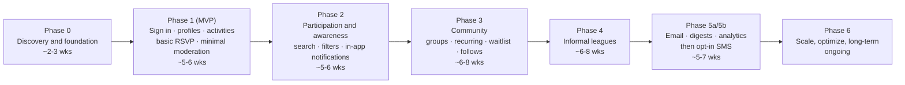
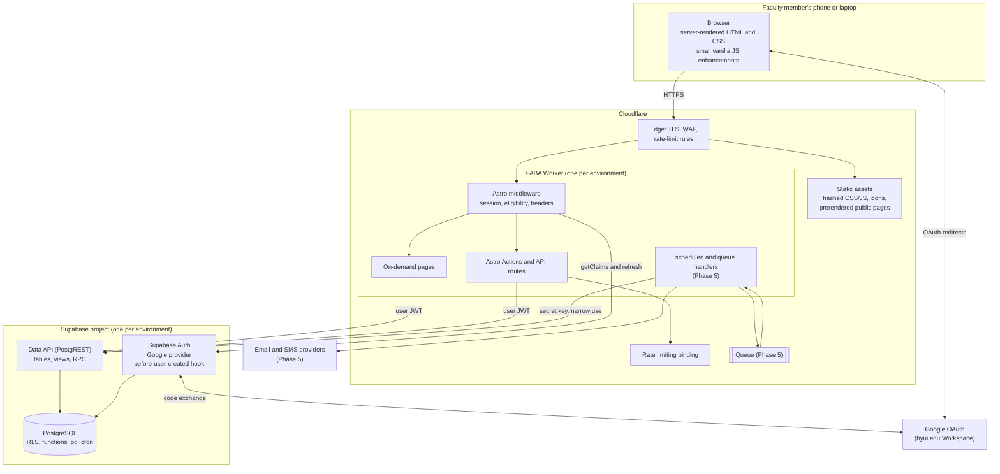
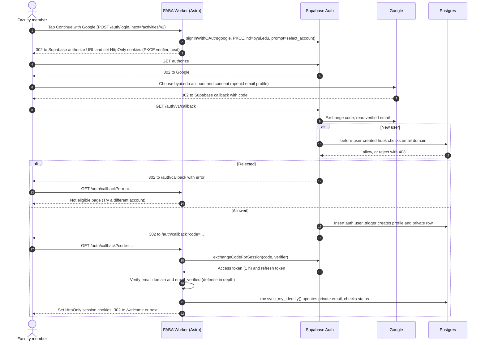
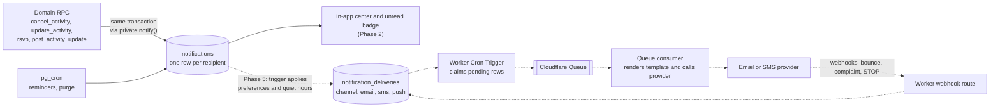
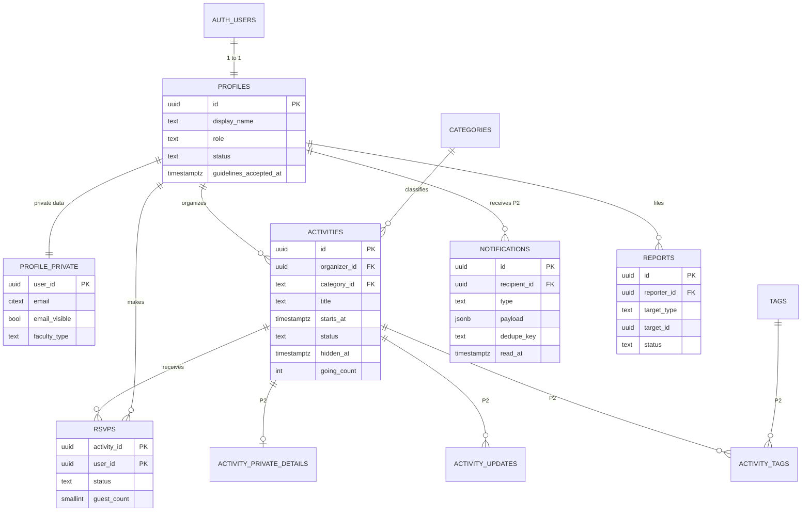
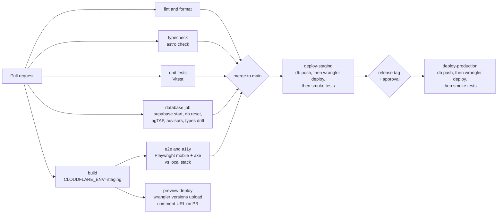

# FABA: Faculty Association Board Activities

## Software Design Document

|                    |                                                                                        |
| ------------------ | -------------------------------------------------------------------------------------- |
| **Status**         | Draft v0.1, for review by the FABA board and the development team                      |
| **Date**           | 2026-10-21                                                                             |
| **Codebase state** | Astro 7.4 minimal starter. No adapter, database, or auth is configured yet             |
| **Scope**          | Product, UX, architecture, data, delivery, and testing for Phases 0 to 6               |
| **Not in scope**   | Application code. This document is the input to implementation, not the implementation |

### How to read this document

- **Product and board readers:** Sections 1 to 5, 7, 13, and the [unresolved questions](#unresolved-questions-to-answer-before-development) at the end.
- **Developers:** "Decisions at a glance" below, then Sections 8 to 12 and 14.
- **Assumptions** appear as **Assumption:** callouts. Each one includes a recommended default so work can start, and anything flagged that way should be confirmed or overridden.
- **Requirement and story IDs** (such as `ACT-03` and `FR-RSVP-2`) are stable. Use them in issues, pull requests, and tests.

### Decisions at a glance

| Topic               | Decision                                                                                                                                                                                                                    | Section   |
| ------------------- | --------------------------------------------------------------------------------------------------------------------------------------------------------------------------------------------------------------------------- | --------- |
| Rendering           | Astro `output: 'server'` (on-demand by default). Only static public pages (about, privacy, guidelines, help) use `prerender = true`. The landing page stays on-demand so it can send signed-in members straight to Discover | 9.2       |
| Runtime             | **One Cloudflare Worker** runs the whole Astro app: pages, Astro Actions, a few API routes, and (later) `scheduled` and `queue` handlers through a custom entrypoint. There is no separate API service                      | 9.1, 9.3  |
| Data access         | Server-side only. The Worker calls Supabase with **the signed-in user's JWT** and the publishable key, so Row Level Security (RLS) applies to every user request. Multi-step operations run as Postgres functions (RPC)     | 9.6, 9.8  |
| Browser to Supabase | **None** in early phases. The browser talks only to the FABA Worker, and auth cookies are `HttpOnly`                                                                                                                        | 9.4       |
| Sessions            | `@supabase/ssr` with the PKCE flow and cookie-based sessions. Middleware calls `getClaims()` on every request. `getSession()` is never trusted for authorization                                                            | 9.7       |
| Eligibility gate    | Four layers: Google `hd=byui.edu` hint, then the Supabase **before-user-created** auth hook, then a callback check, then an RLS helper. Together they form a lightweight gate, **not** employment verification              | 9.7       |
| Notifications       | Postgres writes one `notifications` row per recipient in the same transaction as the change that caused it. Email and SMS arrive in Phase 5 as `notification_deliveries` rows on top of the same model                      | 8.8, 9.12 |
| Scheduled jobs      | `pg_cron` in Supabase for data jobs (reminders, cleanup, recurring-activity generation). Cloudflare Cron Triggers and Queues are added only in Phase 5, for external delivery                                               | 9.3       |
| Environments        | Local (Supabase CLI) → per-PR preview (against the staging database) → staging → production. Staging and production use separate Supabase projects and separate Google OAuth clients                                        | 11        |
| CI/CD               | GitHub Actions. Database migrations run before each Worker deploy and follow expand/contract so a rollback never breaks the database                                                                                        | 11        |
| Phasing changes     | Basic **"I'm going" RSVP** and **minimal moderation** move into Phase 1, ahead of the suggested outline, because neither the product nor user-generated content is safe or useful without them                              | 5         |

---

## 1. Executive summary

### The problem

BYU-Idaho has roughly **600 full-time** and **2,000 part-time** faculty. Faculty social life (hikes, game nights, pickleball, potlucks, book clubs) is organized today through scattered email threads, group texts, and word of mouth. That causes predictable problems:

- **Discovery is luck.** If you are not on the right thread you never hear about the activity. Part-time faculty, who are about 77% of all faculty and are often remote or on campus only briefly, are the most likely to miss out.
- **Organizing is high-friction.** Organizers cannot easily gauge interest, share updates, or tell people about a change of plans.
- **Official channels are the wrong tool.** University email lists and calendars are built for official business. Informal social activity either clutters them or never reaches them.

### The proposed solution

FABA is a **mobile-first web app** where faculty sign in with their school Google account and can:

1. See what is happening soon.
2. Say "I'm in" with one tap.
3. Post their own activity in under a minute.
4. Get in-app updates when plans change.

Over later phases FABA adds recurring activities, interest groups, and informal leagues. Email and SMS come last, as opt-in channels.

### Intended users

All faculty with an `@byui.edu` Google account, plus a small team of FABA board members who moderate and curate. **Assumption:** realistic engagement is 300 to 800 active accounts in year one, with tens (not thousands) of concurrent users at peak.

### Value

| For                          | Value                                                                                                     |
| ---------------------------- | --------------------------------------------------------------------------------------------------------- |
| Faculty                      | One trusted, informal place to find people and things to do, without joining a dozen email threads        |
| Part-time and remote faculty | A visible on-ramp to the faculty community, including online activities                                   |
| Organizers                   | Activities posted in seconds, attendance visible at a glance, attendees notified of changes automatically |
| FABA board                   | Less coordination overhead, and aggregate, privacy-respecting insight into what faculty enjoy             |

### Design stance

FABA is a **small application**. Load is not a design driver. **Simplicity, privacy, speed on phones, and maintainability by a small team** are. Every choice below favors fewer moving parts.

---

## 2. Goals and non-goals

### Goals

| #   | Goal                                                | How we will know (suggested targets, refined in Phase 0)                                                                                                 |
| --- | --------------------------------------------------- | -------------------------------------------------------------------------------------------------------------------------------------------------------- |
| G1  | Make faculty activities easy to discover on a phone | Median time from opening the app to seeing upcoming activities under 2 seconds on 4G. At least 40% of weekly visitors open an activity detail            |
| G2  | Make organizing low-friction                        | A new activity can be published in 60 seconds or less with no more than 5 required fields. At least 30 organizer-created activities per month by month 3 |
| G3  | Increase participation and connection               | At least 50% of activities get 3 or more "going" RSVPs. Repeat attendance (people attending 2 or more activities a semester) keeps growing               |
| G4  | Include part-time and remote faculty                | Part-time share of active users trends toward their share of faculty. Online activities exist every month                                                |
| G5  | Keep people informed without noise                  | Fewer than 10% of users mute notifications. Cancellation and change notifications reach 100% of affected attendees in-app                                |
| G6  | Protect privacy and keep the space welcoming        | Zero data exposure to non-members. Reported content is reviewed within 2 business days                                                                   |
| G7  | Stay cheap and maintainable                         | Hosting costs about $35/month or less. A new developer can run the app locally in under 30 minutes                                                       |

### Non-goals

FABA will **not**:

- **Act as an official university communication channel**, or claim authority over official announcements. Every page footer states this.
- **Verify employment**, distinguish full-time from part-time status, or integrate with HR, payroll, the faculty directory, the student information system, or campus SSO.
- **Replace** university calendars, email lists, the LMS, or departmental tools.
- **Handle money**: no payments, ticketing, dues, or reimbursements. A free-text "cost note" is allowed.
- **Offer chat**: no direct messages, group chat, or threaded discussion in early phases. One-way organizer updates cover the core need.
- **Be a social network**: no followers, likes, feeds ranked by algorithm, stories, or photo galleries.
- **Be public**: no activity, profile, or attendee data is visible to anyone who is not signed in.
- **Ship native apps.** The web app is installable to the home screen in Phase 3 (as a PWA). Native apps are not planned.
- **Manage liability**: no waivers or insurance. A participation disclaimer is shown (see [open questions](#unresolved-questions-to-answer-before-development)).
- **Send email or SMS before Phase 5.**

---

## 3. Users and roles

### 3.1 Roles

FABA has **two global roles** (member and moderator/admin) and **two contextual roles** (organizer of a specific activity, and organizer of a specific group or league). Contextual roles come from ownership, not from an account setting. Anyone can become an organizer by creating something.

| Role                                      | Who                                                                                                  | How someone gets it                                                      | Introduced     |
| ----------------------------------------- | ---------------------------------------------------------------------------------------------------- | ------------------------------------------------------------------------ | -------------- |
| **Unauthenticated visitor**               | Anyone with the URL                                                                                  | Default                                                                  | Phase 1        |
| **Member** (authenticated faculty member) | A person signed in with an eligible `@byui.edu` Google account who accepted the community guidelines | Signs in and completes the one-screen welcome                            | Phase 1        |
| **Activity organizer**                    | A member who created an activity, or was added as a co-organizer (Phase 3)                           | Creates an activity                                                      | Phase 1        |
| **Group or league organizer**             | A member who owns or co-organizes a group or league                                                  | Creates a group or league, or is promoted by its owner                   | Phases 3 and 4 |
| **Moderator**                             | A FABA board member or trusted volunteer                                                             | Granted by an admin                                                      | Phase 1        |
| **Admin** (board administrator)           | One to three board leaders, including at least one technical owner                                   | Set by database migration or SQL runbook in Phase 1. Admin UI in Phase 3 | Phase 1        |

A member can be suspended (cannot sign in or act) or deactivated (deleted or left). Neither state is a role. Both are profile statuses.

### 3.2 Responsibilities

- **Visitor:** none. Sees only the landing page, "about", privacy notice, community guidelines, and the sign-in button.
- **Member:** follows the community guidelines and keeps RSVPs reasonably accurate.
- **Activity organizer:** keeps details accurate, cancels rather than ghosts, posts updates when plans change, and keeps any private location details appropriate.
- **Group or league organizer:** keeps membership and schedules current, handles disputes informally, and escalates to moderators when needed.
- **Moderator:** reviews reports within 2 business days, hides inappropriate content, suspends members for serious or repeated violations, and records a reason for every action (written to the audit log automatically).
- **Admin:** everything a moderator can do, plus managing moderators and categories, featuring board activities, reviewing the audit log, and owning the privacy notice and guidelines.

### 3.3 Permission matrix

Legend: ✅ allowed · 🔸 only for their own items, or items they organize · — not allowed. P*n* means the permission arrives in Phase _n_.

| Capability                                   | Visitor | Member                       | Activity organizer | Group/league organizer | Moderator            | Admin                |
| -------------------------------------------- | ------- | ---------------------------- | ------------------ | ---------------------- | -------------------- | -------------------- |
| View landing, guidelines, privacy            | ✅      | ✅                           | ✅                 | ✅                     | ✅                   | ✅                   |
| Browse and view activities                   | —       | ✅                           | ✅                 | ✅                     | ✅                   | ✅                   |
| View member profiles                         | —       | ✅                           | ✅                 | ✅                     | ✅                   | ✅                   |
| See member email                             | —       | Only if that member opted in | Same               | Same                   | ✅                   | ✅                   |
| RSVP                                         | —       | ✅                           | ✅                 | ✅                     | ✅                   | ✅                   |
| See attendee list                            | —       | ✅                           | ✅                 | ✅                     | ✅                   | ✅                   |
| See private location details (P2)            | —       | When going                   | 🔸                 | 🔸 (group activities)  | ✅                   | ✅                   |
| Create activity                              | —       | ✅                           | ✅                 | ✅                     | ✅                   | ✅                   |
| Edit or cancel activity                      | —       | —                            | 🔸                 | 🔸 (group activities)  | Hide only            | Hide only            |
| Post organizer update (P2)                   | —       | —                            | 🔸                 | 🔸                     | —                    | —                    |
| Remove an attendee (P3)                      | —       | —                            | 🔸                 | 🔸                     | ✅                   | ✅                   |
| Create group (P3) or league (P4)             | —       | ✅                           | ✅                 | ✅                     | ✅                   | ✅                   |
| Manage group members, teams, schedule        | —       | —                            | —                  | 🔸                     | Hide or archive only | Hide or archive only |
| Report content or a member                   | —       | ✅                           | ✅                 | ✅                     | ✅                   | ✅                   |
| View reports queue, hide content             | —       | —                            | —                  | —                      | ✅                   | ✅                   |
| Suspend or reinstate a member                | —       | —                            | —                  | —                      | ✅                   | ✅                   |
| Feature an activity as a board activity (P2) | —       | —                            | —                  | —                      | —                    | ✅                   |
| Manage categories and moderators             | —       | —                            | —                  | —                      | —                    | ✅                   |
| View audit log                               | —       | —                            | —                  | —                      | Own actions          | ✅                   |
| View aggregate analytics (P5)                | —       | —                            | —                  | —                      | ✅                   | ✅                   |

Moderators deliberately **cannot edit** another person's activity. They can only hide it, with a reason the organizer can see. This keeps authorship honest and the audit trail simple.

---

## 4. Core user journeys

Tap counts assume the user is signed in and starts on the Home (Discover) screen, unless stated otherwise. "Tap" means one deliberate touch, and typing counts separately.

### J1. Signing in with Google (first time)

1. The visitor opens FABA and sees the landing page: a one-sentence purpose statement, a **Continue with Google** button, and a note that the app is for BYU-Idaho faculty with an `@byui.edu` account.
2. They tap **Continue with Google**. Google shows the account chooser, pre-filtered toward `byui.edu` accounts by the `hd` hint.
3. They choose their `@byui.edu` account and consent. Only the basic scopes are requested: name, email, and profile picture.
4. FABA lands them on **Welcome** (a single screen). Their display name and photo are prefilled from Google. They see three short community guidelines, one checkbox ("I'm a BYU-Idaho faculty member and I'll follow these guidelines"), and a **Let's go** button.
5. They arrive on Home.

**Taps:** about 4 (Continue, choose account, check the box, Let's go).
**Returning users:** one tap on Continue with Google, or zero while the session is still valid.

**Edge cases:**

- **Non-`@byui.edu` account:** a friendly "FABA is for BYU-Idaho faculty" page appears, with a **Try a different account** button that forces Google's account chooser. No FABA account is created.
- **Google error or cancel:** the user returns to the landing page with an inline message ("Sign-in was cancelled. Try again?").
- **Suspended member:** a "Your access is paused" page appears with a way to contact the board.
- **Deep link while signed out** (for example, an activity URL shared in a text): after sign-in the user goes straight to that activity.

### J2. Viewing upcoming activities

1. The user opens FABA and sees Home immediately. The page is server-rendered, with no loading spinner on first paint.
2. If they are going to something in the next 7 days, a **Your next plan** card appears at the top.
3. A chronological list follows, grouped by day ("Today", "Tomorrow", "Sat, Oct 24"). Each card shows the category icon, title, time, place, going count, and the user's own RSVP state.
4. **Show more** at the bottom loads the next 20 (cursor pagination).

**Taps:** 0 to see activities, 1 to open a detail.

### J3. Searching and filtering

1. Filter chips sit directly under the header: **All · This week · This weekend · Outdoors · Games · Sports · Online · Family-friendly**. One tap applies a chip, and the filter lives in the URL so links are shareable.
2. The search icon opens a full-width search field with recent searches. Results update on submit (Phase 2). Search covers title, description, place, and organizer name.
3. **More filters** opens a bottom sheet for date range, category, in person or online, has spots left, and free. A **Clear** action is always visible.

**Taps:** 1 for a common filter, 2 plus typing for a search.

**Edge cases:**

- **No results:** the empty state suggests clearing filters and offers **Start one yourself**.

### J4. Creating an activity

1. The user taps **＋** (center of the bottom navigation).
2. A single-screen form appears with five required fields:
   - **What** (title)
   - **When** (date and start time, with quick picks "Today", "Tomorrow", "This Sat")
   - **Where** (place name, or an **Online** toggle that turns the field into a link)
   - **Category** (chips)
   - **Details** (optional description)
3. **More options** (collapsed) holds: end time, capacity, guests welcome, cost note, what to bring, private details for attendees, and (later) repeats and group.
4. **Post** publishes immediately, with no draft or approval step. The user lands on the new activity's page with a "Posted!" toast and a **Share** button (native share sheet).
5. The organizer is automatically marked as going.

**Taps:** about 6 plus typing. **Target:** publish in 60 seconds or less.

**Edge cases:**

- **Start time in the past:** inline error.
- **End time before start time:** inline error.
- **Connection drops:** the form keeps the entered values (a local draft in browser storage) and retries.
- **Daily limit:** creating more than 10 activities in a day gets a friendly limit message.
- **Copy a past activity** (Phase 2): from **My plans → Organized**, pick a past activity and choose **Post again**. Everything except the date is prefilled.

### J5. Editing or cancelling an activity

1. The organizer opens their activity and taps **Edit** (visible only to organizers).
2. The same form appears, prefilled. They change the time and tap **Save**.
3. **Phase 2 onward:** if the time, date, or place changed and people are going, a confirmation reads "12 people are going. We'll let them know about the change." Attendees get an "Activity changed" notification showing old and new values.
4. **Cancel activity** lives at the bottom of the edit screen as a destructive button. It asks for an optional short reason and needs one confirmation. The activity stays visible with a **Cancelled** banner (so people who did not see a notification are not confused), drops out of default discovery, and notifies attendees (Phase 2).

**Taps:** edit is about 3 plus typing, cancel is 3.

**Edge cases:**

- **Editing a past activity:** only the description can change (for example, to add a thank-you note).
- **Un-cancel:** allowed until the start time. It notifies attendees that the activity is back on.
- **Two organizers editing at once** (Phase 3): optimistic concurrency. The second save is told to refresh.

### J6. RSVPing to an activity

1. On a card or the detail page, the user taps **I'm in**. The button flips immediately to **✓ Going** (optimistic), the count increments, and an "You're going. Undo" toast shows for 5 seconds.
2. Tapping **✓ Going** opens a small sheet with three options:
   - **Can't make it** (withdraw)
   - **Maybe** (Phase 2)
   - **Bringing guests: 0/1/2/3** (Phase 2, only when the organizer allows guests)
3. **Full activities** (Phase 2): the button reads **Full** and is disabled. **Phase 3:** **Join waitlist**, with automatic promotion and a notification.

**Taps:** 1 to RSVP, 2 to change.

**Edge cases:**

- **Cancelled or past activities:** RSVP is disabled.
- **Last spot taken by someone else at the same moment:** the server is authoritative. The UI reverts and explains "Just filled up."
- **Without JavaScript:** the button is a normal form POST and still works.

### J7. Viewing attendees

1. On the detail page, a row of avatars with a count ("12 going · 3 maybe") is tappable.
2. A bottom sheet lists attendees: avatar, display name, and department. The organizer appears first with a badge, and guests are shown as "+2".
3. Tapping a name opens that member's profile.

**Taps:** 1 to view, 2 to reach a profile.

**Privacy:** only members see attendee lists. "Can't make it" responses are never shown to anyone except the person who gave them. The organizer additionally sees "maybe" responses and guest counts.

### J8. Receiving an in-app notification (Phase 2)

1. An organizer changes an activity's time. The user's bell icon shows a badge (for example **2**) on their next page load, or within about 60 seconds while the app is open in the foreground.
2. They tap the bell and see the **Notification center**: newest first, unread items emphasized, each with an icon, one-line summary ("Board game night moved to 7:30 PM, Fri"), and relative time.
3. Tapping a notification marks it read and opens the activity. **Mark all read** is available at the top.

**Taps:** 2 from any screen to reach the relevant activity.

**Edge cases:**

- **Notification for a hidden or deleted activity:** the notification stays, but opens a "No longer available" state.
- **Repeat edits:** several edits within 10 minutes collapse into one notification (deduplication key per activity, recipient, and window).

### J9. Organizing a recurring activity (Phase 3)

1. In the create form, under **More options**, the organizer toggles **Repeats**.
2. They choose a pattern: **Weekly** (default, on the same weekday as the chosen date), **Every 2 weeks**, or **Monthly**, which can be **Monthly on the same date** or on **the nth weekday** (for example, the 2nd Tuesday).
3. They choose an end: **On a date**. A quick pick for "end of semester" appears if admins have entered semester dates. The default is "8 weeks", rolling.
4. **Post** creates the series. Individual dates appear in discovery as separate activities labeled **Weekly**.
5. Attendees can tap **I'm in for all upcoming** once, or RSVP to individual dates.
6. When editing, the organizer chooses **Just this date** or **This and all future dates**. Cancelling one date is the common case and takes 2 taps.

**Edge cases:**

- **Holidays:** no automatic skipping. The organizer cancels individual dates.
- **Time zone and daylight saving:** occurrences are generated in the series' local time zone (default `America/Denver`), so 7:00 PM stays 7:00 PM across daylight saving changes.

### J10. Creating or joining an informal league (Phase 4)

**Organizer flow:**

1. **Groups → ＋ → League** opens a short form: sport or game, season name and dates, format (teams or individual ladder), team size range, and registration open or closed.
2. Members register as a **player** (optionally with a note such as "beginner" or "can sub") or as a **free agent**.
3. The organizer creates teams and assigns players (a manual list, with **Auto-balance** offered later as a Could Have).
4. The organizer builds the schedule: add games one by one, or generate a round robin. Each game is an activity, so RSVP, reminders, and change notifications work with no extra code.
5. After each game, either captain enters the score. The other captain or the organizer confirms. Standings update automatically.

**Member flow:**

1. A member finds the league under **Groups** or through a "Registration open" activity card.
2. They tap **Join season**, then **Player** or **Free agent**.
3. **My plans** shows their games, and they RSVP "Can play" or "Can't play" so captains know who is coming.

**Edge cases:**

- **Uneven teams:** handled manually by the organizer.
- **Forfeits:** recorded as a status, not a score.
- **Mid-season joins:** allowed; the organizer assigns them to a team.
- **Disputes:** handled by the organizer, with moderators only for conduct issues.

---

## 5. Phased product roadmap

### 5.1 Changes from the suggested outline, and why

| Change                                                                                          | Reason                                                                                                                                                                                                                                                           |
| ----------------------------------------------------------------------------------------------- | ---------------------------------------------------------------------------------------------------------------------------------------------------------------------------------------------------------------------------------------------------------------- |
| A basic **"I'm going" RSVP**, going count, and attendee list move from Phase 2 into **Phase 1** | Without them, Phase 1 is only a bulletin board, and organizers cannot see who is coming, which is the main reason to use FABA instead of an email thread. The feature is one table and one action. Capacity, maybe, guests, and waitlists stay in Phases 2 and 3 |
| **Edit and cancel** move into **Phase 1**                                                       | Anyone who can post must be able to fix a typo or call an activity off. The _notifications_ about changes stay in Phase 2                                                                                                                                        |
| **Minimal moderation** (report, hide, suspend, audit log) moves into **Phase 1**                | User-generated content exists from day one, so the board needs a way to respond from day one. The richer moderation tools stay in Phase 3                                                                                                                        |
| **Phase 5 splits into 5a (email, digests, analytics) and 5b (SMS)**                             | Email is cheap and broadly useful. US application-to-person SMS requires carrier (A2P 10DLC) registration that takes weeks, costs money per message, and should be justified by Phase 5a data first                                                              |

**Assumption:** the team is about 2 developers plus part-time product/design help from the board. Duration estimates below are rough calendar weeks for that team and should be re-estimated in Phase 0.

### 5.2 Roadmap overview



Every phase ends in a production release that is usable on its own. If funding or energy stops after any phase, FABA still works.

---

### Phase 0: Discovery and technical foundation

**Main objective:** Answer the blocking questions and stand up a "walking skeleton": a deployed app where a real `@byui.edu` user can sign in, see seeded data, and sign out, in staging and production, through the full CI/CD pipeline.

**Features included**

- **Dropped:** stakeholder interviews with 6 to 10 faculty. Zack Alvey acts as the faculty expert for FABA's needs and requirements instead (FND-01).
- A pilot group of about 25 faculty, recruited for the Phase 1 soft launch (FND-11).
- Answers to the [unresolved questions](#unresolved-questions-to-answer-before-development), recorded as decisions in `docs/adr/`.
- Confirmation with BYU-Idaho IT that `@byui.edu` Google Workspace accounts can authorize a third-party OAuth app (see risk R-AUTH-2).
- Repository setup: Cloudflare adapter, linting, formatting, type checking, test runners, and GitHub Actions.
- Supabase projects (staging, production), Cloudflare Workers (staging, production), Google OAuth clients (dev, staging, production), and domain setup.
- Auth spike: Google sign-in, domain gate, `HttpOnly` cookie sessions, and email-change behavior.
- Low-fidelity wireframes for Home, Activity detail, Create, and Welcome. Tested on phones with 5 faculty.
- Community guidelines (draft), privacy notice (draft), and participation disclaimer (draft).

**Intentionally excluded:** any user-facing feature beyond sign-in and a placeholder home; visual polish.

**User stories:** `FND-02` to `FND-11`. `FND-01` was dropped. `FND-10` covers skeleton versions of `AUTH-01` to `AUTH-03`.

**Acceptance criteria**

- A real `@byui.edu` account can sign in on staging and production. A personal Gmail account is rejected and no `auth.users` row is created.
- A PR produces a preview URL. Merging to `main` deploys to staging. A release tag with approval deploys to production.
- Database migrations run automatically in CI and in deploys. pgTAP tests run in CI.
- The privacy notice, guidelines, and disclaimer are approved by the board.

**Dependencies:** board sponsorship; IT confirmation on Google Workspace OAuth; a domain decision; Cloudflare and Supabase accounts with a payment method.

**Risks:** Google Workspace blocks third-party apps (R-AUTH-2); university branding or approval delays (R-POL-1); unclear ownership (R-OPS-1).

**Definition of done**

- The walking skeleton is deployed to production behind the domain gate.
- ADRs are recorded for rendering mode, data access, environments, and auth.
- The Phase 1 backlog is estimated and prioritized.

**Suggested success metrics:** a new developer runs the app locally in under 30 minutes; a CI run takes under 10 minutes; every blocking question has an answer or a decision with an owner.

---

### Phase 1: MVP (sign in, profiles, activities, basic RSVP, minimal moderation)

**Main objective:** Faculty can find and post activities and say "I'm going." The board can respond to problems. This is the smallest version that is worth telling faculty about.

**Features included**

- **Sign in, sign out, and sessions:** Google sign-in, domain gate, welcome with guidelines acceptance, sign out, deep-link return.
- **Profiles:** display name, avatar, optional department and short bio, optional "show my email to other faculty" toggle, and an optional "I'm based in the Rexburg area / elsewhere" setting.
- **Activities:** create, view, edit, cancel, and un-cancel. Fields are title, date and time, place or online link, category, and description. An optional end time and cost note sit under **More options**.
- **Discovery:** a chronological Home feed of upcoming activities grouped by day, with category chips (in-URL filters) and a **Your next plan** card.
- **RSVP (basic):** "I'm in" and "Can't make it", a going count, and an attendee list. The organizer is auto-going.
- **My activities:** a simple list of what I'm going to and what I organize.
- **Moderation (minimal):** report an activity or profile; a moderator queue; hide and unhide an activity (with a reason shown to the organizer); suspend and reinstate a member; an automatic audit log.
- **Fixed category list**, managed by migration: Outdoors · Sports & Fitness · Games · Food & Socials · Arts & Crafts · Learning & Hobbies · Service · Family · Online & Remote · Other.
- **Footer disclaimer** ("informal, not an official BYU-Idaho channel") and participation disclaimer.
- **Account deletion** (self-service).

**Intentionally excluded:** notifications of any kind (the on-screen state is the confirmation), search, capacity, maybe, guests, waitlists, recurring activities, groups, leagues, images or uploads, comments, email, SMS, and admin UI for categories and moderators (SQL runbooks are used instead).

**User stories:** `AUTH-01` to `AUTH-05`, `PROF-01` to `PROF-05`, `ACT-01` to `ACT-06`, `RSVP-01` to `RSVP-03`, `MOD-01` to `MOD-06`, `HIST-02`, `INFO-01`, `OPS-01`.

**Acceptance criteria**

- All Phase 1 Must Have stories pass their acceptance criteria in staging.
- RLS tests prove that a signed-out user and a non-eligible JWT can read **nothing** from any table.
- Home renders in under 2.0 seconds (Largest Contentful Paint) on a mid-range Android phone over throttled 4G. Total JavaScript is 30 KB or less (gzipped) per page.
- WCAG 2.2 AA automated checks (axe) pass on all pages. A manual screen-reader pass is done on iOS VoiceOver and Android TalkBack.
- A pilot group of about 25 faculty (board members plus volunteers, including part-time) uses the app for 2 weeks with no Severity 1 issues open.

**Dependencies:** Phase 0 complete; guidelines, privacy notice, and disclaimer approved; at least 2 moderators named.

**Risks:** low initial content ("empty room", R-ADOPT-1); students with `@byui.edu` accounts (R-AUTH-1); scope creep toward notifications (R-SCOPE-1).

**Definition of done**

- Released to production. The board announces FABA through its normal channels, with the board seeding 10 to 15 real activities before the announcement.
- Runbooks exist for: grant moderator, merge or transfer an account, handle a takedown request, restore from backup.

**Suggested success metrics (first 6 weeks after announcement)**

- At least 200 accounts, at least 25% of them part-time.
- At least 25 activities posted by at least 12 distinct organizers.
- At least 50% of activities reach 3 or more going.
- At least 35% of members return in a second week.
- Zero unauthorized data exposure. The median time to resolve a report is 2 business days or less.

---

### Phase 2: Participation and awareness

**Main objective:** Help people find the right activity quickly and keep attendees informed without leaving the app.

**Features included**

- **Search and filters:** keyword search (Postgres full-text search); date filters (Today, This week, This weekend, custom range); in person or online; has spots; free; family-friendly; curated tags.
- **Richer RSVP:** optional capacity with a **Full** state; "Maybe"; guest count (when the organizer allows guests).
- **My plans tab:** upcoming RSVPs and organized activities, plus a **Past** list.
- **In-app notifications:**
  - **Notification center**, with an unread badge on the bell.
  - **Activity changed** (time, date, or place) and **activity cancelled or restored**, sent to everyone going or maybe.
  - **Organizer updates:** a short one-way post to attendees, shown on the activity page and sent as a notification.
  - **RSVP confirmation:** created as already-read, so it appears in history without inflating the badge.
  - **Organizer digest-style notices:** batched "3 new people are going to Board game night", at most one per activity per hour.
  - **In-app reminders:** the morning of the activity, or 2 hours before for evening activities.
  - **Board announcements:** an admin features an activity, and every member gets one notification. Guidance is 2 or fewer per month.
  - **Mute an activity:** stop updates from one activity.
- **"New since your last visit"** marker on Home, instead of a notification for every new activity.
- **Private details for attendees:** an exact address, gate code, or meeting link, visible only to going attendees and organizers.
- **Add to calendar:** a per-activity `.ics` download and a Google Calendar link.
- **Post again:** duplicate a past activity.
- **Share:** native share sheet. The shared link requires sign-in.

**Intentionally excluded:** notification preferences beyond per-activity mute (Phase 3); new-activity notifications for category follows (Phase 3); waitlist (Phase 3); real-time push (polling only); email and SMS (Phase 5); comments.

**User stories:** `SRCH-01` to `SRCH-03`, `RSVP-04` to `RSVP-06`, `RSVP-08`, `NOTIF-01` to `NOTIF-08`, `ACT-07` to `ACT-09`, `ACT-11`, `MOD-07`.

**Acceptance criteria**

- When an activity's time, date, or place changes, a notification appears for every going and maybe attendee within one page load. Deduplication collapses edits made within 10 minutes.
- The unread count is correct after mark-read, mark-all-read, and new notifications (integration tests).
- Search returns relevant results for title, description, place, and organizer name within 300 ms server time for the expected data volume.
- Capacity is never exceeded under concurrent RSVPs (a concurrency test with 20 parallel requests).
- Private details are never present in the HTML or API responses for non-attendees (RLS test plus end-to-end test).

**Dependencies:** Phase 1 in production; `pg_cron` enabled in Supabase (for reminders); the notification copy deck reviewed by the board.

**Risks:** notification overload (R-NOTIF-1); permission errors around private details (R-DB-1).

**Definition of done:** released; notification types documented in `docs/notifications.md` (type, trigger, recipients, copy, dedupe rule); support FAQ updated.

**Suggested success metrics**

- At least 60% of weekly active users open the notification center weekly.
- Less than 5% of attendee-activity pairs are muted.
- At least 40% of discovery sessions use a chip or search.
- More than 10% of activities use "Post again" by the end of the phase.

---

### Phase 3: Community (groups, recurring activities, follows, stronger moderation)

**Main objective:** Support ongoing communities (the Tuesday pickleball crowd, the hiking club) rather than one-off events, and give moderators better tools as volume grows.

**Features included**

- **Interest groups:** create, join, and leave. Join policy is open or approval. Groups have organizers, group activities, and group updates (one-way posts). Activity visibility is "all members" or "group members only".
- **Recurring activities:** weekly, every 2 weeks, or monthly series; edit "just this date" or "this and future"; cancel one date; "I'm in for all upcoming".
- **Waitlist** with automatic promotion and a notification.
- **Co-organizers** on activities.
- **Follows:** follow categories or groups, and get "New activity in Outdoors" notifications. These are batched: at most one notification per follow per day.
- **Notification preferences:** per-type on/off for in-app delivery, stored with a `channel` column (only `in_app` exists yet).
- **Organizer tools:** remove an attendee, see guest totals, export the attendee list as CSV (names only).
- **Moderation:** report groups; moderator notes; reason templates; admin UI for categories and moderators; audit log viewer.
- **PWA:** web app manifest and an installable icon. The service worker is limited to an offline fallback page.
- **Personal calendar feed** (Could Have): a private, revocable iCal URL listing activities I'm going to.
- **History:** a "Past" archive for my attended and organized activities, and group activity history.

**Intentionally excluded:** leagues, teams, scores; comments (re-evaluate at the end of the phase); image uploads; email and SMS.

**User stories:** `GRP-01` to `GRP-05`, `REC-01` to `REC-04`, `RSVP-07`, `RSVP-09`, `ACT-10`, `NOTIF-09`, `NOTIF-10`, `MOD-08`, `HIST-01`, `CAL-01`, `PWA-01`.

**Acceptance criteria**

- Generating recurring dates is correct across daylight saving transitions (unit-tested for the 2027 transitions).
- Group-only activities are invisible to non-members in every list, search, notification, and `.ics` endpoint (RLS tests).
- Waitlist promotion is first-in, first-out and atomic under concurrent cancellations.
- Follow notifications are batched to at most one per follow per day.

**Dependencies:** Phase 2 notification model; moderators trained on the new tools.

**Risks:** a group sprawl of empty groups (mitigated by auto-archiving groups with no activity after 6 months); permission complexity (R-DB-1).

**Definition of done:** released; a group organizer guide is published; an RLS test matrix covers groups.

**Suggested success metrics**

- At least 10 active groups (with an activity in the last 30 days).
- At least 30% of activities belong to a series or group.
- Waitlist promotions accepted (not withdrawn) at a rate of 70% or more.

---

### Phase 4: Informal leagues and team management

**Main objective:** Let faculty run casual seasonal leagues (pickleball, basketball, bowling, chess, video games) without spreadsheets.

**Features included**

- **League** as a type of group, with **seasons** (name, dates, registration open or closed).
- **Registration** as a player or free agent, with an optional note.
- **Teams:** name, color, and captain. The organizer assigns players. An individual-ladder format is also supported for one-on-one sports and games.
- **Schedule:** games are activities linked to two teams. Add them manually or generate a single round robin. Byes are handled.
- **Availability:** the RSVP labels on game activities become "Can play" and "Can't play". Captains see their roster's availability.
- **Scores and standings:** a captain reports the score and the opponent or organizer confirms. Win-loss-tie standings use configurable points. Forfeits are recorded as a status.
- **Substitute requests** (Could Have): a captain posts "need 1 sub", which notifies the league's free agents.

**Intentionally excluded:** brackets and playoffs (Could Have, later); player statistics; payments and dues; officials; scheduling optimization.

**User stories:** `LEAG-01` to `LEAG-08`.

**Acceptance criteria**

- A season can be set up, registered, teamed, scheduled, played, scored, and closed in staging by a non-developer in under 30 minutes for 6 teams.
- Standings recompute correctly from confirmed scores only (unit-tested).
- Only captains, organizers, and moderators can enter or confirm scores.

**Dependencies:** Phase 3 groups and the activity model.

**Risks:** complicated league management (R-LEAG-1); disputes over scores (mitigated: organizer has final say; scores are informal).

**Definition of done:** released; a league organizer guide is published; one real league completes a season during the phase.

**Suggested success metrics:** at least 2 leagues in the first semester; at least 80% of games have a confirmed score within 3 days; returning players next season.

---

### Phase 5a: Email notifications, digests, advanced reminders, analytics

**Main objective:** Reach people who don't open the app daily, using opt-in email that respects attention, and give the board aggregate insight.

**Features included**

- **Email delivery** for selected notification types:
  - **Default on:** activity cancelled and activity changed within 48 hours of the start.
  - **Default off:** everything else.
- **Weekly digest email** (opt-in): "This week on FABA", covering upcoming activities in followed categories and groups.
- **Per-type, per-channel preferences** and quiet hours.
- **One-click unsubscribe** that works without signing in, through a signed token.
- **Advanced reminders:** the member chooses a lead time (none, 2 hours, the morning of, 1 day before).
- **Delivery pipeline:** `notification_deliveries` records; a Cloudflare Queue; a transactional email provider; retries; bounce and complaint handling.
- **Board analytics dashboard** (aggregate only, minimum cohort size of 10): weekly active members, activities posted, RSVPs, the full-time and part-time split (self-reported, optional), and category popularity.

**Intentionally excluded:** SMS (Phase 5b); marketing emails; per-person tracking pixels (open tracking is disabled).

**User stories:** `NOTIF-11` to `NOTIF-13`, `NOTIF-15`, `NOTIF-16`, `ANLY-01`.

**Acceptance criteria**

- No email is sent to anyone who has not opted in, except the two default-on urgent types, which can be turned off from the first email.
- Unsubscribe works in one click and takes effect within 1 minute.
- Delivery is idempotent: retrying never sends duplicates (a test with an injected provider failure).
- SPF, DKIM, and DMARC pass for the sending domain.

**Dependencies:** a sending domain and DNS access; an email provider account; a privacy notice update.

**Risks:** notification overload (R-NOTIF-1); deliverability to the school's mail servers (R-NOTIF-2).

**Definition of done:** released to an opt-in beta group first, then to everyone after 2 weeks with a complaint rate below 0.1%.

**Suggested success metrics:** at least 30% digest opt-in among weekly active users; unsubscribe rate below 2% per month; more activity views from digest links.

### Phase 5b: SMS for urgent changes (optional, only if 5a data justifies it)

**Main objective:** Optional text messages for same-day changes and cancellations only.

**Features included**

- Phone number entry with one-time-code verification.
- SMS for "cancelled or changed within 6 hours of the start" only.
- STOP and HELP handling.
- Carrier registration (A2P 10DLC) and a monthly budget cap.

**Intentionally excluded:** marketing texts, reminders by SMS, and two-way SMS.

**User stories:** `NOTIF-14`, `NOTIF-17`, `NOTIF-18`.

**Acceptance criteria:**

- Only verified, opted-in numbers receive messages.
- A STOP reply opts the number out immediately.
- When the monthly budget cap is reached, the system falls back to email and in-app only and alerts admins.

**Dependencies:** a funding decision; an SMS provider; registration approval.

**Risks:** cost; registration delays; phone numbers are sensitive personal data.

**Definition of done:** shipped behind a feature flag to an opt-in beta, then to everyone.

**Suggested success metrics:** fewer no-shows at same-day cancelled activities; cost per month within budget.

---

### Phase 6: Scaling, optimization, and long-term improvements

**Main objective:** Keep FABA fast, cheap, accessible, and maintainable as usage grows and volunteers change.

**Candidate features (prioritize with data)**

- **Real-time notification badge** using Supabase Realtime, instead of 60-second polling.
- **Web Push** as a channel. The delivery pipeline already supports it, and installed PWAs on iOS 16.4+ and Android support it.
- **Image uploads** for activity covers and group banners, using Cloudflare Images or R2, with moderation.
- **Comments** on activities (flat, moderated), if Phase 3 feedback supports them.
- **Playoff brackets** for leagues.
- **Data retention automation**, and a data export ("download my data").
- **Performance:** query review with `pg_stat_statements`, edge caching of non-personalized fragments, Smart Placement tuning.
- **Third-party accessibility audit.**
- **Handover kit:** architecture walkthrough recording, runbooks, an on-call rota for volunteer maintainers.

**Intentionally excluded:** native apps, payments, chat. These stay out unless the board explicitly re-scopes FABA.

**User stories (candidates):** `NOTIF-19`, `NOTIF-20`, `ACT-12`, `MEDIA-01`, `LEAG-09`, `PRIV-01`, `PRIV-02`, `PERF-01`, `A11Y-01`, `OPS-02`.

**Definition of done:** this is an ongoing phase. Review it each semester against the metrics and costs.

**Suggested success metrics:**

- 75th-percentile Largest Contentful Paint under 2.0 seconds sustained.
- Error rate below 0.5%.
- Hosting cost per active member stays flat or falls.
- Mean time to restore under 1 hour.

---

## 6. User stories

### 6.1 Conventions

- **Priority** uses MoSCoW, measured against the phase it is listed in:
  - **Must:** the phase cannot ship without it.
  - **Should:** important, but the phase can ship without it if time runs out. It then moves to the next phase.
  - **Could:** include it only if it is cheap.
  - **Won't Have Yet:** explicitly out of scope for now.
- Phase 0 stories are for the people building and running FABA (the FABA board, technical owners, and developers). They set up the project rather than add member features.
- Phase 1 and 2 stories are written at implementation detail. Phase 3 and later stories are intentionally lighter, and should be refined during that phase's kickoff using what the team has learned.
- Phase 6 stories are candidates. Prioritize them each semester using metrics and costs.
- A dropped story keeps its ID and is marked **Priority:** Dropped, with a **Status** line giving the date and the reason. Its issue is closed as not planned.
- "Member" means an authenticated, eligible, non-suspended faculty member who has accepted the guidelines.

### 6.2 Story index

| Area                   | Phase 0          | Phase 1            | Phase 2                     | Phase 3                            | Phase 4            | Phase 5              | Phase 6                  |
| ---------------------- | ---------------- | ------------------ | --------------------------- | ---------------------------------- | ------------------ | -------------------- | ------------------------ |
| Foundation             | FND-02 to FND-11 |                    |                             |                                    |                    |                      |                          |
| Auth                   |                  | AUTH-01 to AUTH-05 |                             |                                    |                    |                      |                          |
| Profiles               |                  | PROF-01 to PROF-05 |                             |                                    |                    |                      |                          |
| Public pages           |                  | INFO-01            |                             |                                    |                    |                      |                          |
| Activities             |                  | ACT-01 to ACT-06   | ACT-07 to ACT-09, ACT-11    | ACT-10                             |                    |                      | ACT-12                   |
| RSVP                   |                  | RSVP-01 to RSVP-03 | RSVP-04 to RSVP-06, RSVP-08 | RSVP-07, RSVP-09                   |                    |                      |                          |
| Search                 |                  |                    | SRCH-01 to SRCH-03          |                                    |                    |                      |                          |
| Notifications          |                  |                    | NOTIF-01 to NOTIF-08        | NOTIF-09, NOTIF-10                 |                    | NOTIF-11 to NOTIF-18 | NOTIF-19, NOTIF-20       |
| Moderation             |                  | MOD-01 to MOD-06   | MOD-07                      | MOD-08                             |                    |                      |                          |
| Groups / recurring     |                  |                    |                             | GRP-01 to GRP-05, REC-01 to REC-04 |                    |                      |                          |
| History / calendar     |                  | HIST-02            |                             | HIST-01, CAL-01                    |                    |                      |                          |
| Leagues                |                  |                    |                             |                                    | LEAG-01 to LEAG-08 |                      | LEAG-09                  |
| Analytics              |                  |                    |                             |                                    |                    | ANLY-01              |                          |
| App and media          |                  |                    |                             | PWA-01                             |                    |                      | MEDIA-01                 |
| Privacy                |                  |                    |                             |                                    |                    |                      | PRIV-01, PRIV-02         |
| Operations and quality |                  | OPS-01             |                             |                                    |                    |                      | OPS-02, PERF-01, A11Y-01 |

### 6.3 Phase 0 stories

#### FND-01 · Hear from faculty before building

- **Role:** FABA board · **Priority:** Dropped · **Phase:** 0
- **Status:** Dropped on 2026-10-29. Zack Alvey is already clear on the need for FABA and acts as the faculty expert for its needs and requirements, so there are no faculty interviews. Pilot-group recruitment moved to FND-11.
- **Story:** As the FABA board, I want to hear from a mix of faculty before the team builds anything, so that the MVP fits how faculty actually find and organize activities.
- **Acceptance criteria**
  1. 6 to 10 faculty are interviewed, including at least 3 part-time and 2 remote, about how they find activities today, what gets in the way, and which devices they use.
  2. Synthesis notes are shared with the team, and the top insights are reflected in the Phase 1 backlog.
- **Dependencies:** board sponsorship.
- **Notes / edge cases:** Iteration 1 task UX-1. The interviews were also meant to inform open questions 5 and 9, which are now settled under FND-02 without them.

#### FND-02 · Settle the open questions

- **Role:** FABA board · **Priority:** Must · **Phase:** 0
- **Story:** As the FABA board, I want every blocking question answered or given an owner, so that development isn't stalled by unknowns.
- **Acceptance criteria**
  1. Each [unresolved question](#unresolved-questions-to-answer-before-development) has an answer, or a decision date and an owner.
  2. Decisions are recorded as ADRs in `docs/adr/`, including rendering mode, data access, environments, and auth.
  3. The board confirms or rejects the Phase 1 scope change (ADR-010).
  4. The Phase 1 backlog is estimated and prioritized.
- **Dependencies:** none.
- **Notes / edge cases:** Iteration 1 tasks PRD-1 and PRD-2. Each question has a recommended default, so work can start before every answer is in.

#### FND-03 · Prove byui.edu accounts can sign in

- **Role:** Technical owner · **Priority:** Must · **Phase:** 0
- **Story:** As a technical owner, I want to prove early that `@byui.edu` Google accounts can sign in through FABA's own Google app, so that we don't build on a sign-in path the university blocks.
- **Acceptance criteria**
  1. FABA's Google OAuth consent screen is set to **External** and requests only the `openid email profile` scopes. BYU-Idaho IT isn't asked to approve or host it (ADR-016).
  2. A real `byui.edu` account completes a test sign-in through it.
  3. The outcome is recorded in ADR-005.
- **Dependencies:** none.
- **Notes / edge cases:**
  - Risk R-AUTH-2. Phase 0 is not done until a real `byui.edu` sign-in succeeds in production (FND-10).
  - If the university's Google Workspace blocks the app, contact BYU-Idaho IT and revisit ADR-005 and ADR-016.

#### FND-04 · Test wireframes with faculty

- **Role:** Product and UX · **Priority:** Should · **Phase:** 0
- **Story:** As the product and UX lead, I want low-fidelity wireframes tested on phones with faculty, so that the core flows meet the tap budget before we build them.
- **Acceptance criteria**
  1. Wireframes cover Landing, Welcome, Not eligible, Discover, Activity detail, Create/Edit, and Me.
  2. 5 faculty test them on phones against the tap budget (Section 7.2).
  3. Issues found are logged, and the wireframes are revised.
- **Dependencies:** none.
- **Notes / edge cases:** Iteration 1 tasks UX-2 and UX-3. Design tokens, component specs, and the copy deck (UX-4 to UX-6) build on the revised wireframes.

#### FND-05 · Approve the guidelines, privacy notice, and disclaimer

- **Role:** FABA board · **Priority:** Must · **Phase:** 0
- **Story:** As the FABA board, I want the community guidelines, privacy notice, and participation disclaimer approved before launch, so that members know the rules, and that FABA is unofficial, from day one.
- **Acceptance criteria**
  1. Drafts exist for community guidelines v1, the privacy notice, and the participation disclaimer.
  2. The board approves each one, and the approved text is merged into `src/content` or the pages.
  3. The privacy notice matches the data inventory and retention table in Section 9.14.
- **Dependencies:** FND-02 (open questions 3, 6, and 10).
- **Notes / edge cases:** Iteration 1 task PRD-3. FABA runs independently of BYU-Idaho (ADR-016): the disclaimer says FABA isn't an official university site, outdoor and sports activities get a participation disclaimer with no waivers (R-SAFE-1), and no institutional policy or risk-management review applies.

#### FND-06 · Run FABA locally in under 30 minutes

- **Role:** Developer · **Priority:** Must · **Phase:** 0
- **Story:** As a new developer, I want to run FABA locally from a clean clone in under 30 minutes, so that volunteers can start contributing quickly.
- **Acceptance criteria**
  1. Following `CONTRIBUTING.md`, `supabase start` and `astro dev` work from a clean clone.
  2. `seed.sql` loads personas (member, organizer, moderator, admin, and suspended) and about 50 activities over the next 6 weeks.
  3. `.dev.vars.example` and `supabase/.env.example` list every variable with placeholder values. Nothing secret is committed.
  4. Every variable is declared in Astro's `env.schema`, so a missing variable fails at startup.
- **Dependencies:** none.
- **Notes / edge cases:**
  - Iteration 1 tasks DB-1, DB-8, AS-1, and DP-6.
  - The repository currently uses Docker Compose Postgres (`compose.yml`) and the `@astrojs/node` adapter, while this design specifies the Supabase CLI and `@astrojs/cloudflare`. Reconcile the two in an ADR.

#### FND-07 · Check every pull request automatically

- **Role:** Developer · **Priority:** Must · **Phase:** 0
- **Story:** As a developer, I want every pull request checked automatically, so that `main` is always deployable.
- **Acceptance criteria**
  1. `ci.yml` runs lint and format, typecheck (`astro check`), unit tests (Vitest), the database job (migrations from zero, `seed.sql`, pgTAP, and the generated-types drift check), build, and end-to-end and accessibility tests (Playwright with axe).
  2. A full run takes under 10 minutes.
  3. `main` is protected with required checks, 1 approving review, and squash-merge only. `CODEOWNERS`, a PR template, Dependabot, and secret scanning are set up.
- **Dependencies:** FND-06.
- **Notes / edge cases:** Iteration 1 tasks DP-1, DP-2, TS-1, TS-2, and TS-4. Section 11.5 lists each job.

#### FND-08 · Deploy from preview to staging to production

- **Role:** Developer · **Priority:** Must · **Phase:** 0
- **Story:** As a developer, I want every change to flow from a pull request preview to staging to production through one pipeline, so that releases are routine and easy to roll back.
- **Acceptance criteria**
  1. Every PR push produces a preview URL, posted as a PR comment.
  2. Merging to `main` pushes migrations to the staging database, then builds and deploys the `faba-staging` Worker and runs smoke tests.
  3. A release tag with a technical owner's approval deploys to production the same way.
  4. Migrations always run before the Worker deploys.
- **Dependencies:** FND-07; FND-09.
- **Notes / edge cases:** Iteration 1 tasks DP-3 to DP-5. Smoke tests check that the landing page loads, the health endpoint returns OK, protected routes redirect to sign-in, and the Google redirect starts.

#### FND-09 · Set up separate, organization-owned environments

- **Role:** Technical owner · **Priority:** Must · **Phase:** 0
- **Story:** As a technical owner, I want staging and production on separate, organization-owned accounts, so that testing never touches real data and no single volunteer holds the keys.
- **Acceptance criteria**
  1. Staging and production each have their own Supabase project. Production is on a paid plan in a US West region, with backups verified.
  2. The `faba-staging` and `faba` Workers serve the app on their own domains.
  3. Google OAuth clients exist for dev, staging, and production.
  4. Cloudflare, Supabase, Google Cloud, and GitHub accounts belong to a FABA organization with at least 2 owners, and MFA is required.
  5. Staging holds only synthetic data.
- **Dependencies:** a domain decision; a payment method (open question 7).
- **Notes / edge cases:** Iteration 1 tasks AU-1, AU-2, CF-1, and DP-8.

#### FND-10 · Walking skeleton

- **Role:** Member · **Priority:** Must · **Phase:** 0
- **Story:** As a faculty member, I want to sign in to the deployed app with my school account, see sample activities, and sign out, so that the team proves the whole path works before building features.
- **Acceptance criteria**
  1. A real `@byui.edu` account can sign in on staging and production, see seeded data on a placeholder home page, and sign out.
  2. A personal Gmail account is rejected, and no `auth.users` row is created.
  3. The skeleton ships through the full pipeline (FND-08).
- **Dependencies:** FND-03; FND-08; FND-09.
- **Notes / edge cases:** This is the skeleton version of AUTH-01 to AUTH-03. The full stories ship in Phase 1.

#### FND-11 · Recruit the pilot group

- **Role:** FABA board · **Priority:** Should · **Phase:** 0
- **Story:** As the FABA board, I want a pilot group of faculty lined up before launch, so that real users try FABA for 2 weeks before it is announced.
- **Acceptance criteria**
  1. About 25 faculty are recruited: board members plus volunteers, including full-time and part-time faculty in the Rexburg area.
  2. Names and consent to participate are recorded.
  3. The group includes at least one assistive-technology user, if possible.
- **Dependencies:** none.
- **Notes / edge cases:** Moved from FND-01 when the interviews were dropped. Iteration 1 task PRD-4. The pilot runs in production as a quiet soft launch (ADR-013), and Phase 1 acceptance requires 2 weeks of pilot use with no Severity 1 issues open. Remote faculty aren't recruited, because Phase 1 serves in-person Rexburg activities only (ADR-017).

### 6.4 Phase 1 stories

#### AUTH-01 · Sign in with Google

- **Role:** Unauthenticated visitor · **Priority:** Must · **Phase:** 1
- **Story:** As a faculty member, I want to sign in with my BYU-Idaho Google account, so that I don't need another password.
- **Acceptance criteria**
  1. The landing page shows one primary button, **Continue with Google**. No other sign-in methods are offered in staging or production.
  2. The OAuth request uses PKCE, requests only the `openid email profile` scopes, and passes `hd=byui.edu` and `prompt=select_account`.
  3. On success, a first-time user lands on **Welcome**. A returning user lands on Home, or on the page they originally requested.
  4. Session cookies are `HttpOnly`, `Secure`, and `SameSite=Lax`.
  5. If the user cancels or Google returns an error, they land on the landing page with a plain-language message and a retry button.
- **Dependencies:** Google OAuth client per environment; Supabase Google provider enabled; Phase 0 auth spike.
- **Notes / edge cases:**
  - In-app browsers (for example, a link opened inside a messaging app) may block Google sign-in. Detect common in-app user agents and show "Open in your browser" guidance.

#### AUTH-02 · Reject ineligible accounts

- **Role:** Unauthenticated visitor · **Priority:** Must · **Phase:** 1
- **Story:** As the FABA board, I want only `@byui.edu` Google accounts to get in, so that FABA stays within the BYU-Idaho community.
- **Acceptance criteria**
  1. The before-user-created hook rejects any email whose domain is not exactly `byui.edu` (case-insensitive). No `auth.users` or `profiles` row is created.
  2. The callback independently verifies the domain and `email_verified = true`. On failure it signs the user out and shows **Not eligible**.
  3. The **Not eligible** page explains the requirement, says FABA is unofficial and can't make exceptions, and offers **Try a different account**.
  4. RLS helper `is_active_member()` returns false when the JWT email domain is not `byui.edu`, so even a misissued session reads nothing.
- **Dependencies:** AUTH-01; auth hook configured in each Supabase project.
- **Notes / edge cases:**
  - Lookalike domains (`byui.edu.evil.com`) and subdomains (`x.byui.edu`) are rejected. Matching is on the exact string after `@`.
  - Students and staff also have `@byui.edu` accounts, and they can join. There's no faculty attestation or allow-list (ADR-015, risk R-AUTH-1).

#### AUTH-03 · Stay signed in, and sign out

- **Role:** Member · **Priority:** Must · **Phase:** 1
- **Story:** As a member, I want to stay signed in on my phone and be able to sign out, so that FABA is one tap away but still under my control.
- **Acceptance criteria**
  1. Sessions refresh silently in middleware. A member who uses FABA at least every 30 days is not asked to sign in again.
  2. **Sign out** (on the Me screen) is a POST form. It ends the session server-side, clears cookies, and lands on the landing page.
  3. After sign-out, the Back button does not reveal private pages, because responses are `Cache-Control: private, no-store`.
- **Dependencies:** AUTH-01.
- **Notes / edge cases:**
  - "Sign out of all devices" is a Could Have for Phase 2.
  - Configure the Supabase inactivity timeout to 30 days (Assumption).

#### AUTH-04 · Return to where I was going

- **Role:** Unauthenticated visitor · **Priority:** Must · **Phase:** 1
- **Story:** As someone tapping a shared FABA link while signed out, I want to land on that page after signing in, so that I don't have to find it again.
- **Acceptance criteria**
  1. The protected route redirects to `/auth/login?next=<path>`.
  2. `next` is accepted only as a same-origin relative path (it starts with `/` and not `//`). Anything else is replaced with `/`, which prevents open redirects.
  3. After first-time Welcome, the user still continues to `next`.
- **Dependencies:** AUTH-01.
- **Notes / edge cases:** `next` survives the OAuth round trip in a short-lived `HttpOnly` cookie, not in the OAuth `state`.

#### AUTH-05 · Handle email changes and lost eligibility

- **Role:** Member · **Priority:** Should · **Phase:** 1
- **Story:** As a member whose school email changes, I want to keep my FABA account, so that my activities and RSVPs stay with me.
- **Acceptance criteria**
  1. Accounts are keyed by the Supabase user ID (tied to the Google subject ID), never by email address.
  2. On each sign-in, the stored private email syncs from the verified identity.
  3. If the new email is still `@byui.edu`, nothing else changes.
  4. If the verified email is no longer `@byui.edu`, the user is signed out and sees **Not eligible**. Their profile is marked `ineligible` and hidden from people lists. Their upcoming organized activities stay visible with a "Organizer no longer active" note, and moderators can transfer them.
- **Dependencies:** AUTH-02; a Phase 0 spike confirming how Supabase updates `auth.users.email` when Google's email changes.
- **Notes / edge cases:**
  - A person who gets a brand-new Google account gets a new FABA account. Merging accounts is an admin runbook, not a feature.

#### PROF-01 · Welcome and community guidelines

- **Role:** Member (first sign-in) · **Priority:** Must · **Phase:** 1
- **Story:** As a new member, I want a quick, friendly setup, so that I can start browsing in seconds.
- **Acceptance criteria**
  1. One screen shows: a prefilled, editable display name (2 to 50 characters); the Google photo, with a **Use initials instead** option; three short guidelines with a link to the full text; and a required checkbox ("I agree to the community guidelines").
  2. Optional fields are **not** on this screen. A small "Add more to your profile later" link goes to the Me screen.
  3. Accepting stores `guidelines_accepted_at` and the guidelines version. Until then, every protected route redirects to Welcome.
  4. If the guidelines version changes materially, members re-accept on their next visit.
- **Dependencies:** AUTH-01; the guidelines text approved by the board.
- **Notes / edge cases:**
  - There's no faculty attestation. Any `byui.edu` account can join, including students who take part as teaching assistants and adjuncts (ADR-015).

#### PROF-02 · Edit my profile

- **Role:** Member · **Priority:** Must · **Phase:** 1
- **Story:** As a member, I want to add a little about myself, so that colleagues recognize me at activities.
- **Acceptance criteria**
  1. Editable fields:
     - Display name.
     - Avatar choice (Google photo or initials).
     - Department (optional; free text up to 60 characters, with suggestions).
     - Short bio (optional; up to 280 characters).
     - Interests (optional; category chips).
     - "Faculty type" (optional, private, self-reported): **Full-time**, **Part-time**, or **Prefer not to say**. The UI labels it "Only used for anonymous totals. Never shown to others."
  2. Saving with a valid form returns to the profile with a "Saved" toast. Validation errors appear inline per field.
  3. Members cannot change their own role, status, or email through any request (column-level grants plus RLS).
- **Dependencies:** PROF-01.
- **Notes / edge cases:**
  - There's no "based in" field while FABA serves in-person Rexburg activities only (ADR-017).

#### PROF-03 · View a member's profile

- **Role:** Member · **Priority:** Should · **Phase:** 1
- **Story:** As a member, I want to tap an organizer's or attendee's name to see who they are, so that I feel comfortable joining.
- **Acceptance criteria**
  1. The profile shows: display name, avatar, department, bio, interests, and upcoming activities they organize.
  2. It also shows their email, only if they opted in.
  3. It never shows faculty type, RSVP history, or last-seen time.
  4. Suspended, deactivated, or ineligible profiles show "This member is no longer active."
- **Dependencies:** PROF-02.
- **Notes / edge cases:** A **Report** link appears in an overflow menu (MOD-01).

#### PROF-04 · Control my email visibility

- **Role:** Member · **Priority:** Should · **Phase:** 1
- **Story:** As a member, I want to choose whether other faculty can see my email, so that I control how people contact me.
- **Acceptance criteria**
  1. The setting defaults to **off**.
  2. When on, the email appears on the member's profile as a `mailto:` link, visible to members only.
  3. Moderators and admins can always see emails, for safety follow-up.
- **Dependencies:** PROF-02.
- **Notes / edge cases:** This covers "contact the organizer" without building messaging.

#### PROF-05 · Delete my account

- **Role:** Member · **Priority:** Should · **Phase:** 1
- **Story:** As a member, I want to delete my FABA account, so that my information is removed when I no longer want to use it.
- **Acceptance criteria**
  1. **Me → Delete account** explains the consequences and requires the member to type `DELETE`.
  2. On confirmation:
     - Upcoming activities they organize (with no co-organizer) are cancelled, and attendees are notified once notifications exist.
     - Their RSVPs are removed.
     - The profile is anonymized ("Former member").
     - Private data is deleted.
     - The `auth.users` record is deleted through the admin API.
  3. Past activities they organized remain, attributed to "Former member".
  4. Audit records keep the user ID but no personal data.
- **Dependencies:** a server-only admin client (secret key) isolated in one module.
- **Notes / edge cases:** Deletion is final. Signing in again later creates a new, empty account.

#### ACT-01 · Browse upcoming activities

- **Role:** Member · **Priority:** Must · **Phase:** 1
- **Story:** As a member, I want to see what's coming up, soonest first, so that I can quickly find something to do.
- **Acceptance criteria**
  1. Home lists published, non-hidden activities whose start time is no more than 3 hours ago (in-progress) or later. They are sorted by start time and grouped under day headers in the viewer's time zone.
  2. Each card shows: category icon and color, title (up to 2 lines), relative date and time, place, going count, up to 3 attendee avatars, and the viewer's RSVP state.
  3. Pages hold 20 activities. A **Show more** link loads the next page, using a cursor of start time and ID. There is no infinite scroll (see 7.4).
  4. A **Your next plan** card appears when the viewer is going to something in the next 7 days.
  5. Cancelled activities do not appear in the default feed.
- **Dependencies:** ACT-03 (or seed data).
- **Notes / edge cases:**
  - An empty feed shows an encouraging empty state with **Post the first activity**.
  - Times show in the activity's time zone, with a note if that differs from the viewer's.

#### ACT-02 · View activity details

- **Role:** Member · **Priority:** Must · **Phase:** 1
- **Story:** As a member, I want all the details on one screen, so that I can decide quickly and know where to go.
- **Acceptance criteria**
  1. The page shows: title, category, date and time range, place with an **Open in Maps** link (generated from the place text), description (plain text with links made clickable), cost note, organizer (linked to their profile), going count, and attendee avatars.
  2. A sticky bottom action bar holds the primary RSVP button within thumb reach.
  3. Organizers see **Edit**. Everyone sees **Share** and **Report** in the overflow menu.
  4. Cancelled activities show a prominent banner with the reason. Hidden activities return "not available" to non-organizers.
- **Dependencies:** ACT-03.
- **Notes / edge cases:**
  - The description is stored as plain text and rendered with safe auto-linking only. There is no HTML or Markdown, which avoids cross-site scripting.

#### ACT-03 · Create an activity

- **Role:** Member (becomes Activity organizer) · **Priority:** Must · **Phase:** 1
- **Story:** As a member, I want to post an activity in under a minute from my phone, so that colleagues can join me.
- **Acceptance criteria**
  1. Required fields:
     - Title (3 to 80 characters).
     - Start date and time.
     - Place (up to 120 characters). There are no online activities for now (ADR-017).
     - Category.
  2. Optional fields: description (up to 2,000 characters). Under **More options**: end time, cost note (up to 60 characters).
  3. Quick date picks (Today, Tomorrow, This Saturday) and native date and time inputs.
  4. Validation runs on both client and server. The start must be in the future and no more than 12 months ahead, and the end must be after the start.
  5. On success, the organizer is redirected to the new activity, sees a "Posted!" toast, and is automatically going.
  6. A member can create at most 10 activities per 24 hours. Exceeding it shows a friendly message.
  7. The form works without JavaScript. With JavaScript, unsent input is saved in local browser storage and restored after a failure.
- **Dependencies:** categories seeded; PROF-01.
- **Notes / edge cases:**
  - Time zone is always `America/Denver` and isn't shown on the form. It's still stored with each activity (risk R-TECH-2).
  - Watch for duplicate submits from a double tap: an idempotency key goes in a hidden field.

#### ACT-04 · Edit my activity

- **Role:** Activity organizer · **Priority:** Must · **Phase:** 1
- **Story:** As an organizer, I want to fix or update details, so that information stays accurate.
- **Acceptance criteria**
  1. Only the organizer (and, from Phase 3, co-organizers) see **Edit**. Server and RLS reject anyone else.
  2. The edit form uses the same validation as create.
  3. Past activities allow editing only the description.
  4. `updated_at` is shown as "Updated 2h ago" on the detail page when the time or place changed.
- **Dependencies:** ACT-03.
- **Notes / edge cases:**
  - Change notifications arrive in Phase 2 (NOTIF-02). Phase 1 shows the "Updated" label only.

#### ACT-05 · Cancel or restore my activity

- **Role:** Activity organizer · **Priority:** Must · **Phase:** 1
- **Story:** As an organizer, I want to cancel an activity clearly, so that nobody shows up to nothing.
- **Acceptance criteria**
  1. **Cancel activity** requires confirmation and accepts an optional reason (up to 200 characters).
  2. A cancelled activity keeps its URL, shows a banner, disables RSVP, and leaves the default feed. It stays in attendees' **My activities** list, marked cancelled.
  3. **Restore** is allowed until the start time.
  4. There is no hard delete for organizers.
- **Dependencies:** ACT-03.
- **Notes / edge cases:** Notifications for cancellation arrive in Phase 2 (NOTIF-03).

#### ACT-06 · Filter by category

- **Role:** Member · **Priority:** Must · **Phase:** 1
- **Story:** As a member, I want one-tap category filters, so that I can see only the kinds of things I enjoy.
- **Acceptance criteria**
  1. Chips under the header filter the feed (for example `?cat=outdoors`). They work as plain links, without JavaScript.
  2. The active chip is visually selected and announced to screen readers (`aria-current`).
  3. Chips scroll horizontally. The first chip is always **All**.
- **Dependencies:** ACT-01.
- **Notes / edge cases:** A chip with zero upcoming activities is still shown, with an empty state that invites the member to post one.

#### RSVP-01 · Say "I'm in"

- **Role:** Member · **Priority:** Must · **Phase:** 1
- **Story:** As a member, I want to RSVP with one tap, so that the organizer knows I'm coming.
- **Acceptance criteria**
  1. **I'm in** on cards and the detail page creates or updates the member's RSVP to `going`. The count updates immediately (optimistic), and a 5-second **Undo** toast appears.
  2. Without JavaScript, the button is a form POST that redirects back (POST, then redirect, then GET).
  3. RSVP is rejected for cancelled, hidden, or past activities, with a clear message.
  4. A member has at most one RSVP per activity (primary key on activity and user).
- **Dependencies:** ACT-02.
- **Notes / edge cases:** The `rsvp()` database function is the only write path, so later capacity and waitlist rules plug into one place.

#### RSVP-02 · Change or withdraw my RSVP

- **Role:** Member · **Priority:** Must · **Phase:** 1
- **Story:** As a member, I want to change my mind easily, so that counts stay accurate.
- **Acceptance criteria**
  1. Tapping **✓ Going** opens a small sheet. **Can't make it** sets the status to `not_going`.
  2. `not_going` RSVPs are never shown to other members, and are not counted.
  3. The organizer cannot withdraw from their own activity. They are offered **Cancel activity** instead.
- **Dependencies:** RSVP-01.
- **Notes / edge cases:**
  - Withdrawing within 2 hours of the start is allowed. A future Phase 3 could tell organizers about late withdrawals.

#### RSVP-03 · See who's going

- **Role:** Member · **Priority:** Must · **Phase:** 1
- **Story:** As a member, I want to see who else is going, so that I can join people I know or meet new colleagues.
- **Acceptance criteria**
  1. The going count plus up to 3 avatars appear on cards. On the detail page, tapping them opens the full attendee list (avatar, name, department), with the organizer first.
  2. The list contains only active members with `going` status. Suspended or deleted members are excluded.
  3. The list is visible only to members (RLS).
- **Dependencies:** RSVP-01.
- **Notes / edge cases:** For very large activities (more than 50 going), show the first 50 and then a "Show all" link.

#### MOD-01 · Report content

- **Role:** Member · **Priority:** Must · **Phase:** 1
- **Story:** As a member, I want to report an activity or profile that seems inappropriate, so that moderators can look at it.
- **Acceptance criteria**
  1. **Report** in the overflow menu opens a short form:
     - Reason chips: Inappropriate, Spam / commercial, Unsafe, Other.
     - An optional note (up to 500 characters).
  2. Submitting shows "Thanks, a moderator will review this." The reporter's identity is visible only to moderators.
  3. A member can report the same item only once. They are limited to 10 reports per day.
- **Dependencies:** ACT-02, PROF-03.
- **Notes / edge cases:** Reports never automatically hide content in Phase 1. Auto-hide after N reports can be revisited in Phase 3.

#### MOD-02 · Review the reports queue

- **Role:** Moderator · **Priority:** Must · **Phase:** 1
- **Story:** As a moderator, I want a simple queue of open reports, so that I can handle them quickly from my phone.
- **Acceptance criteria**
  1. `/mod` lists open reports, oldest first, with target preview, reason, note, reporter, and age.
  2. The available actions are **Dismiss**, **Hide content**, and **Suspend member**. Each requires a reason, which goes to the audit log.
  3. Moderators see an "Open reports: N" indicator on the Me screen.
- **Dependencies:** MOD-01; moderator role assigned.
- **Notes / edge cases:**
  - There is no email alert to moderators until Phase 5. Moderators agree to check the queue on business days.
  - Phase 2 adds an in-app notification to moderators when a report arrives.

#### MOD-03 · Hide or unhide an activity

- **Role:** Moderator · **Priority:** Must · **Phase:** 1
- **Story:** As a moderator, I want to hide inappropriate activities, so that members don't see them.
- **Acceptance criteria**
  1. A hidden activity disappears from all lists and search for everyone except its organizer and moderators.
  2. The organizer sees a banner on their activity: "Hidden by a moderator: _reason_. Contact the FABA board if you think this was a mistake."
  3. **Unhide** restores the activity. Both actions are audit-logged.
- **Dependencies:** MOD-02.
- **Notes / edge cases:** Moderators never edit content. They hide it, and the organizer can edit, after which a moderator can unhide.

#### MOD-04 · Suspend or reinstate a member

- **Role:** Moderator · **Priority:** Must · **Phase:** 1
- **Story:** As a moderator, I want to suspend a member who seriously or repeatedly breaks the guidelines, so that the community stays safe.
- **Acceptance criteria**
  1. Suspension sets the profile status to `suspended`. Within one request, the member is redirected to **Access paused** and RLS denies all reads and writes.
  2. The suspended member's upcoming organized activities are hidden automatically (and logged).
  3. **Reinstate** reverses the status. It does not automatically unhide activities.
- **Dependencies:** MOD-02.
- **Notes / edge cases:** Suspension is enforced in the database through `is_active_member()`, not just in the UI.

#### MOD-05 · Automatic audit log

- **Role:** Admin · **Priority:** Must · **Phase:** 1
- **Story:** As an admin, I want every moderation and role change recorded, so that the board can review decisions fairly.
- **Acceptance criteria**
  1. Hide, unhide, suspend, reinstate, dismiss report, role change, account deletion, and admin data fixes each write an `audit_log` row with actor, action, target, reason, and timestamp.
  2. Audit rows cannot be updated or deleted by any application role.
  3. In Phase 1, admins read the log through the Supabase dashboard. A viewer UI arrives in Phase 3.
- **Dependencies:** none.
- **Notes / edge cases:** Audit logging happens inside the same database functions that perform the action, so it cannot be skipped.

#### MOD-06 · Grant or revoke moderator

- **Role:** Admin · **Priority:** Must · **Phase:** 1
- **Story:** As an admin, I want to appoint moderators, so that the workload is shared.
- **Acceptance criteria**
  1. Phase 1 uses a documented SQL runbook that calls `set_member_role(user_id, role, reason)`, which is audit-logged.
  2. The role takes effect on the moderator's next request. Roles are read from the database, not cached in the JWT.
- **Dependencies:** MOD-05.
- **Notes / edge cases:** A UI arrives in Phase 3 (MOD-08). At least 2 admins should exist at all times.

#### HIST-02 · My activities

- **Role:** Member · **Priority:** Must · **Phase:** 1
- **Story:** As a member, I want a simple list of what I'm going to and what I organize, so that I can find my plans without scrolling the feed.
- **Acceptance criteria**
  1. **My activities** lists upcoming activities I'm going to and upcoming activities I organize, soonest first.
  2. Cancelled activities stay in the list, marked cancelled (ACT-05).
  3. Each item opens the activity's detail page.
- **Dependencies:** ACT-03; RSVP-01.
- **Notes / edge cases:** Requirement FR-HIST-1. The **Plans** tab replaces this list in Phase 2 (RSVP-08).

#### INFO-01 · Public pages and disclaimers

- **Role:** Unauthenticated visitor · **Priority:** Must · **Phase:** 1
- **Story:** As a visitor, I want to read what FABA is, its guidelines, and its privacy notice before I sign in, so that I know what I'm joining and that it isn't an official university channel.
- **Acceptance criteria**
  1. Signed-out visitors can open only the landing page, **About**, the **Privacy notice**, and the **Community guidelines**. No profile or activity data is visible to them, and every app page sends `noindex`.
  2. About, Privacy, and Guidelines are prerendered. The landing page is rendered on demand and sends signed-in members to Discover.
  3. Every page footer says FABA is informal and not an official BYU-Idaho channel.
  4. The participation disclaimer appears on the guidelines page and on Outdoors and Sports & Fitness activity pages.
  5. The guidelines page gives an out-of-app contact for urgent safety concerns (the board's email), and says emergencies go to 911 or campus security.
- **Dependencies:** FND-05.
- **Notes / edge cases:** Requirements FR-PROF-7 and FR-REP-5. Use no university logo or marks (R-POL-1).

#### OPS-01 · Launch runbooks

- **Role:** Admin · **Priority:** Must · **Phase:** 1
- **Story:** As an admin, I want written procedures for rare but serious tasks, so that any admin can handle them without the original developers.
- **Acceptance criteria**
  1. `docs/runbooks/` has runbooks to grant a moderator, merge or transfer an account, handle a takedown request, and restore from backup.
  2. Runbook steps that change data go through audited functions (MOD-05), such as `set_member_role()`.
- **Dependencies:** MOD-05; MOD-06.
- **Notes / edge cases:** Part of the Phase 1 definition of done. Iteration 1 task DP-7 covers the rollback, backup restore, key rotation, grant moderator, and Supabase settings runbooks.

### 6.5 Phase 2 stories

#### SRCH-01 · Search activities

- **Role:** Member · **Priority:** Must · **Phase:** 2
- **Story:** As a member, I want to search by keyword, so that I can find "pickleball" or "hike" quickly.
- **Acceptance criteria**
  1. The search field searches title, description, place, and organizer display name, using Postgres full-text search with English stemming and prefix matching on the last word.
  2. Results default to upcoming activities, with an **Include past** toggle.
  3. The query lives in the URL (`?q=`), and search works without JavaScript.
  4. Server time is under 300 ms at 10,000 activities.
- **Dependencies:** Phase 1 activities; the search index (see Section 10).
- **Notes / edge cases:** Typo tolerance (trigram matching) is a Could Have. An empty query shows recent searches (stored in browser storage only).

#### SRCH-02 · Date filters

- **Role:** Member · **Priority:** Must · **Phase:** 2
- **Story:** As a member, I want to filter by Today, This week, or This weekend, so that I can plan around my schedule.
- **Acceptance criteria**
  1. Chips: **Today**, **This week** (through Sunday), **This weekend** (Friday 5 PM to Sunday night).
  2. **More filters** offers a custom date range.
  3. Ranges are computed in the viewer's time zone, and filters combine with category and search.
- **Dependencies:** ACT-06.
- **Notes / edge cases:** "This weekend", viewed on a Sunday, means today.

#### SRCH-03 · More filters

- **Role:** Member · **Priority:** Should · **Phase:** 2
- **Story:** As a member, I want to filter by has spots, free, and family-friendly, so that I see only what fits me.
- **Acceptance criteria**
  1. A **More filters** bottom sheet offers: Has spots left; Free; and curated tags (Family-friendly, Beginner-friendly, Accessible).
  2. The active filter count shows on the button. **Clear all** is always visible.
  3. All filters are reflected in the URL.
- **Dependencies:** RSVP-04 (for "has spots"); curated tags.
- **Notes / edge cases:** Tags are a curated list managed by admins. Free-form tags are Won't Have Yet. An In person / Online filter returns if online activities do (ADR-017).

#### RSVP-04 · Capacity and "Full"

- **Role:** Activity organizer · **Priority:** Should · **Phase:** 2
- **Story:** As an organizer, I want to cap attendance, so that the activity stays manageable.
- **Acceptance criteria**
  1. An optional capacity (1 to 500) sits under **More options**. Guests count toward capacity.
  2. When going plus guests reaches capacity, the button shows **Full** and the card shows "Full".
  3. Concurrent RSVPs never exceed capacity: the `rsvp()` function locks the activity row.
  4. Lowering capacity below the current count is allowed, but existing RSVPs are kept and new RSVPs are blocked.
- **Dependencies:** RSVP-01.
- **Notes / edge cases:** The waitlist is Phase 3 (RSVP-07).

#### RSVP-05 · "Maybe"

- **Role:** Member · **Priority:** Could · **Phase:** 2
- **Story:** As a member, I want to mark "Maybe", so that I get updates without committing.
- **Acceptance criteria**
  1. The RSVP sheet offers **Maybe**. Maybe responses don't count toward capacity.
  2. The detail page shows "3 maybe" separately from the going count.
  3. Maybe attendees receive change and cancellation notifications.
- **Dependencies:** RSVP-02.
- **Notes / edge cases:** Validate demand with the pilot group. Drop this story if it adds clutter.

#### RSVP-06 · Bring guests

- **Role:** Member · **Priority:** Should · **Phase:** 2
- **Story:** As a member, I want to say I'm bringing my spouse or kids, so that the organizer can plan.
- **Acceptance criteria**
  1. When the organizer has enabled **Guests welcome**, the RSVP sheet shows a 0 to 5 stepper (the maximum is configurable per activity).
  2. Counts display as "12 going (+5 guests)".
  3. Guests count toward capacity.
- **Dependencies:** RSVP-01, RSVP-04.
- **Notes / edge cases:** Guests are a count only. Guest names and data are never collected.

#### RSVP-08 · My plans

- **Role:** Member · **Priority:** Must · **Phase:** 2
- **Story:** As a member, I want one place for everything I'm going to or organizing, so that I can manage my week.
- **Acceptance criteria**
  1. The **Plans** tab has segments: **Going** (upcoming going and maybe), **Organizing**, and **Past**.
  2. Each item shows the same card as Home, with status badges (Cancelled, Changed, Full).
  3. Plans is reachable in one tap from the bottom navigation.
- **Dependencies:** RSVP-01.
- **Notes / edge cases:** This replaces Phase 1's simple "My activities" list.

#### NOTIF-01 · Notification center and unread badge

- **Role:** Member · **Priority:** Must · **Phase:** 2
- **Story:** As a member, I want a single place for updates, with a count of unread ones, so that I never miss a change.
- **Acceptance criteria**
  1. The bell in the navigation shows an unread count. The count is capped at a "9+" display.
  2. The count is rendered on every page load. While the page is visible, it refreshes every 60 seconds (paused when the tab is hidden, and refreshed on `visibilitychange`).
  3. `/notifications` lists the last 90 days, newest first, paginated in groups of 30. Unread items are visually distinct, with text weight plus a dot, not color alone.
  4. Tapping an item marks it read and navigates to its target. **Mark all read** is available.
  5. Notifications older than 90 days are deleted by a scheduled job.
- **Dependencies:** the `notifications` table; the RLS policy so members see only their own rows.
- **Notes / edge cases:** Polling hits one cheap endpoint that uses a partial index on unread rows.

#### NOTIF-02 · Activity changed

- **Role:** Member (attendee) · **Priority:** Must · **Phase:** 2
- **Story:** As an attendee, I want to know when the time, date, or place changes, so that I show up at the right place and time.
- **Acceptance criteria**
  1. When the start, end, place, or private details change, all `going` and `maybe` attendees (except the editor) get an `activity_changed` notification with before and after values.
  2. Edits within 10 minutes collapse into one unread notification per recipient (`dedupe_key`).
  3. Description-only edits do not notify.
  4. Notifications are created in the same database transaction as the edit.
- **Dependencies:** NOTIF-01; ACT-04.
- **Notes / edge cases:** Members who muted the activity (NOTIF-08) get nothing.

#### NOTIF-03 · Activity cancelled or restored

- **Role:** Member (attendee) · **Priority:** Must · **Phase:** 2
- **Story:** As an attendee, I want to know immediately when an activity is cancelled or back on, so that I can adjust my plans.
- **Acceptance criteria**
  1. Cancelling notifies all going and maybe attendees with the reason. Restoring sends an `activity_restored` notification.
  2. Mute does **not** suppress cancellation notices.
- **Dependencies:** NOTIF-01; ACT-05.
- **Notes / edge cases:** In Phase 5, cancellation is the first type that can also go by email.

#### NOTIF-04 · Organizer update to attendees

- **Role:** Activity organizer · **Priority:** Must · **Phase:** 2
- **Story:** As an organizer, I want to post a short update ("Bring a headlamp!"), so that everyone going gets it without a reply-all thread.
- **Acceptance criteria**
  1. **Post update** on the activity accepts plain text up to 500 characters. The update appears on the activity page, newest first, and notifies going and maybe attendees.
  2. Organizers are limited to 5 updates per activity per day.
  3. Updates are reportable, and moderators can hide them.
- **Dependencies:** NOTIF-01.
- **Notes / edge cases:** This is one-way only. There are no replies, which keeps it from becoming chat.

#### NOTIF-05 · RSVP confirmation

- **Role:** Member · **Priority:** Should · **Phase:** 2
- **Story:** As a member, I want a record that my RSVP went through, so that I can trust it later.
- **Acceptance criteria**
  1. RSVPing creates an `rsvp_confirmed` notification **already marked read**. It appears in the list but doesn't increase the badge.
  2. Waitlist promotion (Phase 3) creates an _unread_ `rsvp_promoted` notification.
- **Dependencies:** NOTIF-01.
- **Notes / edge cases:** This becomes the email confirmation template in Phase 5, if a member opts in.

#### NOTIF-06 · New attendees (for organizers)

- **Role:** Activity organizer · **Priority:** Should · **Phase:** 2
- **Story:** As an organizer, I want to know when people join, without getting a ping for every single one.
- **Acceptance criteria**
  1. The first RSVP in each hour creates or updates a single unread `new_attendees` notification ("3 new people are going to Pickleball").
  2. The notification is batched per activity per hour, and the organizer can turn it off per activity.
- **Dependencies:** NOTIF-01.
- **Notes / edge cases:** The batching uses a `dedupe_key` per organizer, activity, and hour, with an upsert that increments a count stored in the payload.

#### NOTIF-07 · In-app reminders

- **Role:** Member (attendee) · **Priority:** Should · **Phase:** 2
- **Story:** As an attendee, I want a reminder before an activity, so that I don't forget.
- **Acceptance criteria**
  1. A `pg_cron` job every 15 minutes creates `reminder` notifications for going attendees. Activities starting before 1 PM get the reminder at 7 AM the same day. Later activities get it 2 hours before. Times are in the activity's time zone.
  2. Each attendee gets at most one reminder per activity (`dedupe_key`).
  3. Reminders are not created for cancelled or muted activities.
- **Dependencies:** NOTIF-01; `pg_cron` enabled.
- **Notes / edge cases:** The **Your next plan** card on Home is a second, always-on reminder that needs no job.

#### NOTIF-08 · Mute an activity

- **Role:** Member · **Priority:** Should · **Phase:** 2
- **Story:** As a member, I want to stop updates from one activity, so that I control the noise.
- **Acceptance criteria**
  1. The overflow menu has **Mute updates**. It suppresses changed, update, new-attendee, and reminder notifications for that activity.
  2. Cancellation notices still arrive.
  3. Unmuting is available from the same menu.
- **Dependencies:** NOTIF-01.
- **Notes / edge cases:** Implemented as a `muted_at` timestamp on the RSVP row (or a small mutes table for organizers).

#### ACT-07 · Post again

- **Role:** Activity organizer · **Priority:** Should · **Phase:** 2
- **Story:** As an organizer of repeat events, I want to copy a past activity, so that I don't retype everything.
- **Acceptance criteria**
  1. **Post again** on my past or cancelled activities opens Create, prefilled with everything except the date and time.
  2. No link to the original is stored, other than an optional `copied_from_id` kept for analytics.
- **Dependencies:** ACT-03.
- **Notes / edge cases:** This covers much of the recurring-activity need before Phase 3.

#### ACT-08 · Add to my calendar

- **Role:** Member · **Priority:** Should · **Phase:** 2
- **Story:** As a member, I want to add an activity to my own calendar, so that it shows up next to my classes.
- **Acceptance criteria**
  1. **Add to calendar** offers an `.ics` download (which works with Apple Calendar, Outlook, and Google) and a "Google Calendar" link.
  2. The `.ics` contains the title, time with time zone, place, the FABA URL, and a stable `UID`.
  3. The `.ics` contains private details only if the requester is going.
  4. The `.ics` endpoint requires sign-in.
- **Dependencies:** ACT-02.
- **Notes / edge cases:** The calendar copy doesn't auto-update. The subscription feed (CAL-01) solves that in Phase 3.

#### ACT-09 · Private details for attendees

- **Role:** Activity organizer · **Priority:** Should · **Phase:** 2
- **Story:** As an organizer hosting at home, I want my address visible only to people who are going, so that my privacy is protected.
- **Acceptance criteria**
  1. **More options → Details for attendees only** is free text up to 500 characters.
  2. It is shown only to the organizer, co-organizers, and members with `going` status. Everyone else sees "Exact location shared with attendees after you RSVP."
  3. The details are stored in a separate table with its own RLS. They are never included in feed queries, search indexes, or notifications to non-attendees.
- **Dependencies:** RSVP-01.
- **Notes / edge cases:** Waitlisted and maybe members do not see private details.

#### MOD-07 · Board activity and announcement

- **Role:** Admin · **Priority:** Should · **Phase:** 2
- **Story:** As a board admin, I want to mark official FABA board events and announce them, so that faculty notice our major gatherings.
- **Acceptance criteria**
  1. Admins can toggle **FABA board activity** on any activity they organize. A badge appears on the card and detail page.
  2. **Announce** sends one `board_announcement` notification to every active member. The notification is limited to once per activity, and the UI warns when more than 2 announcements were sent in the last 30 days.
  3. Both actions are audit-logged.
- **Dependencies:** NOTIF-01.
- **Notes / edge cases:** Fan-out to about 2,600 rows is a single `INSERT … SELECT`, which takes milliseconds.

#### ACT-11 · New since your last visit

- **Role:** Member · **Priority:** Should · **Phase:** 2
- **Story:** As a member, I want Home to mark activities posted since my last visit, so that I notice new things without getting a notification for each one.
- **Acceptance criteria**
  1. Activity cards on Home show a **NEW** marker when the activity was created after the member's previous visit.
  2. The previous visit comes from `profile_private.last_seen_at`.
  3. No notification goes to every member when a new activity is posted.
- **Dependencies:** ACT-01.
- **Notes / edge cases:** This is the main defense against notification overload (R-NOTIF-1). Decide how often `last_seen_at` updates, so that markers don't disappear while a member is still browsing.

### 6.6 Phase 3 stories (lighter, to be refined at phase kickoff)

#### GRP-01 · Create an interest group

- **Role:** Member (becomes Group organizer) · **Priority:** Must · **Phase:** 3
- **Story:** As a member, I want to start a group (for example, "Trail Runners"), so that recurring participants have a home.
- **Acceptance criteria:**
  - Fields: name, description, category, and join policy (open by default, or approval).
  - The creator becomes the owner.
  - A member can create at most 3 groups per month.
- **Dependencies:** Phase 2.
- **Notes / edge cases:** A group with no activity for 6 months is auto-archived after a 2-week warning to its owner.

#### GRP-02 · Join or leave a group

- **Role:** Member · **Priority:** Must · **Phase:** 3
- **Story:** As a member, I want to join groups that interest me, so that I hear about their activities.
- **Acceptance criteria:**
  - **Join** is one tap for open groups. Approval groups show **Request to join** and notify the group's organizers.
  - **Leave** is always available.
  - The member count is shown.
- **Dependencies:** GRP-01.
- **Notes / edge cases:** Joining a group implies following it, so members get notifications for its new activities.

#### GRP-03 · Group activities and visibility

- **Role:** Group organizer · **Priority:** Must · **Phase:** 3
- **Story:** As a group organizer, I want to post activities under my group, visible to everyone or to members only.
- **Acceptance criteria:**
  - The create form gets a **Group** selector, shown only to organizers of a group.
  - Visibility is **Everyone** (the default) or **Group members only**.
  - RLS enforces visibility everywhere.
- **Dependencies:** GRP-01.
- **Notes / edge cases:** Group-only activities never appear in board announcements or analytics drill-downs.

#### GRP-04 · Group updates

- **Role:** Group organizer · **Priority:** Should · **Phase:** 3
- **Story:** As a group organizer, I want to post a one-way update to my group, so that members stay informed.
- **Acceptance criteria:**
  - Same rules as NOTIF-04: up to 500 characters, at most 3 per day, reportable.
- **Dependencies:** GRP-02.
- **Notes / edge cases:** No replies.

#### GRP-05 · Manage group members and organizers

- **Role:** Group organizer · **Priority:** Should · **Phase:** 3
- **Story:** As a group owner, I want to approve requests, remove members, and add co-organizers.
- **Acceptance criteria:**
  - The owner can promote or demote organizers.
  - Organizers can approve or remove members.
  - The owner can transfer ownership.
- **Dependencies:** GRP-02.
- **Notes / edge cases:** The last owner cannot leave without transferring ownership. A moderator can reassign it.

#### REC-01 · Create a recurring activity

- **Role:** Activity organizer · **Priority:** Must · **Phase:** 3
- **Story:** As an organizer, I want to set up a weekly activity once, so that I don't post it every week.
- **Acceptance criteria:**
  - **Repeats** offers Weekly, Every 2 weeks, or Monthly (by date or by nth weekday), ending on a date or rolling.
  - Occurrences are materialized as individual activities, up to 8 weeks ahead, and topped up daily by `pg_cron`.
- **Dependencies:** Phase 2.
- **Notes / edge cases:** Generation is correct across daylight saving changes. The maximum series length is 12 months.

#### REC-02 · Edit one date or the series

- **Role:** Activity organizer · **Priority:** Must · **Phase:** 3
- **Story:** As an organizer, I want to change one week, or every week from now on.
- **Acceptance criteria:**
  - Editing asks **Just this date** or **This and future dates**.
  - Single-date edits detach that occurrence from series updates.
  - Attendees are notified per NOTIF-02.
- **Dependencies:** REC-01.
- **Notes / edge cases:** "This and future" keeps existing RSVPs if only the time changed. It warns if the weekday changed.

#### REC-03 · Cancel one date

- **Role:** Activity organizer · **Priority:** Must · **Phase:** 3
- **Story:** As an organizer, I want to skip a holiday week in two taps.
- **Acceptance criteria:**
  - Same behavior as ACT-05, for one occurrence.
  - The series continues.
- **Dependencies:** REC-01.
- **Notes / edge cases:** None.

#### REC-04 · I'm in for all upcoming

- **Role:** Member · **Priority:** Should · **Phase:** 3
- **Story:** As a regular, I want to RSVP to the whole series at once.
- **Acceptance criteria:**
  - Creates going RSVPs for all future occurrences, including newly generated ones (a series subscription).
  - **Leave series** reverses it.
- **Dependencies:** REC-01.
- **Notes / edge cases:** Capacity applies per occurrence. If one occurrence is full, the member is waitlisted for it.

#### RSVP-07 · Waitlist

- **Role:** Member · **Priority:** Should · **Phase:** 3
- **Story:** As a member, I want to join a waitlist for a full activity, and be added automatically if a spot opens.
- **Acceptance criteria:**
  - **Join waitlist** appears when an activity is full.
  - Promotion is first-in, first-out and atomic, and sends an unread `rsvp_promoted` notification.
  - Promotion stops 1 hour before the start.
- **Dependencies:** RSVP-04.
- **Notes / edge cases:** The member's position is shown ("You're #2").

#### ACT-10 · Co-organizers

- **Role:** Activity organizer · **Priority:** Should · **Phase:** 3
- **Story:** As an organizer, I want to add a co-organizer, so that someone else can edit or cancel if I'm unavailable.
- **Acceptance criteria:**
  - The organizer can add up to 3 co-organizers from the attendee list or by name search.
  - Co-organizers have the same permissions as the organizer, except removing the organizer.
- **Dependencies:** Phase 2.
- **Notes / edge cases:** Implemented in the `is_activity_organizer()` helper, so existing policies don't change.

#### NOTIF-09 · Follow categories and groups

- **Role:** Member · **Priority:** Should · **Phase:** 3
- **Story:** As a member, I want to hear about new activities in categories I love.
- **Acceptance criteria:**
  - **Follow** is available on category pages and groups.
  - New matching activities create at most one batched notification per follow per day ("2 new Outdoors activities").
- **Dependencies:** NOTIF-01.
- **Notes / edge cases:** The PROF-02 interests field can suggest follows.

#### NOTIF-10 · Notification preferences

- **Role:** Member · **Priority:** Should · **Phase:** 3
- **Story:** As a member, I want to turn notification types on or off.
- **Acceptance criteria:**
  - **Me → Notifications** lists each type with a toggle.
  - Cancellations cannot be turned off.
  - Stored per type and channel, with only `in_app` values in this phase.
- **Dependencies:** NOTIF-01.
- **Notes / edge cases:** The table shape is final, and Phase 5 only adds rows for new channels.

#### MOD-08 · Moderation and admin tools

- **Role:** Moderator / Admin · **Priority:** Should · **Phase:** 3
- **Story:** As a moderator, I want better tools as FABA grows.
- **Acceptance criteria:**
  - Groups and updates can be reported.
  - Moderators can add notes and use reason templates.
  - Admin UI manages categories, tags, and moderators.
  - An audit log viewer is filterable by actor and target.
  - Moderators get an in-app notification when a report arrives.
- **Dependencies:** MOD-01 to MOD-06.
- **Notes / edge cases:** Consider auto-hiding after 3 distinct reports, pending review.

#### HIST-01 · Activity history

- **Role:** Member · **Priority:** Should · **Phase:** 3
- **Story:** As a member, I want to look back at what I've done and organized.
- **Acceptance criteria:**
  - **Plans → Past** shows activities from the last 24 months with "went" or "organized" labels.
  - Group pages show past activities.
- **Dependencies:** RSVP-08.
- **Notes / edge cases:** History is private to the member. Profiles never show attendance history.

#### CAL-01 · Personal calendar feed

- **Role:** Member · **Priority:** Could · **Phase:** 3
- **Story:** As a member, I want my FABA plans to appear in my calendar automatically.
- **Acceptance criteria:**
  - **Me → Calendar feed** creates a secret, revocable URL (a random 32-byte token, stored hashed) serving an iCal feed of going activities, including changes and cancellations.
- **Dependencies:** ACT-08.
- **Notes / edge cases:** The URL is a credential: show it once, offer **Reset link**, and rate-limit the endpoint.

#### RSVP-09 · Manage my attendee list

- **Role:** Activity organizer · **Priority:** Should · **Phase:** 3
- **Story:** As an organizer, I want to remove an attendee, see guest totals, and export the list, so that I can plan for the people who are actually coming.
- **Acceptance criteria:**
  - Organizers and co-organizers can remove an attendee. Group organizers can do the same for group activities, and moderators for any activity.
  - The attendee list shows the guest total.
  - **Export CSV** downloads attendee names only.
- **Dependencies:** RSVP-03; RSVP-06; ACT-10.
- **Notes / edge cases:** Requirement FR-ACT-12. Decide at kickoff whether a removed attendee is notified, and whether they can RSVP again.

#### PWA-01 · Install FABA on my home screen

- **Role:** Member · **Priority:** Should · **Phase:** 3
- **Story:** As a member, I want to add FABA to my phone's home screen, so that it opens like an app.
- **Acceptance criteria:**
  - A web app manifest and icons make FABA installable on iOS and Android.
  - The service worker is limited to an offline fallback page.
  - The offline state follows Section 7.13.
- **Dependencies:** none.
- **Notes / edge cases:** Native apps stay out of scope (WH-04). An installed PWA is also what makes Web Push possible later (NOTIF-20).

### 6.7 Phase 4 stories

#### LEAG-01 · Create a league and season

- **Role:** Member (becomes League organizer) · **Priority:** Must · **Phase:** 4
- **Story:** As a league organizer, I want to set up a season with dates and a format.
- **Acceptance criteria:**
  - A league is a group with `kind = league`.
  - Season fields: name, start and end dates, format (teams or individual ladder), team size range, points for win, tie, and loss (default 3, 1, 0), and registration open or closed.
- **Dependencies:** GRP-01.
- **Notes / edge cases:** A league can have many seasons, but only one active at a time.

#### LEAG-02 · Register for a season

- **Role:** Member · **Priority:** Must · **Phase:** 4
- **Story:** As a member, I want to sign up as a player or free agent.
- **Acceptance criteria:**
  - **Join season** offers Player or Free agent, with an optional note.
  - Withdrawal is allowed until teams are set. After that, the member must ask the organizer.
- **Dependencies:** LEAG-01.
- **Notes / edge cases:** Registering also joins the league group.

#### LEAG-03 · Teams and rosters

- **Role:** League organizer · **Priority:** Must · **Phase:** 4
- **Story:** As an organizer, I want to create teams and assign players.
- **Acceptance criteria:**
  - Teams have a name, color, and captain.
  - The organizer assigns or moves players, and the roster is visible to league members.
- **Dependencies:** LEAG-02.
- **Notes / edge cases:** **Auto-balance** (random, or by experience note) is a Could Have.

#### LEAG-04 · Schedule games

- **Role:** League organizer · **Priority:** Should · **Phase:** 4
- **Story:** As an organizer, I want to generate a round-robin schedule.
- **Acceptance criteria:**
  - **Generate round robin** takes the start date, weekday, time, and place, and creates game activities (with byes for odd team counts).
  - Games can be edited individually.
- **Dependencies:** LEAG-03; REC patterns.
- **Notes / edge cases:** Each game is an activity, so RSVP, reminders, and notifications work for free.

#### LEAG-05 · Scores and standings

- **Role:** Captain / League organizer · **Priority:** Should · **Phase:** 4
- **Story:** As a captain, I want to report a score, and everyone wants to see standings.
- **Acceptance criteria:**
  - A captain reports the score. The opposing captain or the organizer confirms it.
  - Standings (P, W, T, L, points, and differential) come from confirmed results only.
  - Forfeit is a status.
- **Dependencies:** LEAG-04.
- **Notes / edge cases:** The organizer can override a score, and the override is audit-logged.

#### LEAG-06 · Request a substitute

- **Role:** Captain · **Priority:** Could · **Phase:** 4
- **Story:** As a captain, I want to ask free agents to sub for a game.
- **Acceptance criteria:**
  - **Need a sub** on a game notifies the season's free agents.
  - The first to accept is added to that game only.
- **Dependencies:** LEAG-04.
- **Notes / edge cases:** Rate-limited per game.

#### LEAG-07 · Game availability

- **Role:** Member (player) · **Priority:** Should · **Phase:** 4
- **Story:** As a player, I want to say whether I can play each game, so that my captain knows if we have enough players.
- **Acceptance criteria:**
  - On game activities, the RSVP choices become **Can play** and **Can't play**.
  - Games appear in the player's **Plans**.
  - Captains see their roster's availability for each game.
- **Dependencies:** LEAG-03; LEAG-04.
- **Notes / edge cases:** Games are activities, so this reuses the RSVP model instead of adding a new one.

#### LEAG-08 · Individual ladder

- **Role:** League organizer · **Priority:** Should · **Phase:** 4
- **Story:** As an organizer of a one-on-one sport or game, I want to run a season for individual players instead of teams.
- **Acceptance criteria:**
  - A season with the individual-ladder format registers players, not teams.
  - Each game is between two players.
  - Standings come from confirmed results only, as in LEAG-05.
- **Dependencies:** LEAG-01; LEAG-05.
- **Notes / edge cases:** Ladder rules (for example, who may challenge whom) are decided at phase kickoff, with the pilot league.

### 6.8 Phase 5 stories

#### NOTIF-11 · Email for urgent changes

- **Role:** Member · **Priority:** Must · **Phase:** 5a
- **Story:** As an attendee, I want an email if an activity I'm going to is cancelled or changed shortly before it starts.
- **Acceptance criteria:**
  - Applies to cancellations, and to changes within 48 hours of the start.
  - Sent to the account email by default, with a one-click unsubscribe.
  - Sent within 5 minutes.
- **Dependencies:** delivery pipeline; email provider.
- **Notes / edge cases:** Plain-text plus simple HTML templates, with no tracking pixels.

#### NOTIF-12 · Weekly digest

- **Role:** Member · **Priority:** Should · **Phase:** 5a
- **Story:** As a member who rarely opens the app, I want a weekly summary email.
- **Acceptance criteria:**
  - Opt-in. Sent Monday at 7 AM local time.
  - Covers the next 2 weeks in followed categories and groups, plus board activities.
  - Skipped if there is nothing to send.
- **Dependencies:** NOTIF-09.
- **Notes / edge cases:** Rendered on the server and queued, at about 2,600 messages per week at most.

#### NOTIF-13 · Channel preferences, quiet hours, reminder timing

- **Role:** Member · **Priority:** Must · **Phase:** 5a
- **Story:** As a member, I want to choose what reaches me by email and when.
- **Acceptance criteria:**
  - A matrix of type × channel.
  - Quiet hours (default 9 PM to 7 AM) delay non-urgent email.
  - Reminder lead-time choice.
  - Unsubscribe links map to specific preferences.
- **Dependencies:** NOTIF-10.
- **Notes / edge cases:** None.

#### NOTIF-14 · SMS for same-day changes

- **Role:** Member · **Priority:** Could · **Phase:** 5b
- **Story:** As an attendee, I want a text if an activity I'm going to today is cancelled or changed.
- **Acceptance criteria:**
  - Requires a verified phone number and explicit opt-in.
  - Applies only to changes within 6 hours of the start.
  - STOP is honored immediately, and spending stays under the monthly cap.
- **Dependencies:** NOTIF-13; carrier registration.
- **Notes / edge cases:** Phone numbers are stored in the private table and visible only to their owner.

#### ANLY-01 · Board analytics

- **Role:** Admin / Moderator · **Priority:** Should · **Phase:** 5a
- **Story:** As the board, I want aggregate participation trends, so that we can plan and report value.
- **Acceptance criteria:**
  - Weekly active members, new members, activities by category, RSVPs, the self-reported full-time and part-time split, and organizer count.
  - Totals for groups smaller than 10 are suppressed.
  - Computed nightly into a `daily_metrics` table, and never shows individuals.
- **Dependencies:** Phase 2 data.
- **Notes / edge cases:** Cloudflare Web Analytics (cookieless) covers page views. No third-party trackers.

#### NOTIF-15 · One-click unsubscribe

- **Role:** Member · **Priority:** Must · **Phase:** 5a
- **Story:** As a member, I want to turn off an email type straight from the email, so that I don't have to sign in to change my settings.
- **Acceptance criteria:**
  - Every email has an unsubscribe link with a signed token that works without signing in.
  - One click turns off that email type, as mapped in NOTIF-13, and takes effect within 1 minute.
  - The default-on urgent emails can be turned off from the first one a member receives.
- **Dependencies:** NOTIF-13; NOTIF-16.
- **Notes / edge cases:** The token is signed with `UNSUBSCRIBE_SIGNING_KEY`. It only changes email preferences and never signs anyone in.

#### NOTIF-16 · Reliable email delivery

- **Role:** Admin · **Priority:** Must · **Phase:** 5a
- **Story:** As the FABA board, I want email delivery to be reliable and never send duplicates, so that members trust what FABA sends.
- **Acceptance criteria:**
  - Each email is a `notification_deliveries` row, sent through a Cloudflare Queue to a transactional email provider, with retries.
  - Retrying never sends a duplicate (tested with an injected provider failure).
  - Bounce and complaint webhooks are handled.
  - SPF, DKIM, and DMARC pass for the sending domain. Open tracking is disabled.
  - Email goes to an opt-in beta group first, then to everyone after 2 weeks with a complaint rate below 0.1%.
- **Dependencies:** a sending domain and DNS access; an email provider account; a privacy notice update.
- **Notes / edge cases:** School mail servers may filter FABA email (R-NOTIF-2). Ask IT to allow-list the sender.

#### NOTIF-17 · Verify my phone number

- **Role:** Member · **Priority:** Could · **Phase:** 5b
- **Story:** As a member who wants texts, I want to verify my phone number, so that FABA texts reach only my phone.
- **Acceptance criteria:**
  - Entering a phone number sends a one-time code. The number counts as verified only after the code is entered.
  - Only verified, opted-in numbers receive messages.
  - A STOP reply opts the number out immediately, and a HELP reply returns help text.
- **Dependencies:** an SMS provider; carrier registration (A2P 10DLC).
- **Notes / edge cases:** Phone numbers are sensitive. They are stored in `profile_private` and visible only to their owner.

#### NOTIF-18 · SMS spending cap

- **Role:** Admin · **Priority:** Could · **Phase:** 5b
- **Story:** As the FABA board, I want SMS spending capped each month, so that texting never exceeds the budget.
- **Acceptance criteria:**
  - A monthly SMS budget cap is configured.
  - When the cap is reached, FABA sends only email and in-app notifications, and alerts admins.
  - SMS sits behind a feature flag that can turn it off in minutes.
- **Dependencies:** NOTIF-14; a funding decision.
- **Notes / edge cases:** Phase 5b ships only if Phase 5a data justifies it.

### 6.9 Phase 6 stories (candidates, prioritized with data)

#### NOTIF-19 · Real-time unread badge

- **Role:** Member · **Priority:** Could · **Phase:** 6
- **Story:** As a member, I want the notification badge to update the moment something happens, so that I don't wait for the next refresh.
- **Acceptance criteria:**
  - The unread badge updates through Supabase Realtime instead of 60-second polling.
  - Members still receive only their own notifications.
  - If the real-time connection drops, the badge falls back to polling.
- **Dependencies:** NOTIF-01.
- **Notes / edge cases:** This would be FABA's first browser connection to Supabase, so revisit ADR-003 before starting.

#### NOTIF-20 · Web Push notifications

- **Role:** Member · **Priority:** Could · **Phase:** 6
- **Story:** As a member who installed FABA, I want push notifications on my phone, so that urgent changes reach me without email or SMS.
- **Acceptance criteria:**
  - Web Push is a new channel in the existing delivery pipeline.
  - It works on installed PWAs on iOS 16.4 and later, and on Android.
  - It is opt-in, and each notification type can be turned on or off for push (NOTIF-13).
- **Dependencies:** PWA-01; NOTIF-13; NOTIF-16.
- **Notes / edge cases:** None.

#### ACT-12 · Comments on activities

- **Role:** Member · **Priority:** Could · **Phase:** 6
- **Story:** As a member, I want to ask a quick question on an activity page, so that I don't have to email the organizer.
- **Acceptance criteria:**
  - Comments are flat (no threads) and plain text.
  - Comments are reportable, and moderators can hide them.
- **Dependencies:** MOD-08.
- **Notes / edge cases:** Build only if Phase 3 feedback supports it. Threaded discussion and chat stay out of scope (WH-01).

#### MEDIA-01 · Images for activities and groups

- **Role:** Activity organizer · **Priority:** Could · **Phase:** 6
- **Story:** As an organizer, I want to add a cover image to my activity or a banner to my group, so that it stands out.
- **Acceptance criteria:**
  - Images are stored with Cloudflare Images or R2.
  - Images are reportable, and moderators can hide them.
  - Pages with images stay within the performance budget (PERF-01).
- **Dependencies:** MOD-08.
- **Notes / edge cases:** Revisits WH-07. Update the privacy notice and the Content Security Policy's `img-src` before launch.

#### LEAG-09 · Playoff brackets

- **Role:** League organizer · **Priority:** Could · **Phase:** 6
- **Story:** As a league organizer, I want to run a playoff bracket at the end of a season.
- **Acceptance criteria:**
  - Seeds come from the final standings.
  - Each bracket game is an activity, like regular-season games.
- **Dependencies:** LEAG-05.
- **Notes / edge cases:** Brackets were left out of Phase 4 to keep leagues simple (R-LEAG-1).

#### PRIV-01 · Download my data

- **Role:** Member · **Priority:** Could · **Phase:** 6
- **Story:** As a member, I want to download the data FABA holds about me, so that I can see exactly what is stored.
- **Acceptance criteria:**
  - **Me → Download my data** returns my profile, private settings, RSVPs, organized activities, and notifications in a machine-readable file.
  - The export contains only my own data.
- **Dependencies:** PROF-05.
- **Notes / edge cases:** Rate-limit the endpoint.

#### PRIV-02 · Automatic data retention

- **Role:** Admin · **Priority:** Could · **Phase:** 6
- **Story:** As the FABA board, I want data deleted automatically when its retention period ends, so that FABA keeps only what it promised to keep.
- **Acceptance criteria:**
  - Scheduled jobs enforce the retention table in Section 9.14. For example, reports are deleted 2 years after resolution, and audit log rows after 3 years.
  - Each run records how many rows it removed.
- **Dependencies:** FND-05.
- **Notes / edge cases:** Some cleanup already exists from earlier phases, such as the 90-day notification job (NOTIF-01).

#### PERF-01 · Keep FABA fast as it grows

- **Role:** Member · **Priority:** Could · **Phase:** 6
- **Story:** As a member, I want FABA to stay fast on my phone as more people use it.
- **Acceptance criteria:**
  - The 75th-percentile Largest Contentful Paint stays under 2.0 seconds, and the error rate stays below 0.5%.
  - Slow queries are reviewed with `pg_stat_statements`, non-personalized fragments are cached at the edge, and Smart Placement is tuned.
  - Hosting cost per active member stays flat or falls.
- **Dependencies:** none.
- **Notes / edge cases:** These are the Phase 6 success metrics.

#### A11Y-01 · Independent accessibility audit

- **Role:** Member · **Priority:** Could · **Phase:** 6
- **Story:** As a member who uses assistive technology, I want FABA checked by an independent auditor, so that I can rely on it.
- **Acceptance criteria:**
  - A third party audits FABA against WCAG 2.2 AA.
  - Findings are logged as issues and fixed in priority order.
- **Dependencies:** none.
- **Notes / edge cases:** Automated axe checks and manual screen-reader passes run from Phase 1 (Section 7.14).

#### OPS-02 · Handover kit

- **Role:** Technical owner · **Priority:** Should · **Phase:** 6
- **Story:** As a technical owner, I want new volunteer maintainers to be able to take over, so that FABA survives when people move on.
- **Acceptance criteria:**
  - A recorded architecture walkthrough, up-to-date runbooks, and an on-call rota for volunteer maintainers exist.
  - Mean time to restore stays under 1 hour.
- **Dependencies:** OPS-01.
- **Notes / edge cases:** Marked Should, not Could, because losing a sole maintainer is a high-likelihood, high-impact risk (R-OPS-1).

### 6.10 Won't Have Yet

| ID    | Item                                               | Why not now                                                                             |
| ----- | -------------------------------------------------- | --------------------------------------------------------------------------------------- |
| WH-01 | Direct messages, group chat, threaded comments     | Heavy moderation burden; duplicates existing tools; one-way updates cover the core need |
| WH-02 | Payments, dues, ticketing                          | Financial and liability scope; not a FABA goal                                          |
| WH-03 | Public (signed-out) activity pages or a public API | Privacy; FABA is faculty-only                                                           |
| WH-04 | Native iOS or Android apps                         | A PWA is enough at this scale                                                           |
| WH-05 | Campus SSO, HR, or directory integration           | Explicit non-goal                                                                       |
| WH-06 | Following people, likes, ranked feeds              | Not a social network; avoids popularity dynamics                                        |
| WH-07 | Photo galleries and uploads                        | Storage, moderation, and privacy cost. Revisit in Phase 6                               |
| WH-08 | Free-form hashtags                                 | Taxonomy sprawl. Use curated categories and tags                                        |
| WH-09 | Rideshare or carpool coordination                  | Liability. Organizers can mention it in descriptions                                    |

---

## 7. Mobile-first UX design

### 7.1 Principles in practice

- **Content first, no splash.** Pages are server-rendered with real content in the first response. There is no client-side "app shell" that loads data after a spinner.
- **The thumb zone owns the actions.** Primary actions (RSVP, Post, Save) live in a sticky bar at the bottom. Navigation is at the bottom. Destructive actions sit far from primary ones.
- **One primary action per screen.** Everything else goes into an overflow menu or **More options** (progressive disclosure).
- **Forms ask for the minimum.** Five required fields to post an activity. Every optional field is collapsed.
- **Shareable, back-button-safe URLs.** Filters, search, and tabs live in the URL.
- **Informal, warm voice.** Sentence case, verbs on buttons ("I'm in", "Post activity"), friendly empty states, and no bureaucratic language.

### 7.2 Tap budget

These targets are acceptance criteria for UX reviews.

| Task                                          | Target                                          |
| --------------------------------------------- | ----------------------------------------------- |
| See upcoming activities after opening the app | 0 taps                                          |
| RSVP from the feed                            | 1 tap                                           |
| Open an activity                              | 1 tap                                           |
| Change or withdraw an RSVP                    | 2 taps                                          |
| Apply a common filter                         | 1 tap                                           |
| Post a new activity                           | about 6 taps plus typing, in 60 seconds or less |
| Reach the activity behind a new notification  | 2 taps                                          |
| Cancel my activity                            | 3 taps                                          |
| Report something                              | 3 taps                                          |

### 7.3 Primary navigation

A **bottom navigation bar** on phones. It grows by phase, but never past 5 items.

| Phase       | Items                                                                                                      |
| ----------- | ---------------------------------------------------------------------------------------------------------- |
| 1           | **Discover** · **＋ Post** · **Me**                                                                        |
| 2           | **Discover** · **Plans** · **＋ Post** · **Alerts** (badge) · **Me**                                       |
| 3 and later | Same 5 items. **Discover** gains a segmented control, **Activities \| Groups**. Leagues live inside Groups |

- The center **＋** is visually prominent. It is the only filled button in the bar.
- The **Alerts** badge shows the unread count (displayed as "9+" above 9).
- The top app bar is minimal: the FABA wordmark (which returns to Home) and a **search** icon. Detail pages show **Back** and an overflow (⋯) menu.
- Moderators get a **Moderation** entry inside **Me**, not in the bottom bar.

### 7.4 Home (Discover)

```text
+------------------------------------+
| FABA                          [Q]  |  <- search icon
+------------------------------------+
| YOUR NEXT PLAN                     |
| +--------------------------------+ |
| | [hike] Sunrise hike, R Mountain| |
| | Sat 7:00 AM . 12 going  [v In] | |
| +--------------------------------+ |
| (All)(This weekend)(Outdoors)(Ga>  |  <- chips scroll sideways
|                                    |
| TODAY . TUE, OCT 21                |
| +--------------------------------+ |
| | [dice] Board game night  * NEW | |
| | 7:00 PM . Taylor 120           | |
| | (o)(o)(o) 8 going    [I'm in]  | |
| +--------------------------------+ |
| TOMORROW                           |
| +--------------------------------+ |
| | [ball] Lunch pickleball   FULL | |
| | 12:10 PM . Hart courts         | |
| +--------------------------------+ |
|          [ Show more ]             |
+------------------------------------+
| Discover  Plans  [ + ]  Alerts  Me |
+------------------------------------+
```

- **Your next plan** appears only when the member is going to something in the next 7 days. It doubles as an always-on reminder.
- Day headers ("Today", "Tomorrow", "Sat, Oct 25") make scanning fast.
- **NEW** marks activities created since the member's previous visit (Phase 2). This replaces notifying everyone about every new activity.
- **Show more** is a button, not infinite scroll. It keeps the footer reachable and works better with screen readers.
- Members based "Elsewhere / online" see **Online** chips first, and online activities are ordered first within each day.

### 7.5 Activity cards

| Element                        | Rule                                                                                                       |
| ------------------------------ | ---------------------------------------------------------------------------------------------------------- |
| Category icon and color stripe | Always shown. Color is never the only signal, because the category name is in the accessible label         |
| Title                          | Up to 2 lines, truncated with an ellipsis                                                                  |
| When                           | Relative for the next 6 days ("Tomorrow 6:30 PM", "Sat 7:00 AM"), absolute after that ("Nov 3, 6:30 PM")   |
| Where                          | Short place text or "Online". At most 1 line                                                               |
| Social proof                   | Up to 3 avatars plus "8 going". "+3 guests" appears only in details                                        |
| Status                         | One badge at most, in priority order: Cancelled → Full → Board activity → New                              |
| Action                         | **I'm in** / **✓ Going** button on the right, 44 px tall. The whole card (except the button) opens details |

### 7.6 Activity details

```text
+------------------------------------+
| <  Back                     [...]  |  <- Share, Mute, Report
+------------------------------------+
| OUTDOORS                           |
| Sunrise hike up the R              |
| Sat, Oct 25 . 7:00-9:30 AM         |
| [pin] R Mountain trailhead  Maps > |
| Free . Guests welcome              |
|                                    |
| (o)(o)(o)(o) 12 going . 2 maybe  > |
| Hosted by Dana Smith, Biology    > |
|                                    |
| Easy pace, about 3 miles round     |
| trip. Bring water and a headlamp.  |
|                                    |
| FOR ATTENDEES                      |
| [lock] Exact meeting spot is       |
| shared after you RSVP.             |
|                                    |
| UPDATES                            |
| Dana, 2h ago: Parking is at the... |
+------------------------------------+
| [Add to calendar]    [  I'm in  ]  |  <- sticky action bar
+------------------------------------+
```

- The order of information follows the questions people ask: **what → when → where → who → details**.
- **Maps >** opens the platform maps app with the place text as the query. There is no embedded map, which saves JavaScript, data, and privacy.
- **Organizer view:** the sticky bar shows **Edit** and **Post update** instead of RSVP. Their own RSVP state shows as "You're hosting".
- **Cancelled:** a full-width banner at the top ("Cancelled: _reason_"). RSVP is disabled. **Add to calendar** is hidden.

### 7.7 Create-activity flow

```text
+------------------------------------+
| x  New activity                    |
+------------------------------------+
| What are you doing?                |
| [ Sunrise hike up the R          ] |
|                                    |
| When?                              |
| (Today)(Tomorrow)(This Sat)        |
| [ Sat, Oct 25 ]  [ 7:00 AM ]       |
|                                    |
| Where?                [ ] Online   |
| [ R Mountain trailhead           ] |
|                                    |
| Category                           |
| (Outdoors)(Sports)(Games)(Food)>   |
|                                    |
| Details (optional)                 |
| [                                ] |
|                                    |
| > More options                     |
+------------------------------------+
|        [   Post activity   ]       |  <- sticky, thumb zone
+------------------------------------+
```

- **One screen, not a wizard.** Wizards add taps and hide context. The form is short enough to scroll.
- **More options**, by phase:
  - **Phase 1:** end time, cost note, time zone.
  - **Phase 2:** spots (capacity), guests welcome, tags, details for attendees only.
  - **Phase 3:** repeats, group and visibility, co-organizers.
- **Smart defaults:**
  - Time defaults to the next round half hour after now, plus 1 day.
  - Category is preselected from the active Home filter.
  - The Online toggle swaps the place field for a link field.
- **Inputs:** native `<input type="date">` and `<input type="time">`. They are fast, accessible, and familiar on mobile.
- **After posting:** redirect to the activity with a "Posted!" toast and a **Share** prompt. The organizer is automatically going.
- **Local draft:** text typed into the form is kept in browser storage until it is posted or discarded.

### 7.8 RSVP interaction

- **One tap** flips **I'm in** to **✓ Going** instantly (optimistic). The going count and avatar row update, and a toast says "You're going · Undo" (5 seconds, announced through `role="status"`).
- **Second tap** on **✓ Going** opens a bottom sheet (a native `<dialog>`) with these options:
  - **Going** (selected).
  - **Maybe** (Phase 2).
  - **Can't make it**.
  - **Guests** stepper (Phase 2, when allowed).
  - **Mute updates** (Phase 2).
- **Full** (Phase 2): the button is disabled and reads **Full**. In Phase 3 it reads **Join waitlist**, and the sheet shows the member's position.
- **The server is the source of truth.** If the server rejects the RSVP (for example, it just filled), the UI reverts and explains in plain words.
- **No-JS fallback:** a standard `<form method="post">` and a redirect back to the same scroll position (using a URL fragment anchor).

### 7.9 Notification center (Phase 2)

- **Layout:** a reverse-chronological list grouped as **New** (unread) and **Earlier**. Each row shows a type icon, a one-line summary, the activity title, and relative time.
- **Unread treatment:** a bold title plus a dot, not color alone.
- **Tapping a row** marks it read and opens the target. A long press or the overflow menu offers **Mute this activity**.
- **Mark all read** is a text button at the top right.
- **Copy examples:**
  - "**Board game night** moved to **7:30 PM**, Fri (was 7:00)"
  - "**Sunrise hike** was cancelled: _weather_"
  - "**Dana** posted an update in **Sunrise hike**"
  - "Reminder: **Lunch pickleball** today at 12:10 PM, Hart courts"
- **Empty state:** "You're all caught up. We'll let you know when plans change."

### 7.10 Search and filters

- **Search** (Phase 2): the search icon opens a dedicated `/search` view with an autofocused input, recent searches (stored on the device), and popular categories. Submitting runs the search and shows results as standard cards with the same chips.
- **Chips** (Phase 1 categories; Phase 2 adds Today, This week, This weekend, Online, Family-friendly). Applying a chip is one tap, the selected state has a visible check, and chips are links (`?when=weekend&cat=outdoors`).
- **More filters** (Phase 2): a bottom sheet holding the long tail of filters: date range, in person or online, has spots, free, and tags. **Show N results** is the sheet's primary button. The count is computed live when JavaScript is available, and appears as plain "Apply" without it.
- **Combining filters:** filters combine with AND. The active filter count appears on the **Filters** button, and **Clear all** is always visible.

### 7.11 Empty states

| Where                             | Message                                                      | Action                           |
| --------------------------------- | ------------------------------------------------------------ | -------------------------------- |
| Home, nothing upcoming            | "It's quiet right now. Be the one who gets people together." | **Post an activity**             |
| Filter or search, no results      | "Nothing matches _pickleball this weekend_."                 | **Clear filters** · **Post one** |
| Plans, nothing upcoming           | "No plans yet. Find something fun."                          | **Browse activities**            |
| Alerts                            | "You're all caught up."                                      | —                                |
| Attendee list, only the organizer | "Be the first to join Dana."                                 | **I'm in**                       |
| Groups (Phase 3)                  | "No groups yet. Start one around something you love."        | **Start a group**                |
| Moderation queue                  | "No open reports. Nice."                                     | —                                |

### 7.12 Loading states

- **First load:** server-rendered HTML with content. There are no skeletons on the first paint.
- **Navigations:** Astro link prefetch on tap and viewport for primary links, and CSS cross-document view transitions for a smooth, app-like feel with zero JavaScript.
- **Buttons:** show an inline spinner and disable themselves while submitting, which prevents double posts. The label remains visible.
- **Partial content** ("Show more", unread badge): skeleton rows sized like the real content, so the page does not shift.
- **Slow responses:** if an action takes longer than 3 seconds, show "Still working…". After 10 seconds, show a retry option.

### 7.13 Error states

| Type                                            | Treatment                                                                                                                           |
| ----------------------------------------------- | ----------------------------------------------------------------------------------------------------------------------------------- |
| Field validation                                | Inline under the field, linked with `aria-describedby`. Focus moves to the first invalid field. Values the member typed are kept    |
| Action conflict (for example, "Just filled up") | Toast plus UI revert, in plain language                                                                                             |
| Offline                                         | A slim banner: "You're offline. We'll keep what you typed." Forms are disabled, and browsing cached pages still works (Phase 3 PWA) |
| 403 or hidden                                   | "This activity isn't available." with a link to Home. It never reveals whether the activity exists                                  |
| 404                                             | A friendly not-found page with a link to Discover                                                                                   |
| 500                                             | "Something went wrong on our side (ref `7F3K2Q`)." with **Try again**. The ref ties to logs                                         |
| Session expired                                 | Silently redirect to sign-in with `next`, and return the member to the same page                                                    |
| Rate limited                                    | "You're doing that a lot. Try again in a few minutes."                                                                              |

### 7.14 Accessibility (target: WCAG 2.2 AA)

- **Structure:** semantic HTML first: landmarks (`header`, `nav`, `main`), one `h1` per page, real `<button>` and `<a>` elements, and a visible "Skip to content" link.
- **Contrast:** text at least 4.5:1 and UI components at least 3:1, checked in both light and dark themes. Status is never conveyed by color alone.
- **Text scaling:** the layout supports text scaled to 200% and the OS large-text setting, with no horizontal scrolling at 320 px wide.
- **Focus:** visible focus rings on every interactive element. Bottom sheets use native `<dialog>` with focus containment and return focus to the opening control.
- **Announcements:** toasts and RSVP state changes are announced with `role="status"`. Errors use `role="alert"` sparingly.
- **Motion:** honor `prefers-reduced-motion` (no view transitions, no animated counters).
- **Forms:** every input has a visible `<label>`, correct `autocomplete` and `inputmode` values, and native date and time pickers.
- **Testing:** automated axe checks in CI, plus a manual VoiceOver (iOS) and TalkBack (Android) pass before each phase release.

### 7.15 Touch targets and one-handed use

- **Size:** every tap target is at least **44 × 44 px**, with at least 8 px between adjacent targets. Card RSVP buttons are 44 px tall even when they look smaller.
- **Placement:** primary actions sit in the bottom third of the screen: the sticky action bar, bottom navigation, and bottom sheets. There are no essential controls in the top corners, except **Back**.
- **Gestures:** no gestures are required. Swipes (for example, swipe to mark read) are optional shortcuts with visible equivalents.
- **Typing:** inputs use the right keyboard (`inputmode="url"` for links), and the form scrolls the focused field above the keyboard.

### 7.16 Responsive behavior on larger screens

| Width                                  | Layout                                                                                                                                                                                                                                                                                                       |
| -------------------------------------- | ------------------------------------------------------------------------------------------------------------------------------------------------------------------------------------------------------------------------------------------------------------------------------------------------------------ |
| Under 640 px (phones)                  | Single column, bottom navigation, sticky action bars, bottom sheets                                                                                                                                                                                                                                          |
| 640 to 1023 px (large phones, tablets) | Single centered column (max 640 px). Bottom navigation stays. Sheets become centered dialogs                                                                                                                                                                                                                 |
| 1024 px and up (laptops)               | The top app bar holds navigation links and a **Post activity** button. Discover uses a 2-column layout: a filter sidebar (left) and the feed (max 720 px). Detail pages use a 2-column layout: details (left) and an attendee and updates rail (right). The sticky action bar becomes an inline button group |

The same HTML serves all widths. CSS (container queries and media queries) handles the layout, and there is no separate desktop app.

### 7.17 Visual and content style

- **Fonts:** a system font stack, with no web-font download.
- **Themes:** light and dark mode follow the OS setting.
- **Color:** a warm primary color and a distinct, accessible color plus icon for each category.
- **Icons:** an inline SVG sprite, without an icon font.
- **Voice:** first-name friendly and inclusive. Avoid official-sounding language. The footer on every page reads: _"FABA is an informal faculty social space, not an official BYU-Idaho communication channel."_

---

## 8. Functional requirements

Requirements use "must" for required behavior. **P** is the phase in which a requirement is introduced. Story IDs in the Source column point to Section 6.

### 8.1 Authentication

| ID        | Requirement                                                                                                                                                                                                             | P   | Source  |
| --------- | ----------------------------------------------------------------------------------------------------------------------------------------------------------------------------------------------------------------------- | --- | ------- |
| FR-AUTH-1 | The system must authenticate users only through Google OAuth via Supabase Auth, using the PKCE flow and the `openid email profile` scopes. Email/password and magic links must be disabled in staging and production    | 1   | AUTH-01 |
| FR-AUTH-2 | The system must reject account creation for any email not exactly `@byui.edu` (case-insensitive) using the before-user-created hook, and must re-check the domain and `email_verified` at the OAuth callback and in RLS | 1   | AUTH-02 |
| FR-AUTH-3 | Sessions must be stored in `HttpOnly`, `Secure`, `SameSite=Lax` cookies, refreshed in middleware, and verified with `getClaims()` on every protected request                                                            | 1   | AUTH-03 |
| FR-AUTH-4 | Logout must be a POST request that clears the session server-side and client-side                                                                                                                                       | 1   | AUTH-03 |
| FR-AUTH-5 | Every protected route must redirect signed-out users to sign-in with a validated relative `next` path                                                                                                                   | 1   | AUTH-04 |
| FR-AUTH-6 | Accounts must be keyed by the Supabase user ID. The private email must sync from the verified identity on each sign-in, and loss of the `byui.edu` domain must make the account ineligible                              | 1   | AUTH-05 |
| FR-AUTH-7 | Suspended and ineligible accounts must be blocked in middleware and denied by RLS                                                                                                                                       | 1   | MOD-04  |
| FR-AUTH-8 | Members must be able to sign out of all devices                                                                                                                                                                         | 2   | AUTH-03 |

### 8.2 Profiles and privacy

| ID        | Requirement                                                                                                                                                                            | P   | Source  |
| --------- | -------------------------------------------------------------------------------------------------------------------------------------------------------------------------------------- | --- | ------- |
| FR-PROF-1 | A profile must be created automatically when an auth user is created, prefilled with the Google name and avatar                                                                        | 1   | PROF-01 |
| FR-PROF-2 | Members must accept the current guidelines version before accessing protected pages                                                                                                    | 1   | PROF-01 |
| FR-PROF-3 | Members must be able to edit their display name, avatar choice, department, bio, interests, "based in", and faculty type. They must not be able to modify their role, status, or email | 1   | PROF-02 |
| FR-PROF-4 | Email must be hidden from other members by default and shown only on opt-in. Moderators and admins can always see it                                                                   | 1   | PROF-04 |
| FR-PROF-5 | Faculty type, "based in", and RSVP history must never be shown to other members                                                                                                        | 1   | PROF-03 |
| FR-PROF-6 | Members must be able to delete their account. The system must anonymize past content and delete personal data                                                                          | 1   | PROF-05 |
| FR-PROF-7 | No profile or activity data may be visible to signed-out visitors, and the app must send `noindex`                                                                                     | 1   | INFO-01 |

### 8.3 Activities

| ID        | Requirement                                                                                                                                                          | P   | Source                   |
| --------- | -------------------------------------------------------------------------------------------------------------------------------------------------------------------- | --- | ------------------------ |
| FR-ACT-1  | Members must be able to create activities with a title, start time, place or online link, and category. Description, end time, cost note, and time zone are optional | 1   | ACT-03                   |
| FR-ACT-2  | Activities must be published immediately, with no approval step                                                                                                      | 1   | ACT-03                   |
| FR-ACT-3  | Organizers must be able to edit, cancel (with an optional reason), and restore (before the start) their activities. Hard delete is reserved for admins               | 1   | ACT-04, ACT-05           |
| FR-ACT-4  | Past activities must allow description edits only                                                                                                                    | 1   | ACT-04                   |
| FR-ACT-5  | A member must be limited to 10 new activities per 24 hours                                                                                                           | 1   | ACT-03                   |
| FR-ACT-6  | The feed must list upcoming, published, non-hidden activities in chronological order with cursor pagination                                                          | 1   | ACT-01                   |
| FR-ACT-7  | Organizers must be able to set capacity, allow guests (with a maximum per RSVP), and add attendee-only private details                                               | 2   | RSVP-04, RSVP-06, ACT-09 |
| FR-ACT-8  | Organizers must be able to post one-way updates to attendees                                                                                                         | 2   | NOTIF-04                 |
| FR-ACT-9  | Organizers must be able to duplicate a past activity                                                                                                                 | 2   | ACT-07                   |
| FR-ACT-10 | Organizers must be able to add up to 3 co-organizers with equal edit rights                                                                                          | 3   | ACT-10                   |
| FR-ACT-11 | Activities must support "everyone" or "group members only" visibility                                                                                                | 3   | GRP-03                   |
| FR-ACT-12 | Organizers must be able to remove an attendee, and export attendee names as CSV                                                                                      | 3   | RSVP-09                  |

### 8.4 Categories and tags

| ID       | Requirement                                                                                                                                                      | P   | Source  |
| -------- | ---------------------------------------------------------------------------------------------------------------------------------------------------------------- | --- | ------- |
| FR-CAT-1 | Every activity must have exactly one category from a curated list (initially 10)                                                                                 | 1   | ACT-03  |
| FR-CAT-2 | Categories must have a slug, a name, an icon, a color token, a sort order, and an active flag. Inactive categories remain on old activities but cannot be chosen | 1   | —       |
| FR-CAT-3 | Activities may have 0 to 3 curated tags (Family-friendly, Beginner-friendly, Accessible, Free, and so on)                                                        | 2   | SRCH-03 |
| FR-CAT-4 | Admins must be able to manage categories and tags in the UI                                                                                                      | 3   | MOD-08  |
| FR-CAT-5 | Free-form tags are not supported                                                                                                                                 | —   | WH-08   |

### 8.5 RSVPs

| ID        | Requirement                                                                                                                                               | P   | Source             |
| --------- | --------------------------------------------------------------------------------------------------------------------------------------------------------- | --- | ------------------ |
| FR-RSVP-1 | A member must have at most one RSVP per activity, with status `going` or `not_going`                                                                      | 1   | RSVP-01            |
| FR-RSVP-2 | All RSVP writes must go through one database function that enforces activity state (not cancelled, hidden, or past) and, later, capacity and the waitlist | 1   | RSVP-01            |
| FR-RSVP-3 | The organizer must automatically be going and must not be able to withdraw                                                                                | 1   | RSVP-02            |
| FR-RSVP-4 | Going lists must be visible to members. `not_going` responses must be visible only to their owner                                                         | 1   | RSVP-03            |
| FR-RSVP-5 | The system must support `maybe`, a guest count, and capacity enforcement that is safe under concurrency                                                   | 2   | RSVP-04 to RSVP-06 |
| FR-RSVP-6 | Members must have a Plans view (going, organizing, past)                                                                                                  | 2   | RSVP-08            |
| FR-RSVP-7 | The system must support a first-in, first-out waitlist with atomic auto-promotion until 1 hour before the start                                           | 3   | RSVP-07            |
| FR-RSVP-8 | Members must be able to RSVP to all upcoming occurrences of a series                                                                                      | 3   | REC-04             |

### 8.6 Recurring activities

| ID       | Requirement                                                                                                                                                 | P   | Source         |
| -------- | ----------------------------------------------------------------------------------------------------------------------------------------------------------- | --- | -------------- |
| FR-REC-1 | Organizers must be able to create series: weekly, every 2 weeks, or monthly (by date or nth weekday), ending on a date or rolling (with a 12-month maximum) | 3   | REC-01         |
| FR-REC-2 | Occurrences must be materialized as activities up to 8 weeks ahead, with a daily top-up job, and generated in the series' time zone                         | 3   | REC-01         |
| FR-REC-3 | Editing must support "just this date" and "this and future dates". Cancelling one date must not affect the series                                           | 3   | REC-02, REC-03 |

### 8.7 Groups and leagues

| ID        | Requirement                                                                                                                        | P   | Source           |
| --------- | ---------------------------------------------------------------------------------------------------------------------------------- | --- | ---------------- |
| FR-GRP-1  | Members must be able to create groups (open or approval) and become their owner                                                    | 3   | GRP-01           |
| FR-GRP-2  | Members must be able to join, request to join, and leave groups. Organizers approve or remove members                              | 3   | GRP-02, GRP-05   |
| FR-GRP-3  | Groups must support organizer roles, ownership transfer, one-way updates, and auto-archiving after 6 months of inactivity          | 3   | GRP-04, GRP-05   |
| FR-LEAG-1 | Leagues must be groups with seasons, registration (player or free agent), and team or individual-ladder formats                    | 4   | LEAG-01, LEAG-02 |
| FR-LEAG-2 | Organizers must be able to manage teams, captains, and rosters                                                                     | 4   | LEAG-03          |
| FR-LEAG-3 | Games must be activities linked to a home and away team. Round-robin generation must be supported                                  | 4   | LEAG-04          |
| FR-LEAG-4 | Scores must be reported by a captain and confirmed by the opponent or organizer. Standings must be computed from confirmed results | 4   | LEAG-05          |

### 8.8 Notifications

| ID       | Requirement                                                                                                                                              | P   | Source             |
| -------- | -------------------------------------------------------------------------------------------------------------------------------------------------------- | --- | ------------------ |
| FR-NOT-1 | The system must store one notification row per recipient with a type, payload snapshot, target, `dedupe_key`, `created_at`, and `read_at`                | 2   | NOTIF-01           |
| FR-NOT-2 | Notifications must be created in the same database transaction as the triggering change, by database functions only. Clients cannot insert notifications | 2   | NOTIF-02           |
| FR-NOT-3 | The system must provide an unread count, mark read, and mark all read                                                                                    | 2   | NOTIF-01           |
| FR-NOT-4 | Members must be able to mute an activity. Cancellations bypass mute                                                                                      | 2   | NOTIF-08           |
| FR-NOT-5 | Notifications older than 90 days must be purged                                                                                                          | 2   | NOTIF-01           |
| FR-NOT-6 | The system must support per-type preferences, stored per channel                                                                                         | 3   | NOTIF-10           |
| FR-NOT-7 | Email delivery must use per-notification, per-channel delivery records with idempotent sends, retries, one-click unsubscribe, and quiet hours            | 5a  | NOTIF-11, NOTIF-13 |
| FR-NOT-8 | SMS delivery must require a verified phone number, explicit opt-in, STOP handling, and a budget cap                                                      | 5b  | NOTIF-14           |

**Notification type catalog.** This table is the source for `docs/notifications.md`.

| Type                                      | Trigger                                            | Recipients                            | Unread?               | Dedupe window        | Mute applies | Email eligible (5a)              | SMS eligible (5b)  | P   |
| ----------------------------------------- | -------------------------------------------------- | ------------------------------------- | --------------------- | -------------------- | ------------ | -------------------------------- | ------------------ | --- |
| `activity_changed`                        | Time, date, place, link, or private details edited | Going and maybe, excluding the editor | Yes                   | 10 min per activity  | Yes          | Yes, if within 48 h (default on) | Yes, if within 6 h | 2   |
| `activity_cancelled`                      | Cancel                                             | Going and maybe                       | Yes                   | None                 | **No**       | Yes (default on)                 | Yes, if within 6 h | 2   |
| `activity_restored`                       | Restore                                            | Previously going and maybe            | Yes                   | None                 | No           | Yes                              | No                 | 2   |
| `organizer_update`                        | Update posted                                      | Going and maybe                       | Yes                   | None                 | Yes          | Opt-in                           | No                 | 2   |
| `rsvp_confirmed`                          | Own RSVP to going                                  | Self                                  | **No** (created read) | 1 per activity       | —            | Opt-in                           | No                 | 2   |
| `new_attendees`                           | Others RSVP                                        | Organizers                            | Yes                   | 1 hour per activity  | Yes          | Opt-in (digest)                  | No                 | 2   |
| `reminder`                                | `pg_cron` schedule                                 | Going                                 | Yes                   | 1 per activity       | Yes          | Opt-in                           | No                 | 2   |
| `board_announcement`                      | Admin announces                                    | All active members                    | Yes                   | 1 per activity       | No           | Opt-in                           | No                 | 2   |
| `report_received`                         | New report                                         | Moderators                            | Yes                   | 1 per target per day | No           | Opt-in                           | No                 | 3   |
| `rsvp_promoted`                           | Waitlist promotion                                 | Self                                  | Yes                   | None                 | No           | Yes                              | Opt-in             | 3   |
| `follow_new_activities`                   | New activity in a followed category or group       | Followers                             | Yes                   | 1 per follow per day | —            | Digest                           | No                 | 3   |
| `group_update`, `group_join_request`      | Group events                                       | Members / organizers                  | Yes                   | None                 | Yes          | Opt-in                           | No                 | 3   |
| `league_*` (score to confirm, sub needed) | League events                                      | Captains, free agents                 | Yes                   | Per game             | Yes          | Opt-in                           | No                 | 4   |

### 8.9 Moderation

| ID       | Requirement                                                                                                                        | P   | Source |
| -------- | ---------------------------------------------------------------------------------------------------------------------------------- | --- | ------ |
| FR-MOD-1 | Moderators must have a reports queue with dismiss, hide, and suspend actions, each requiring a reason                              | 1   | MOD-02 |
| FR-MOD-2 | Hidden content must be invisible everywhere except to its owner and moderators. The owner sees the reason                          | 1   | MOD-03 |
| FR-MOD-3 | Suspension must block all access (enforced by RLS) and hide the member's upcoming organized activities                             | 1   | MOD-04 |
| FR-MOD-4 | All moderation and role actions must be written to an append-only audit log inside the same transaction                            | 1   | MOD-05 |
| FR-MOD-5 | Admins must be able to feature activities as board activities and send announcements                                               | 2   | MOD-07 |
| FR-MOD-6 | The system must provide admin UIs for moderators, categories, tags, and audit log viewing, plus report notifications to moderators | 3   | MOD-08 |

### 8.10 Reporting inappropriate content

| ID       | Requirement                                                                                                                                                       | P   | Source   |
| -------- | ----------------------------------------------------------------------------------------------------------------------------------------------------------------- | --- | -------- |
| FR-REP-1 | Members must be able to report activities and profiles with a reason and an optional note. The reporter's identity is visible to moderators only                  | 1   | MOD-01   |
| FR-REP-2 | The system must allow one report per member per target, and at most 10 reports per member per day                                                                 | 1   | MOD-01   |
| FR-REP-3 | Organizer updates must be reportable                                                                                                                              | 2   | NOTIF-04 |
| FR-REP-4 | Groups must be reportable                                                                                                                                         | 3   | MOD-08   |
| FR-REP-5 | The guidelines page must include an out-of-app contact for urgent safety concerns (the board's email), and must say that emergencies go to 911 or campus security | 1   | INFO-01  |

### 8.11 Search and filtering

| ID        | Requirement                                                                                                                         | P   | Source  |
| --------- | ----------------------------------------------------------------------------------------------------------------------------------- | --- | ------- |
| FR-SRCH-1 | The system must provide category filter chips encoded in the URL                                                                    | 1   | ACT-06  |
| FR-SRCH-2 | The system must provide full-text search over title, description, place, and organizer name, excluding private details              | 2   | SRCH-01 |
| FR-SRCH-3 | The system must provide date filters (today, this week, this weekend, custom) computed in the viewer's time zone                    | 2   | SRCH-02 |
| FR-SRCH-4 | The system must provide filters for in person or online, has spots, free, and tags, combined with AND and encoded in the URL        | 2   | SRCH-03 |
| FR-SRCH-5 | Search and filters must respect visibility (hidden, cancelled, and group-only activities) through RLS, not just application filters | 2   | —       |

### 8.12 Activity history

| ID        | Requirement                                                                                                             | P   | Source  |
| --------- | ----------------------------------------------------------------------------------------------------------------------- | --- | ------- |
| FR-HIST-1 | The system must show "My activities" (going and organizing, upcoming)                                                   | 1   | HIST-02 |
| FR-HIST-2 | Plans → Past must list activities from the past 24 months                                                               | 2   | RSVP-08 |
| FR-HIST-3 | The system must provide a full past archive including group histories. A member's attendance history is private to them | 3   | HIST-01 |

### 8.13 Calendar integration

FABA does not write to anyone's calendar. Members pull FABA activities into their own calendar, which keeps the integration simple and avoids broad Google Calendar permissions.

| ID       | Requirement                                                                                                                          | P   | Source |
| -------- | ------------------------------------------------------------------------------------------------------------------------------------ | --- | ------ |
| FR-CAL-1 | The system must provide a per-activity `.ics` download (with a stable UID and correct time zone) and a Google Calendar template link | 2   | ACT-08 |
| FR-CAL-2 | The system must provide a personal, revocable iCal subscription feed of going activities, using a hashed token                       | 3   | CAL-01 |
| FR-CAL-3 | Writing to members' Google calendars through OAuth is **not** planned, because it requires broader scopes and more trust             | —   | —      |

---

## 9. Technical architecture

### 9.1 Overall system architecture



**In one paragraph:** the browser talks only to the FABA Worker. The Worker is the Astro app, built with `@astrojs/cloudflare`. Static assets are served directly from Cloudflare's edge. Every other request runs through Astro middleware, which validates the Supabase session from `HttpOnly` cookies, then renders a page or runs an Action. The Worker reads and writes data through Supabase's Data API **as the signed-in user** (the user's JWT plus the publishable key), so PostgreSQL Row Level Security decides what each request may see or change. Supabase Auth owns identity and the Google OAuth exchange. A database hook enforces the `@byui.edu` gate at account creation. Scheduled data work (reminders, cleanup) runs inside Postgres with `pg_cron`. Delivery to external channels (email, SMS) is added in Phase 5 through Worker `scheduled` and `queue` handlers.

### 9.2 Rendering strategy: static, server, or hybrid?

| Option                   | Fit for FABA                                                                                                                                                                                                                                                                                                                                                             |
| ------------------------ | ------------------------------------------------------------------------------------------------------------------------------------------------------------------------------------------------------------------------------------------------------------------------------------------------------------------------------------------------------------------------ |
| Fully static             | ❌ Nearly every page is personalized and behind sign-in, and data changes constantly                                                                                                                                                                                                                                                                                     |
| Fully on-demand (SSR)    | ✅ Works, but wastes compute on pages that never change                                                                                                                                                                                                                                                                                                                  |
| **Hybrid (recommended)** | ✅ `output: 'server'` makes on-demand rendering the default. The handful of public, unchanging pages (about, privacy, guidelines, help) set `export const prerender = true` and are served as static assets. The landing page (`/`) stays on-demand, because prerendered pages are served before the Worker runs and so could not redirect signed-in members to Discover |

**Why on-demand rendering by default:**

- Personalized HTML on the first response means no client-side data fetching, no loading spinners, and very little JavaScript. That is the fastest experience on phones.
- Astro form Actions, which are the no-JavaScript-friendly way to handle mutations, require on-demand pages.
- Supabase's own Astro guidance assumes `output: 'server'`, because there is no user at build time.

**Islands:** most pages ship **no framework JavaScript**. Progressive enhancement uses small vanilla TypeScript `<script>` modules for:

- Optimistic RSVP and undo.
- Unread-badge polling.
- Local form drafts.
- The Web Share API.

Introduce a UI framework island (Preact recommended, for its size) only if a component becomes genuinely stateful, such as a league standings editor in Phase 4. The JavaScript budget is **30 KB gzipped or less per page**.

### 9.3 Responsibilities and how Astro and Workers communicate

**Astro does not call a separate Worker.** The Cloudflare adapter compiles the Astro app _into_ a Worker. Middleware, page frontmatter, Actions, and API endpoints all execute inside the Worker, so "communication" is in-process function calls. Cloudflare bindings (rate limiter, and later the queue) are imported from `cloudflare:workers` (`import { env } from 'cloudflare:workers'`) and typed with `wrangler types`.

**Phase 5 custom entrypoint:** add `src/worker.ts` and point `main` in `wrangler.jsonc` at it. It exports a standard Worker object:

- `fetch` delegates to Astro's `handle` from `@astrojs/cloudflare/handler`.
- `queue` and `scheduled` handlers are added beside it.

The current adapter documentation shows a `queue` handler on this entrypoint. Confirm `scheduled` in a spike before Phase 5.

**If a second Worker is ever justified** (for example, isolating email delivery), it is called through a **Service Binding**, never over public HTTP.

| Component                       | Owns                                                                                                                                                                                                                                                      | Does not own                                                    |
| ------------------------------- | --------------------------------------------------------------------------------------------------------------------------------------------------------------------------------------------------------------------------------------------------------- | --------------------------------------------------------------- |
| **Astro (inside the Worker)**   | Routing; HTML rendering; middleware (session, eligibility, security headers); Actions (input validation, calling RPC, mapping errors); a few API routes (`/api/notifications/unread-count`, `/activities/[id].ics`, `/healthz`); UI components and styles | Business invariants (capacity, quotas, permissions); scheduling |
| **Cloudflare Workers platform** | Hosting and the global edge; static assets; TLS; WAF and rate-limiting rules; the rate limiting binding; logs and observability; Smart Placement near the database. **Phase 5:** Cron Triggers, Queues, and external delivery                             | Long-term data; identity                                        |
| **Supabase Auth**               | Google OAuth exchange; user records (`auth.users`); JWT issuing, signing, and refresh rotation; the before-user-created hook; session lifetime settings                                                                                                   | Profiles; roles; any FABA data                                  |
| **PostgreSQL**                  | The schema; **all authorization (RLS)**; business rules in functions (RSVP capacity, quotas, notification fan-out, moderation and audit); `pg_cron` jobs (reminders, purges, series generation); full-text search                                         | Rendering; external delivery; secrets for third parties         |

**Rule of thumb:** if an invariant must hold even when someone calls the Data API directly with their own token, it belongs in **Postgres**. If it is about presentation or flow, it belongs in **Astro**.

### 9.4 Astro application structure

```text
faba/
├─ astro.config.mjs          # output: 'server', cloudflare adapter, env schema, prefetch
├─ wrangler.jsonc            # worker name per environment, vars, observability, placement, ratelimits
├─ src/
│  ├─ middleware.ts          # create Supabase client, getClaims, eligibility, onboarding, headers
│  ├─ env.d.ts               # App.Locals types (user, profile, supabase)
│  ├─ actions/               # Astro Actions, one file per domain
│  │  ├─ index.ts            # export const server = { activities, rsvps, profile, moderation, notifications }
│  │  ├─ activities.ts
│  │  ├─ rsvps.ts
│  │  ├─ profile.ts
│  │  ├─ moderation.ts
│  │  └─ notifications.ts    # Phase 2
│  ├─ pages/
│  │  ├─ index.astro         # landing for visitors; redirects signed-in members to /discover (on-demand)
│  │  ├─ about.astro  privacy.astro  guidelines.astro   # prerender = true
│  │  ├─ auth/login.astro    # GET: sign-in screen; POST: start Google OAuth
│  │  ├─ auth/callback.ts  auth/logout.ts
│  │  ├─ not-eligible.astro  paused.astro  welcome.astro
│  │  ├─ discover.astro      # Home feed with ?cat= ?when= ?q=
│  │  ├─ search.astro        # Phase 2
│  │  ├─ activities/new.astro
│  │  ├─ activities/[id]/index.astro  activities/[id]/edit.astro
│  │  ├─ activities/[id].ics.ts       # Phase 2
│  │  ├─ plans.astro         # Phase 2 (Phase 1: me/activities)
│  │  ├─ notifications.astro # Phase 2
│  │  ├─ people/[id].astro
│  │  ├─ me/index.astro  me/edit.astro  me/delete.astro
│  │  ├─ mod/index.astro     # moderator queue
│  │  ├─ api/notifications/unread-count.ts
│  │  └─ healthz.ts
│  ├─ components/            # ActivityCard, RsvpButton, BottomNav, Chip, Sheet, Toast, EmptyState…
│  ├─ layouts/               # PublicLayout, AppLayout
│  ├─ lib/
│  │  ├─ server/
│  │  │  ├─ supabase.ts      # per-request user-scoped client factory (publishable key)
│  │  │  ├─ admin.ts         # secret-key client: ONLY account deletion and jobs (lint-restricted)
│  │  │  ├─ auth.ts          # domain check, next-path validation, cookie options
│  │  │  ├─ errors.ts        # DB error code to ActionError and user message
│  │  │  ├─ ratelimit.ts
│  │  │  └─ log.ts           # structured logger with request id, no PII
│  │  ├─ validation/         # Zod schemas shared by Actions and forms
│  │  ├─ time.ts             # time zone and relative-date helpers
│  │  ├─ notifications/      # type catalog and per-channel templates (Phase 2)
│  │  └─ db.types.ts         # generated with `supabase gen types`
│  ├─ scripts/               # tiny progressive-enhancement modules
│  └─ styles/                # tokens.css, base.css
├─ supabase/
│  ├─ config.toml            # local auth config (Google, hook), uses env() for secrets
│  ├─ migrations/            # timestamped SQL migrations (forward-only)
│  ├─ seed.sql               # fake members, categories, activities for local and preview
│  └─ tests/                 # pgTAP: RLS matrix, functions, constraints
├─ tests/
│  ├─ unit/                  # Vitest
│  ├─ integration/           # Vitest against local Supabase
│  └─ e2e/                   # Playwright (mobile viewports)
├─ docs/
│  ├─ faba-design-document.md
│  ├─ adr/                   # architecture decision records
│  ├─ runbooks/              # grant moderator, restore backup, rotate keys…
│  └─ notifications.md       # Phase 2
└─ .github/
   ├─ workflows/             # ci.yml, preview.yml, deploy-staging.yml, deploy-production.yml
   ├─ pull_request_template.md
   └─ CODEOWNERS
```

**Configuration notes for the current Astro version:**

- Cloudflare Pages is no longer supported by the adapter. **Deploy to Workers.**
- Disable features FABA doesn't use, so no extra bindings are provisioned:
  - Astro's KV-backed sessions (FABA uses Supabase cookies).
  - Runtime image transforms. Set the image service to `passthrough`, since FABA has no uploads before Phase 6.
- Declare every environment variable in Astro's `env.schema` (`astro:env`). Secrets get `context: 'server', access: 'secret'`, so a missing variable fails fast and secrets can never be imported into client code.
- Keep Astro's built-in origin check for form submissions (`security.checkOrigin`) enabled.

### 9.5 API boundaries

| Boundary                         | Protocol                                                      | Contents                                                                                                               | Auth                                                        |
| -------------------------------- | ------------------------------------------------------------- | ---------------------------------------------------------------------------------------------------------------------- | ----------------------------------------------------------- |
| Browser ↔ Worker                 | HTTPS                                                         | HTML pages (GET); Astro Actions (POST, as form or RPC at `/_actions/*`); JSON: unread count; `.ics` files; auth routes | Session cookie. Actions re-check the user in their handler  |
| Worker ↔ Supabase Data API       | HTTPS (supabase-js)                                           | Table and view reads; RPC calls to Postgres functions                                                                  | The user's JWT plus the publishable key, so **RLS applies** |
| Worker ↔ Supabase Auth           | HTTPS (supabase-js)                                           | OAuth start, code exchange, refresh, sign-out, admin delete-user                                                       | PKCE. The secret key is used only for admin delete-user     |
| Worker jobs ↔ Supabase (Phase 5) | HTTPS                                                         | Claim pending deliveries, record results                                                                               | Secret key, used only from narrowly scoped RPC functions    |
| Supabase Auth ↔ Postgres         | Internal                                                      | before-user-created hook; trigger that creates the profile                                                             | `supabase_auth_admin`                                       |
| Browser ↔ Supabase               | **None** (until Realtime, if ever adopted in Phase 6)         | —                                                                                                                      | —                                                           |
| Third parties ↔ FABA             | **None** (no public API). Phase 5 adds provider webhooks only | —                                                                                                                      | Signed webhook verification                                 |

**Assume a hostile client.** The publishable key is public, and a determined member can copy their own access token out of the browser's developer tools and call the Data API directly. Therefore:

- Tables with business rules (`activities`, `rsvps`, `notifications`, `reports`, moderation fields) get **no direct INSERT, UPDATE, or DELETE privileges** for the `authenticated` role. Writes go through `SECURITY DEFINER` functions that check `auth.uid()` and every rule explicitly.
- Simple self-owned data (profile fields, notification `read_at`) may be updated directly. Column-level `GRANT UPDATE (…)` plus RLS restrict what can change.
- The `anon` role gets **no privileges** on any FABA table, because FABA has no public data.

### 9.6 Supabase integration and data access pattern

- **Per-request client:** middleware creates a `createServerClient` from `@supabase/ssr` with `getAll` and `setAll` cookie adapters over `Astro.cookies` and the request headers, and stores it on `Astro.locals.supabase`. Every page and Action uses this client, so it carries the user's session.
- **Admin client:** `src/lib/server/admin.ts` creates a secret-key client. It may be imported only by the account-deletion Action and, later, by the Phase 5 job handlers. Enforce this with an ESLint `no-restricted-imports` rule. Remember that the secret key **bypasses RLS**.
- **Typed queries:** generate `db.types.ts` with `supabase gen types typescript` in CI, and fail the build if it drifts from the migrations.
- **Reads:**
  - The Data API's query builder, on tables and on views marked `security_invoker = true` so RLS applies.
  - Search and feed queries with complex filters use one SQL function each (`search_activities`, `get_feed`), so ordering and pagination are tested in SQL.
- **Writes:** RPC functions (Section 10.5). One round trip per user action.
- **Round trips per page:** aim for 2 or fewer: `get_session_context()` (profile status, role, unread count) plus the page's main query.
- **Region and placement:** create Supabase projects in a US West region close to Idaho. Enable Workers **Smart Placement**, so SSR runs near the database while static assets still come from the nearest edge.
- **Why not Hyperdrive or direct Postgres connections?** A direct connection bypasses RLS unless the code sets the role and JWT claims on every transaction. That adds connection management and makes security depend on application code. At FABA's scale, the HTTP Data API is fast enough and keeps RLS as the single authorization layer. Revisit only with measured latency problems (Phase 6).

### 9.7 Authentication and authorization flow

#### Sign-in sequence



#### Eligibility gate: four layers

| Layer                           | Where                                     | Purpose                                                                               | Strength                                                             |
| ------------------------------- | ----------------------------------------- | ------------------------------------------------------------------------------------- | -------------------------------------------------------------------- |
| 1. `hd=byui.edu`                | Google OAuth parameter                    | Nudges the account chooser toward school accounts                                     | **User experience only.** It can be bypassed, so it is never trusted |
| 2. before-user-created hook     | Postgres function called by Supabase Auth | Prevents non-`byui.edu` _accounts_ from ever being created                            | Authoritative for new accounts                                       |
| 3. Callback check               | Worker `/auth/callback`                   | Catches existing accounts whose email changed. Requires `email_verified`              | Authoritative per sign-in                                            |
| 4. `private.is_active_member()` | Every RLS policy                          | The JWT `email` claim must end in `@byui.edu` and the profile status must be `active` | Last line of defense on every query                                  |

**Optional stronger gate (Phase 0 decision):** if BYU-Idaho IT is willing to host the Google Cloud project inside the `byui.edu` Workspace organization, the OAuth consent screen can be set to **Internal**. Google itself then allows only `byui.edu` users. The four layers remain as defense in depth.

#### Middleware, on every non-asset request

1. Create the user-scoped Supabase client from cookies.
2. Call `supabase.auth.getClaims()`. This verifies the JWT signature, locally when asymmetric signing keys are used, and refreshes an expired session through the refresh token, writing new cookies. **Never trust `getSession()` for authorization.**
3. If the route is public (landing, legal pages, `/auth/*`, `/not-eligible`, `/healthz`), continue.
4. If there are no valid claims, redirect to `/auth/login?next=<validated path>`.
5. If the claims' email is not `@byui.edu`, sign out and redirect to `/not-eligible`.
6. Call `rpc('get_session_context')`, which returns `{ status, role, display_name, avatar, guidelines_ok, unread_count }`. Store the result on `Astro.locals`.
7. If the status is `suspended` or `ineligible`, redirect to `/paused` or `/not-eligible`. If `!guidelines_ok`, redirect to `/welcome`.
8. Set response headers: `Cache-Control: private, no-store`, the CSP, and the other security headers (Section 9.14).

#### Session handling

- **Cookie options:** `HttpOnly`, `Secure`, `SameSite=Lax`, `Path=/`, and a max-age that matches the refresh-token lifetime. Because no browser code uses Supabase, `HttpOnly` costs nothing and blocks token theft through cross-site scripting.
- **Token lifetimes:** access tokens use Supabase's default 1-hour expiry. Keep refresh-token rotation and reuse detection on, which is the Supabase default. Set an inactivity timeout of about 30 days if the plan supports it (Assumption).
- **Logout:** a POST form calls `signOut()` (local scope), clears cookies, and redirects. "Sign out everywhere" (Phase 2) uses global scope.
- **Off-boarding:** when a faculty member leaves, Google disables their account, so they cannot sign in again. Existing sessions end at refresh or inactivity expiry. Moderators can suspend immediately if needed.
- **Role checks:** roles are read from the database through RLS helper functions, not from JWT custom claims. Role changes therefore apply on the very next request, with no token-refresh lag.

#### Accounts whose email address changes

| Scenario                                                                        | Behavior                                                                                                                                                                                                                         |
| ------------------------------------------------------------------------------- | -------------------------------------------------------------------------------------------------------------------------------------------------------------------------------------------------------------------------------- |
| Same Google account, new `@byui.edu` address (for example, after a name change) | Same Supabase user, because the identity is tied to Google's stable subject ID. `sync_my_identity()` updates the private email and the opted-in public email. Nothing else changes                                               |
| Same Google account, address no longer `@byui.edu`                              | The callback check and RLS fail. The profile status becomes `ineligible` and the person sees **Not eligible**. Their upcoming organized activities show "organizer no longer active", and moderators can transfer or cancel them |
| A brand-new Google account for the same person                                  | A new FABA account. An admin can transfer organized activities with an audited runbook. A merge feature is not planned                                                                                                           |

**Phase 0 spike:** confirm exactly how Supabase updates `auth.users.email` and the identity data when Google reports a changed email. Design `sync_my_identity()` to read the verified identity email in either case.

### 9.8 Row Level Security design

**Principles**

1. RLS is **enabled on every table** in exposed schemas, and a CI check fails if any table lacks it (Supabase Security Advisor plus a pgTAP test that queries `pg_tables`).
2. `anon` gets no table privileges. `authenticated` gets `SELECT` where needed, column-limited `UPDATE` only on self-owned tables, and `EXECUTE` on the public RPC functions.
3. Helper functions live in a non-exposed `private` schema. They are `STABLE`, `SECURITY DEFINER`, and `set search_path = ''`, and are called as `(select private.fn())` so Postgres evaluates them once per statement.
4. Policies reference `(select auth.uid())`, never a bare `auth.uid()`, and every column used in a policy is indexed.
5. Views use `security_invoker = true` so RLS applies to the caller.
6. Write-path functions are `SECURITY DEFINER`. Each one starts by asserting `private.is_active_member()` and its specific permission (for example, `private.is_activity_organizer(id)`), and writes audit rows for privileged actions.

**Helper functions (Phase 1, extended later without changing policies)**

| Function                                        | Returns true when                                                                                                                                                        |
| ----------------------------------------------- | ------------------------------------------------------------------------------------------------------------------------------------------------------------------------ |
| `private.is_allowed_email(email)`               | The domain after `@` is exactly `byui.edu` (case-insensitive). Used by the hook, the callback RPC, and RLS                                                               |
| `private.is_active_member()`                    | The JWT email is allowed **and** the caller's profile `status = 'active'` **and** the guidelines were accepted                                                           |
| `private.is_moderator()` / `private.is_admin()` | Active member with role `moderator` or `admin` / role `admin`                                                                                                            |
| `private.is_activity_organizer(activity_id)`    | Caller is the organizer. **Phase 3:** or a co-organizer, or a group organizer for group activities                                                                       |
| `private.can_view_activity(activity_id)`        | Active member, and the activity is not hidden (or the caller is the organizer or a moderator). **Phase 3:** and, for group-only activities, the caller is a group member |
| `private.is_going(activity_id)`                 | Caller has a `going` RSVP                                                                                                                                                |

**Policy summary**

| Table                           | SELECT                                                                                              | INSERT / UPDATE / DELETE                                                                                                                |
| ------------------------------- | --------------------------------------------------------------------------------------------------- | --------------------------------------------------------------------------------------------------------------------------------------- |
| `profiles`                      | Own row; or active members see rows with `status='active'`; moderators see all                      | UPDATE own row, limited to the granted columns (name, avatar choice, department, bio, interests, time zone). No direct insert or delete |
| `profile_private`               | Own row; moderators                                                                                 | UPDATE own row, limited to `email_visible`, `based_in`, `faculty_type`. Email is changed only by `sync_my_identity()`                   |
| `categories`, `tags`            | Active members                                                                                      | None (migrations; admin RPC in Phase 3)                                                                                                 |
| `activities`                    | `private.can_view_activity(id)`                                                                     | None directly. Writes go through `create_activity`, `update_activity`, `cancel_activity`, `restore_activity`, and moderation RPCs       |
| `activity_private_details` (P2) | Organizer, going attendees, moderators                                                              | None directly (through `update_activity`)                                                                                               |
| `rsvps`                         | Own rows; `going` rows of viewable activities; all rows for organizers of that activity; moderators | None directly (through `rsvp()`)                                                                                                        |
| `activity_updates` (P2)         | Viewable activity and not hidden                                                                    | None directly (through `post_activity_update()`)                                                                                        |
| `notifications` (P2)            | Own rows                                                                                            | UPDATE own rows, limited to `read_at`                                                                                                   |
| `reports`                       | Own reports; moderators                                                                             | None directly (through `report_content()` and moderation RPCs)                                                                          |
| `private.audit_log`             | Not exposed. Read through an admin-only RPC (Phase 3)                                               | Insert only from inside definer functions                                                                                               |
| Phase 3 and 4 tables            | Membership-based (for example, `group_members` visible to members of that group)                    | Through RPCs                                                                                                                            |

**Testing:** a pgTAP **RLS matrix** in `supabase/tests/` impersonates each persona (anon, ineligible-email JWT, suspended member, member, organizer, attendee, moderator, admin) and asserts the allowed and denied result for every table and operation. Policy changes cannot merge without this matrix passing (Section 12.9).

### 9.9 Validation and error handling

**Three layers of validation, each with a job:**

| Layer         | Tooling                                                                                            | Purpose                                                                                                        |
| ------------- | -------------------------------------------------------------------------------------------------- | -------------------------------------------------------------------------------------------------------------- |
| Browser       | HTML attributes (`required`, `maxlength`, `type=url`, `min`)                                       | Instant feedback, with no JavaScript needed                                                                    |
| Astro Actions | Zod schemas from `astro/zod`, in `src/lib/validation/` and shared with forms for limits and labels | Friendly field-level messages (`isInputError()` → `fields`); input normalization (trimming, time zone parsing) |
| Postgres      | `CHECK` constraints, foreign keys, unique keys, and assertions in functions                        | The authoritative final guard that no client can bypass                                                        |

**Error mapping.** Database functions raise errors with stable message keys (for example, `ACTIVITY_FULL`, `QUOTA_EXCEEDED`, `NOT_ORGANIZER`, `ACTIVITY_CLOSED`). `src/lib/server/errors.ts` maps them to an `ActionError` code (`CONFLICT`, `TOO_MANY_REQUESTS`, `FORBIDDEN`, `BAD_REQUEST`) and a human sentence. Unknown errors become `INTERNAL_SERVER_ERROR` with a short reference ID that is logged with the details.

**Idempotency.** Create forms carry a client-generated idempotency key in a hidden field. `create_activity` returns the existing row for a repeated key, so a double tap never creates duplicates.

**Concurrency.**

- `rsvp()` locks the activity row (`SELECT … FOR UPDATE`) before checking capacity.
- `update_activity` checks a `version` column (optimistic concurrency) and fails with `STALE_EDIT` if someone else saved first.

**Pattern.** Form Actions use POST, then redirect, then GET, so refreshes don't resubmit and Back works as expected.

### 9.10 Rate limiting

| Layer                                              | Limit (initial, tune with data)                                                                           | Mechanism                                                                                         |
| -------------------------------------------------- | --------------------------------------------------------------------------------------------------------- | ------------------------------------------------------------------------------------------------- |
| Edge, per IP                                       | `/auth/*`: 20 requests/min. All POSTs: 120 requests/min                                                   | Cloudflare WAF rate-limiting rule                                                                 |
| Worker, per user                                   | Actions: 60 mutations/min                                                                                 | Workers Rate Limiting binding, keyed by user ID (approximate counters, fine for abuse prevention) |
| Database, per user (authoritative business quotas) | 10 activities/day; 10 reports/day; 5 organizer updates per activity per day; 3 groups per month (Phase 3) | Checks inside RPC functions, counting recent rows (indexed)                                       |
| Supabase Auth                                      | Built-in auth rate limits                                                                                 | Supabase configuration                                                                            |

Limits return HTTP 429, or the `TOO_MANY_REQUESTS` Action error, with a friendly message. Abuse indicators (repeated 429s, rejected-domain sign-in spikes) are logged.

### 9.11 Caching

| What                                              | Policy                                                                                                                                                                                                         |
| ------------------------------------------------- | -------------------------------------------------------------------------------------------------------------------------------------------------------------------------------------------------------------- |
| Hashed static assets (CSS, JS, icons)             | `Cache-Control: public, max-age=31536000, immutable` (the adapter default)                                                                                                                                     |
| Prerendered public pages                          | Served as static assets from the edge                                                                                                                                                                          |
| All authenticated HTML, Actions, JSON, and `.ics` | `Cache-Control: private, no-store`. These responses are personalized and may set cookies, so they must never be stored by shared caches. This also keeps private pages out of the browser cache after sign-out |
| Categories and tags                               | Small, and change only by migration or admin action. Keep an in-memory, per-isolate cache with a 5-minute lifetime                                                                                             |
| Unread count                                      | Not cached. It is a cheap indexed count, polled at most every 60 seconds                                                                                                                                       |
| Navigation speed                                  | Astro prefetch for primary links, plus CSS cross-document view transitions                                                                                                                                     |
| Not used                                          | KV or edge caching of member data (privacy and staleness risk with no meaningful benefit at this scale)                                                                                                        |

### 9.12 Notification architecture and future channels



**Decisions to make now (Phases 1 to 2), so email and SMS need no redesign:**

1. **The canonical record is a per-recipient `notifications` row.** In-app is simply the first view of it. External channels are _deliveries of_ a notification, never separate notification systems.
2. **There is one creation path.** Every notification is created by `private.notify(recipients, type, target, payload, dedupe_key)`, called from domain functions in the same transaction as the change (the transactional outbox pattern). The Worker never inserts notifications.
3. **The notification type catalog is typed.** `type` plus a versioned JSON `payload` schema (Section 8.8 catalog). Each type declares its default recipients, whether mute applies, whether it is urgent, and which channels it may use.
4. **Store data, not rendered text.** Payloads hold snapshots (activity title, old and new times, the organizer's name), and rendering happens per channel at read or send time. The same notification can then become a one-line in-app row, an email, or a 160-character SMS.
5. **Keep in-app copy SMS-short.** Write the first line of every template to stand alone in under 120 characters.
6. **Deduplication and batching keys exist from day one,** so channels never multiply noise.
7. **Preferences are keyed by (user, type, channel)** from Phase 3, with defaults defined in the catalog. Mute (per activity) stays separate from preferences (per type).
8. **Each member's time zone is stored now,** for reminders, quiet hours, and digest timing later.
9. **Contact data is isolated.** Email lives in `profile_private`. The phone number, its verification, and SMS consent timestamps go in the same private table in Phase 5b, never in `profiles`.
10. **The delivery state machine is designed now and built in Phase 5:**
    - Statuses: `pending → sending → sent | failed | suppressed`.
    - Idempotency key: `(notification_id, channel)`.
    - Also recorded: attempts, `provider_message_id`, `last_error`.
    - Claims use `FOR UPDATE SKIP LOCKED`, so retries never double-send.
11. **External providers sit behind an interface** (`sendEmail`, `sendSms`), so switching providers is a configuration change.
12. **Unsubscribe and calendar-feed links use signed or hashed tokens**, with secrets in Worker environment variables. Consent (timestamp and source) is recorded for SMS.

### 9.13 Logging and monitoring

- **Worker logs:**
  - Enable Workers observability (logs) in `wrangler.jsonc`.
  - Log structured JSON: `{ ts, level, req_id (cf-ray), route, status, ms, user_id, action, err_code }`.
  - **Never log** emails, names, activity text, tokens, or cookies. The user ID is a pseudonymous UUID and is acceptable.
- **Error tracking (optional, recommended from Phase 1):** Sentry's Cloudflare SDK on the free tier, with PII scrubbing on and the release tagged with the git SHA.
- **Supabase:**
  - API, Auth, and Postgres logs.
  - **Security Advisor** and **Performance Advisor**, reviewed before every release and kept at zero findings.
  - `cron.job_run_details` for `pg_cron` failures.
- **Uptime:** an external monitor calls `/healthz` every 5 minutes. `/healthz` runs a trivial database query and returns build information.
- **Alerts** go to the technical owner's email or the board's chat. Initial thresholds:
  - 5xx rate above 2% for 5 minutes.
  - `/healthz` failing twice.
  - Any `pg_cron` job failure.
  - Auth callback failure rate above 10%.
  - A spike in RLS denials (SQLSTATE `42501`), which usually indicates a deploy bug.
- **Product metrics (Phase 5):** a nightly `daily_metrics` rollup in Postgres, plus Cloudflare Web Analytics for page views. Both are cookieless, so no consent banner is needed.

### 9.14 Privacy and security considerations

**Data inventory**

| Data                       | Source            | Who can see it                                                  | Retention                                                       |
| -------------------------- | ----------------- | --------------------------------------------------------------- | --------------------------------------------------------------- |
| Name, avatar URL           | Google (editable) | Members                                                         | While the account exists                                        |
| Email                      | Google            | Self and moderators. Members, only if the member opted in       | While the account exists                                        |
| Department, bio, interests | Member (optional) | Members                                                         | While the account exists                                        |
| Faculty type, "based in"   | Member (optional) | Self only. Aggregated for the board with a minimum cohort of 10 | While the account exists                                        |
| Activities, updates        | Organizers        | Members (subject to visibility and hiding)                      | Indefinitely. Anonymized if the organizer deletes their account |
| Private details (address)  | Organizers        | Organizer, going attendees, moderators                          | Purged 30 days after the activity ends                          |
| RSVPs                      | Members           | Going: members. Other statuses: self and organizer              | While the account exists                                        |
| Notifications              | System            | Self                                                            | 90 days                                                         |
| Reports                    | Members           | Reporter and moderators                                         | 2 years after resolution                                        |
| Audit log                  | System            | Admins                                                          | 3 years                                                         |
| Logs                       | Platform          | Technical owners                                                | Platform default retention (days)                               |

**Security controls**

- **No public data:** `anon` has no table privileges, and every app page sends `X-Robots-Tag: noindex`.
- **Cross-site scripting:**
  - Astro escapes output by default, and `set:html` is **banned** for user content (enforced by lint).
  - User text is plain text with safe auto-linking.
  - A strict Content Security Policy (`default-src 'self'`; `img-src 'self' https://lh3.googleusercontent.com data:`; `frame-ancestors 'none'`) is set, using Astro's built-in CSP support if available in the installed version, or headers set in middleware otherwise.
- **Cross-site request forgery:** POST-only mutations; `SameSite=Lax` cookies; Astro's origin check enabled.
- **Open redirects:** `next` must be a same-origin relative path.
- **Direct object access:** every object access goes through RLS, and IDs are UUIDs, not sequential.
- **Headers:** HSTS, `Referrer-Policy: strict-origin-when-cross-origin`, `X-Content-Type-Options: nosniff`, and a `Permissions-Policy` that disables the camera, microphone, and geolocation.
- **Secrets:**
  - Never in the repository. Worker secrets are set through `wrangler secret`, and CI secrets are scoped GitHub Environment secrets.
  - Use a separate Supabase secret key per component, and rotate keys when a maintainer leaves.
- **Least privilege:**
  - Scoped Cloudflare API tokens (Workers edit for one account).
  - MFA required on Cloudflare, Supabase, Google Cloud, and GitHub accounts.
  - At least 2 admins on every platform, so there is no single point of failure.
- **Reduced surface:**
  - Disable unused Supabase features (Storage and Realtime until needed). Disable the GraphQL endpoint if it is unused.
  - Only Google is enabled as an auth provider in staging and production.
- **Dependencies:** Dependabot (weekly), `npm audit` in CI, and GitHub secret scanning and push protection.
- **Backups:**
  - Supabase daily backups (paid plan).
  - Consider point-in-time recovery once real usage begins.
  - Restore drill once per semester (runbook).
- **Notices:**
  - The privacy notice is written in plain language: what is collected, why, who sees it, retention, deletion, and contact.
  - FABA never sells or shares data and uses no ad or tracking scripts.
  - FABA collects **no student data**.

### 9.15 Hosting cost estimate

**Assumption:** prices below are approximate and must be verified in Phase 0.

| Item                                                                                                                               | Phase | Approximate monthly cost                           |
| ---------------------------------------------------------------------------------------------------------------------------------- | ----- | -------------------------------------------------- |
| Cloudflare Workers Paid (more CPU-time headroom, logs, Queues)                                                                     | 1     | ~$5                                                |
| Supabase Pro for production (daily backups, no auto-pause)                                                                         | 1     | ~$25, plus compute if the default size is exceeded |
| Supabase staging. Free plan projects pause after inactivity, which is acceptable for staging. Alternatively, a second paid project | 0     | $0 to ~$10                                         |
| Domain                                                                                                                             | 0     | ~$1                                                |
| Error tracking, uptime monitor                                                                                                     | 1     | $0 (free tiers)                                    |
| Email provider (about 5,000 to 15,000 emails a month)                                                                              | 5a    | $0 to ~$20                                         |
| SMS (registration plus per-message fees)                                                                                           | 5b    | ~$10 to $50, capped                                |
| **Total, Phases 1 to 4**                                                                                                           |       | **~$30 to $40/month**                              |

---

## 10. Initial database design

### 10.1 Conventions

- **Keys and timestamps:**
  - Primary keys are `uuid` with `gen_random_uuid()` defaults. The audit log uses `bigint` identity.
  - Timestamps are `timestamptz`. Every table has `created_at`, and mutable tables also have `updated_at`, maintained by trigger.
- **Statuses** are `text` columns with `CHECK` constraints, which are easier to evolve than Postgres enums.
- **Schemas:**
  - `public` holds tables and RPC functions exposed through the Data API.
  - `private` holds helper functions, the audit log, and job internals. It is **not** exposed through the API.
- **Soft states, not deletes:** activities are cancelled or hidden rather than deleted. Account deletion is the main real delete, and it cascades.
- **Foreign keys to profiles:**
  - Content tables use `ON DELETE SET NULL`, so content survives and shows "Former member".
  - Personal tables (RSVPs, notifications, private details) use `ON DELETE CASCADE`.
- **Migrations** are forward-only SQL files in `supabase/migrations/`. Each phase's tables arrive in that phase's migrations.

### 10.2 MVP and Phase 2 entity relationships



### 10.3 Phase 1 tables

#### `profiles` (Phase 1)

- **Purpose:** a member's identity as other members see it.
- **Important fields:**
  - `id` (PK, FK to `auth.users.id`, `ON DELETE CASCADE`).
  - `display_name` (2 to 50 characters).
  - `avatar_url`, `use_initials`.
  - `department` (60 characters or fewer), `bio` (280 characters or fewer), `interests text[]` (category slugs).
  - `public_email` (null unless the member opted in, kept in sync by the identity-sync function).
  - `timezone` (default `America/Denver`).
  - `role` (`member` | `moderator` | `admin`).
  - `status` (`active` | `suspended` | `ineligible`).
  - `guidelines_version`, `guidelines_accepted_at`.
  - `created_at`, `updated_at`.
- **Relationships:** 1:1 with `auth.users` and `profile_private`. 1:many with activities and RSVPs.
- **Ownership rules:**
  - Created by a trigger on `auth.users` insert.
  - Self-update is limited to the granted columns.
  - Role and status change only through audited moderation or admin RPCs.
- **Indexing:** the primary key. Phase 2 adds a trigram index on `display_name` (for organizer search).

#### `profile_private` (Phase 1)

- **Purpose:** personal data visible only to the member and moderators. It is a separate table because RLS works on rows, not columns.
- **Important fields:**
  - `user_id` (PK, FK to `profiles`, cascade).
  - `email citext`, `email_visible bool`.
  - `based_in` (`rexburg_area` | `elsewhere` | null), `faculty_type` (`full_time` | `part_time` | `prefer_not` | null).
  - `last_seen_at` (for the "New since your last visit" marker).
  - **Phase 5b:** `phone_e164`, `phone_verified_at`, `sms_opt_in_at`.
- **Ownership rules:** self (for the granted columns) and moderators. Email is written only by `sync_my_identity()`.
- **Indexing:** the primary key. A unique index on `email` helps support runbooks.

#### `categories` (Phase 1)

- **Purpose:** the curated activity categories.
- **Important fields:** `id` (slug PK, such as `outdoors`), `name`, `icon`, `color_token`, `sort_order`, `is_active`.
- **Ownership rules:** seeded by migration. Admin RPC from Phase 3. Readable by active members.
- **Indexing:** the primary key is enough (about 10 rows).

#### `activities` (Phase 1, extended in Phases 2 to 4)

- **Purpose:** the core entity, used for one-off activities, recurring occurrences, and league games.
- **Important fields (Phase 1):**
  - `id`, `organizer_id` (FK to `profiles`, `SET NULL`), `category_id`.
  - `title`, `description`.
  - `starts_at`, `ends_at` (`CHECK ends_at > starts_at`), `timezone`.
  - `location_type` (`in_person` | `online`), `location_name`, `online_url` (`CHECK https`).
  - `cost_note`.
  - `status` (`published` | `cancelled`), `cancel_reason`, `cancelled_at`.
  - `hidden_at`, `hidden_reason`, `hidden_by`.
  - `going_count`, `guest_total` (denormalized, maintained **only** by `rsvp()`).
  - `version`, `idempotency_key`.
  - `created_at`, `updated_at`.
- **Phase 2 adds:** `capacity`, `guests_allowed`, `max_guests_per_rsvp`, `maybe_count`, `is_board_activity`, `announced_at`, `copied_from_id`, and `search_doc tsvector` (generated: title weight A, place weight B, description weight C).
- **Phase 3 adds:** `group_id`, `visibility` (`members` | `group`), `series_id`, `series_detached`.
- **Phase 4 adds:** league games link through `matches.activity_id` (no new columns here).
- **Relationships:**
  - Phase 1: many-to-1 with profiles and categories; 1-to-many with RSVPs.
  - Phase 2 adds: 1-to-1 with private details; 1-to-many with updates and tags.
- **Ownership rules:** organizer (and co-organizers from Phase 3) through RPCs. Moderators can hide or unhide only. No direct client writes.
- **Indexing:**
  - Partial `(starts_at)` where `status = 'published' and hidden_at is null`, for the main feed.
  - `(organizer_id, starts_at desc)`.
  - `(category_id, starts_at)`, partial.
  - Unique `(organizer_id, idempotency_key)`.
  - **Phase 2:** GIN on `search_doc`.
  - **Phase 3:** `(group_id, starts_at)` and `(series_id, starts_at)`.
- **Why denormalized counts?** All RSVP writes pass through one function that already locks the activity row for capacity checks. Maintaining the counts there is safe and simple. It also lets every member see accurate "maybe" and guest totals, even though RLS hides the underlying non-going rows. A nightly `pg_cron` job checks that the counts match the RSVP rows and alerts on drift.

#### `rsvps` (Phase 1, extended later)

- **Purpose:** one member's response to one activity.
- **Important fields:**
  - `activity_id`, `user_id` (composite PK; FKs cascade).
  - `status`: `going` | `not_going` in Phase 1. Phase 2 adds `maybe`. Phase 3 adds `waitlisted`.
  - `guest_count` (Phase 2).
  - `muted_at` (Phase 2).
  - `waitlisted_at` (Phase 3).
  - `created_at`, `updated_at`.
- **Relationships:** many-to-1 with activities and profiles.
- **Ownership rules:** written only by `rsvp()` (as the member), by `create_activity` (organizer auto-going), and by organizer removal (Phase 3).
- **Indexing:**
  - The primary key `(activity_id, user_id)`.
  - `(user_id, status)` for **Plans**.
  - `(activity_id, status)` for attendee lists and reminders.

#### `reports` (Phase 1)

- **Purpose:** member reports of inappropriate content.
- **Important fields:**
  - `id`, `reporter_id` (`SET NULL`).
  - `target_type` (`activity` | `profile`; Phase 2 adds `activity_update`; Phase 3 adds `group`), `target_id`.
  - `reason`, `note`.
  - `status` (`open` | `dismissed` | `actioned`), `resolved_by`, `resolved_at`, `resolution_note`.
  - `created_at`.
- **Ownership rules:** created through `report_content()`. Resolved through moderation RPCs. Visible to the reporter and to moderators.
- **Indexing:**
  - Unique `(reporter_id, target_type, target_id)`.
  - Partial `(created_at)` where `status = 'open'`, for the queue.
  - `(reporter_id, created_at)`, for the daily quota.

#### `private.audit_log` (Phase 1)

- **Purpose:** an append-only record of privileged actions.
- **Important fields:** `id bigint identity`, `actor_id` (uuid, deliberately no foreign key), `action`, `target_type`, `target_id`, `reason`, `metadata jsonb`, `created_at`.
- **Ownership rules:** inserted only inside `SECURITY DEFINER` functions. No update or delete privileges for anyone except the database owner. Read through an admin RPC (Phase 3).
- **Indexing:** `(target_type, target_id)`, `(actor_id, created_at)`, `(created_at)`.

### 10.4 Tables added in later phases

| Table                      | Phase | Purpose and key fields                                                                                                                                                                                            | Ownership and RLS                                                            | Indexes                                                                                                                |
| -------------------------- | ----- | ----------------------------------------------------------------------------------------------------------------------------------------------------------------------------------------------------------------- | ---------------------------------------------------------------------------- | ---------------------------------------------------------------------------------------------------------------------- |
| `tags`, `activity_tags`    | 2     | Curated tags (`id` slug, `name`, `is_active`), joined to activities (PK `activity_id, tag_id`)                                                                                                                    | Read by members. Written through activity RPCs                               | `activity_tags(tag_id, activity_id)`                                                                                   |
| `activity_private_details` | 2     | `activity_id` PK, `details` (500 characters or fewer), `updated_at`                                                                                                                                               | Organizer, going attendees, moderators. Purged 30 days after the activity    | Primary key                                                                                                            |
| `activity_updates`         | 2     | `id`, `activity_id`, `author_id`, `body`, `hidden_at`, `created_at`                                                                                                                                               | Viewers of the activity. Created through RPC                                 | `(activity_id, created_at desc)`                                                                                       |
| `notifications`            | 2     | `id`, `recipient_id`, `type`, `activity_id` (`SET NULL`), `actor_id`, `payload jsonb`, `dedupe_key`, `read_at`, `created_at`                                                                                      | Own rows. `read_at` can be updated. Created only by `private.notify()`       | `(recipient_id, created_at desc)`; partial `(recipient_id) where read_at is null`; unique `(recipient_id, dedupe_key)` |
| `groups`                   | 3     | `id`, `slug`, `name`, `description`, `category_id`, `kind` (`interest` \| `league`), `join_policy`, `owner_id`, `archived_at`, `hidden_at`                                                                        | Visible to members (unless hidden). Managed through RPC                      | `slug` unique; `(kind, archived_at)`                                                                                   |
| `group_members`            | 3     | PK `(group_id, user_id)`, `role` (`owner` \| `organizer` \| `member`), `status` (`active` \| `pending`), `joined_at`                                                                                              | Members of the group and the member themself                                 | `(user_id, status)`                                                                                                    |
| `activity_organizers`      | 3     | PK `(activity_id, user_id)`, `added_by`                                                                                                                                                                           | Through RPC. Referenced by `is_activity_organizer()`                         | `(user_id)`                                                                                                            |
| `activity_series`          | 3     | `id`, `organizer_id`, `group_id`, a template of activity fields, `freq` (`weekly` \| `biweekly` \| `monthly_date` \| `monthly_nth`), `by_weekday`, `start_date`, `until_date`, `timezone`, `generated_through`    | Organizer through RPC. Occurrences generated by `pg_cron`                    | `(generated_through)`                                                                                                  |
| `series_subscriptions`     | 3     | PK `(series_id, user_id)`, created by "I'm in for all upcoming"                                                                                                                                                   | Self                                                                         | `(user_id)`                                                                                                            |
| `follows`                  | 3     | PK `(user_id, target_type, target_id)`, where target is a category or group                                                                                                                                       | Self                                                                         | `(target_type, target_id)`                                                                                             |
| `notification_preferences` | 3     | PK `(user_id, type, channel)`, `enabled`, plus quiet hours (5a)                                                                                                                                                   | Self                                                                         | Primary key                                                                                                            |
| `calendar_feed_tokens`     | 3     | `user_id`, `token_hash` (unique), `created_at`, `revoked_at`                                                                                                                                                      | Self (the hash is never returned)                                            | `token_hash`                                                                                                           |
| `terms` (optional)         | 3     | Semester `name`, `starts_on`, `ends_on`, for the "until end of semester" quick pick                                                                                                                               | Read by members. Admin write                                                 | `(ends_on)`                                                                                                            |
| `league_seasons`           | 4     | `id`, `group_id`, `name`, `starts_on`, `ends_on`, `format` (`teams` \| `ladder`), `points_win`, `points_tie`, `points_loss`, `registration_open`, `status`                                                        | League members. Organizer writes                                             | `(group_id, status)`                                                                                                   |
| `season_registrations`     | 4     | PK `(season_id, user_id)`, `kind` (`player` \| `free_agent`), `note`, `status`                                                                                                                                    | League members and the registrant                                            | `(season_id, kind)`                                                                                                    |
| `teams`, `team_members`    | 4     | `teams(id, season_id, name, color, captain_id)`; `team_members` PK `(team_id, user_id)`                                                                                                                           | League members read. The organizer writes                                    | `(season_id)`, `(user_id)`                                                                                             |
| `matches`                  | 4     | `id`, `season_id`, `activity_id` (time, place, RSVP), `home_team_id`, `away_team_id`, `home_score`, `away_score`, `status` (`scheduled` \| `reported` \| `confirmed` \| `forfeit`), `reported_by`, `confirmed_by` | League members read. Captains report, and the opponent or organizer confirms | `(season_id, status)`, `(activity_id)`                                                                                 |
| `standings` (view)         | 4     | Computed from confirmed matches                                                                                                                                                                                   | `security_invoker`                                                           | —                                                                                                                      |
| `notification_deliveries`  | 5a    | `id`, `notification_id`, `channel`, `status`, `attempts`, `provider_message_id`, `last_error`, `send_after`, `sent_at`. Unique `(notification_id, channel)`                                                       | Not exposed. Job functions only                                              | Partial `(send_after) where status = 'pending'`                                                                        |
| `email_suppressions`       | 5a    | `email`, `reason` (`bounce` \| `complaint` \| `unsubscribe`), `created_at`                                                                                                                                        | Not exposed                                                                  | `email`                                                                                                                |
| `daily_metrics`            | 5a    | `date`, `metric`, `value`, `dimension`                                                                                                                                                                            | Moderators and admins (aggregates only)                                      | `(metric, date)`                                                                                                       |

### 10.5 Key database functions (RPC)

| Function                                                                                                      | Phase       | Summary                                                                                                                                                                             |
| ------------------------------------------------------------------------------------------------------------- | ----------- | ----------------------------------------------------------------------------------------------------------------------------------------------------------------------------------- |
| `get_session_context()`                                                                                       | 1           | Status, role, guidelines check, display info, and unread count (from Phase 2) in one call                                                                                           |
| `sync_my_identity()`                                                                                          | 1           | Copies the verified email from `auth.users` into the private and public email fields. Marks the profile `ineligible` if the domain no longer matches                                |
| `accept_guidelines(version)`                                                                                  | 1           | Records acceptance                                                                                                                                                                  |
| `create_activity(payload, idempotency_key)`                                                                   | 1           | Checks the quota and inserts the activity. Adds the organizer's going RSVP. Returns the existing row for a repeated key                                                             |
| `update_activity(id, patch, expected_version)`                                                                | 1           | Organizer check, version check, and past-activity rules. **Phase 2:** detects material changes and calls `notify()`                                                                 |
| `cancel_activity(id, reason)` / `restore_activity(id)`                                                        | 1           | Status change. **Phase 2:** notifies going and maybe attendees                                                                                                                      |
| `rsvp(activity_id, status, guests)`                                                                           | 1           | Locks the activity, validates its state, updates counts. **Phase 2:** capacity. **Phase 3:** waitlist and promotion                                                                 |
| `report_content(target_type, target_id, reason, note)`                                                        | 1           | Quota, deduplication, insert                                                                                                                                                        |
| `moderate_hide`, `moderate_unhide`, `resolve_report`, `suspend_member`, `reinstate_member`, `set_member_role` | 1           | Moderator or admin checks; audit log row                                                                                                                                            |
| `delete_my_account()`                                                                                         | 1           | Cancels upcoming solo-organized activities, clears RSVPs, and audit-logs the deletion. The Worker then deletes the auth user with the admin API, and cascades complete the deletion |
| `search_activities(q, filters, cursor)` / `get_feed(filters, cursor)`                                         | 2 (feed: 1) | Filtered, paginated reads (`SECURITY INVOKER`, so RLS applies)                                                                                                                      |
| `post_activity_update(activity_id, body)`                                                                     | 2           | Organizer check, quota, insert, notify                                                                                                                                              |
| `mark_notifications_read(ids \| all)`                                                                         | 2           | Sets `read_at` on the caller's notifications                                                                                                                                        |
| `mute_activity(activity_id, muted)`                                                                           | 2           | Sets or clears `muted_at`                                                                                                                                                           |
| `private.notify(...)`                                                                                         | 2           | The single notification creation path. Handles deduplication upserts and mute rules                                                                                                 |
| `private.generate_reminders()`, `private.purge_old_data()`, `private.check_counts()`                          | 2           | `pg_cron` jobs                                                                                                                                                                      |
| Group, series, waitlist, and follow functions                                                                 | 3           | For example `create_group`, `join_group`, `create_series`, `generate_occurrences`                                                                                                   |
| League functions                                                                                              | 4           | `create_season`, `register_for_season`, `generate_round_robin`, `report_score`, `confirm_score`                                                                                     |
| `claim_pending_deliveries(limit)`, `record_delivery_result(...)`                                              | 5a          | Called by the Worker with the job key                                                                                                                                               |

### 10.6 How the schema grows

| Phase | New tables                                                                                                                                                          | Notable changes to existing tables                                                                            |
| ----- | ------------------------------------------------------------------------------------------------------------------------------------------------------------------- | ------------------------------------------------------------------------------------------------------------- |
| 1     | `profiles`, `profile_private`, `categories`, `activities`, `rsvps`, `reports`, `private.audit_log`                                                                  | —                                                                                                             |
| 2     | `tags`, `activity_tags`, `activity_private_details`, `activity_updates`, `notifications`                                                                            | `activities`: capacity, guest options, board flags, `search_doc`. `rsvps`: `maybe`, `guest_count`, `muted_at` |
| 3     | `groups`, `group_members`, `activity_organizers`, `activity_series`, `series_subscriptions`, `follows`, `notification_preferences`, `calendar_feed_tokens`, `terms` | `activities`: group, visibility, series columns. `rsvps`: `waitlisted`. Helper functions extended             |
| 4     | `league_seasons`, `season_registrations`, `teams`, `team_members`, `matches`, `standings` view                                                                      | `groups.kind = 'league'`                                                                                      |
| 5     | `notification_deliveries`, `email_suppressions`, `daily_metrics`                                                                                                    | `profile_private`: phone and consent fields (5b). `notification_preferences`: email and SMS rows, quiet hours |

**Expected volume (year 1):**

- About 2,600 profiles at most.
- About 2,000 to 3,000 activities.
- About 30,000 RSVPs.
- About 150,000 notifications per year, with roughly 40,000 alive at any time after the 90-day purge.

That is trivially small for Postgres. Correct indexes matter more for RLS-heavy queries than raw volume does.

---

## 11. Deployment and development workflow

### 11.1 Repository organization

- **One repository, one package.** Section 9.4 shows the layout. A monorepo or workspaces would add tooling without benefit while there is a single deployable.
- **Database as code:** `supabase/migrations/` is the source of truth for the schema, policies, functions, grants, and `pg_cron` jobs. `supabase/tests/` holds pgTAP tests next to them.
- **Decisions as code:** `docs/adr/NNN-title.md` records significant decisions (Section 13.2), and `docs/runbooks/` holds operational procedures.
- **`CODEOWNERS`:** changes to `supabase/migrations/**`, `supabase/tests/**`, `src/middleware.ts`, `src/lib/server/**`, and `.github/workflows/**` require review from a technical owner.

### 11.2 Environments

|                         | Local                                                              | Preview (per PR)                                                 | Staging                                         | Production                                               |
| ----------------------- | ------------------------------------------------------------------ | ---------------------------------------------------------------- | ----------------------------------------------- | -------------------------------------------------------- |
| **App**                 | `astro dev` (runs on `workerd` through the Cloudflare Vite plugin) | A preview version of the `faba-staging` Worker, with its own URL | The `faba-staging` Worker on `staging.<domain>` | The `faba` Worker on `<domain>`                          |
| **Database and auth**   | Local Supabase in Docker (`supabase start`)                        | Staging Supabase project                                         | Staging Supabase project                        | Production Supabase project (paid plan)                  |
| **Google OAuth client** | Dev client (redirects to the local Supabase)                       | Staging client                                                   | Staging client                                  | Production client                                        |
| **Auth providers**      | Google, plus email/password **for test users only**                | Google                                                           | Google                                          | Google only                                              |
| **Data**                | `seed.sql` personas                                                | Synthetic staging data                                           | Synthetic data and team accounts only           | Real                                                     |
| **Deployed by**         | Developer                                                          | PR workflow, on every push                                       | Merge to `main`                                 | Release tag plus manual approval                         |
| **Migrations applied**  | `supabase db reset`                                                | Not applied (see 11.6)                                           | Automatically, before the Worker deploys        | Automatically, before the Worker deploys, after approval |

**Staging never holds real member data.** The Phase 1 pilot runs in **production** as a quiet soft launch, before the public announcement.

### 11.3 Branching strategy

- **Trunk-based development.** `main` is always deployable and protected.
- **Short-lived branches** named `feat/ACT-03-create-form`, `fix/…`, or `chore/…`, ideally merged within 1 to 3 days. Use feature flags (environment variables, or the Phase 3 `app_settings` table) to merge incomplete work safely.
- **Squash-merge** with a conventional title (`feat(activities): create form (ACT-03)`).
- **Releases** are git tags (`v0.3.0`) cut from `main`. Hotfixes are a normal PR to `main` plus a patch tag. There are no long-lived release branches.

### 11.4 Pull requests and code review

- **PR template sections:**
  - **What and why** (story IDs).
  - **Screenshots** (mobile and desktop) for UI changes.
  - **Migration?**
  - **RLS or permission change?**
  - **Testing done.**
  - **Rollback notes.**
- **Required to merge:**
  - 1 approving review.
  - All required checks green.
  - The branch is up to date with `main`.
- **Second reviewer, a database-literate technical owner,** is required for any change to migrations, policies, `SECURITY DEFINER` functions, auth, or middleware.
- **Review checklist:**
  - Authorization enforced in Postgres, not only in the UI.
  - No secret-key usage outside `admin.ts`.
  - No `set:html` with user content.
  - Mobile layout checked at 375 px.
  - Accessible names present.
  - Copy follows the voice guide.
- **Keep PRs small** (about 400 changed lines or fewer, excluding generated types). Split by vertical slice.

### 11.5 Automated checks (GitHub Actions)



| Job                                                                                                   | Runs on                                                        | Required to merge | Typical time |
| ----------------------------------------------------------------------------------------------------- | -------------------------------------------------------------- | ----------------- | ------------ |
| Lint and format (ESLint, Prettier)                                                                    | PR                                                             | ✅                | under 1 min  |
| Typecheck (`astro check`)                                                                             | PR                                                             | ✅                | about 1 min  |
| Unit (Vitest)                                                                                         | PR                                                             | ✅                | about 1 min  |
| Database (local Supabase, migrations from zero, `seed.sql`, pgTAP, lint, generated-types drift check) | PR                                                             | ✅                | 3 to 4 min   |
| Build                                                                                                 | PR                                                             | ✅                | about 1 min  |
| End-to-end and accessibility (Playwright: iPhone SE, Pixel 7, desktop; axe)                           | PR                                                             | ✅                | 4 to 6 min   |
| Lighthouse CI budgets                                                                                 | PR (label `perf`) and nightly                                  | Advisory          | about 2 min  |
| Preview deploy                                                                                        | PR (same-repository branches only, since forks get no secrets) | —                 | about 1 min  |
| OWASP ZAP baseline scan against staging                                                               | Nightly                                                        | Advisory          | about 5 min  |

### 11.6 Preview deployments

- **How:** each PR push builds with the staging configuration and runs `wrangler versions upload` (with a per-PR preview alias) against the `faba-staging` Worker. This produces a preview URL without changing what staging serves. A bot comment on the PR shows the URL.
- **Auth:** the staging Supabase project's redirect allow-list includes the preview URL pattern (a wildcard on the `workers.dev` preview host). Google's OAuth client only needs Supabase's callback URL, so previews need no Google changes.
- **Database:** previews share the **staging database**. As a result:
  - PRs **without** migrations get fully working previews.
  - PRs **with** migrations are verified by the CI database job (local Supabase from zero plus pgTAP). The preview is labeled "UI against current staging schema", and reviewers test the migration locally.
  - Supabase Branching (a per-PR database, a paid feature) can be adopted later if migration-heavy PRs become common. Record that as an ADR.
- **Data:** previews use the same synthetic staging data. Treat preview URLs as semi-public. They require sign-in, but must never show real data.

### 11.7 Staging

- **Deploys automatically on merge to `main`:**
  1. `supabase db push` to the staging project.
  2. `CLOUDFLARE_ENV=staging astro build`.
  3. `wrangler deploy`.
  4. Smoke tests: landing loads, `/healthz` returns OK, protected routes redirect to sign-in, and the Google redirect starts.
- **Purpose:**
  - Integration with real Google OAuth (a manual checklist for auth-touching releases, Section 12.5).
  - Demos to the board.
  - Rehearsing migrations before production.
- **Data:** synthetic data is reset by a manual `seed-staging` workflow when needed.

### 11.8 Production deployment

1. **Cut a release.** A maintainer creates a GitHub Release (tag `vX.Y.Z`) from `main`. Release notes are generated from PR titles.
2. **Approve.** The `deploy-production` workflow targets the `production` GitHub Environment, which requires approval from a technical owner (and the product owner for phase releases).
3. **Migrate.** `supabase db push` to production. For risky migrations, the runbook first takes an on-demand backup.
4. **Deploy.** Build with `CLOUDFLARE_ENV=production`, then `wrangler deploy`. For high-risk releases, use a gradual rollout (`wrangler versions deploy`, at 10% and then 100%).
5. **Verify.** Run the production smoke tests and manually sign in with a real `@byui.edu` account.
6. **Announce** in the board's channel, with a link to the release notes.

**Timing:** release when a maintainer is around for the next 2 hours. Avoid Fridays and exam weeks.

### 11.9 Database migrations

- **Authoring:** `supabase migration new <name>` (handwritten SQL), or `supabase db diff` from local changes. Review the SQL in the PR, because generated SQL still needs a human read.
- **Rules:**
  1. **Forward-only.** Never edit a migration that has run in staging. Write a new one.
  2. **Expand, then contract.** Add the new column or table, deploy code that uses both, backfill, deploy code that uses only the new one, then remove the old one in a **later** release. The previously deployed Worker must always work against the new schema, which is what makes Worker rollback safe.
  3. **Same-PR requirements.** Every new table in the same PR gets: RLS enabled, grants, policies, indexes for policy columns, and pgTAP tests.
  4. **Idempotent seeds.** Reference data (categories, tags) is seeded in migrations with `ON CONFLICT DO NOTHING`. Fake data lives only in `seed.sql`.
  5. **Jobs as code.** `pg_cron` schedules are created in migrations.
- **Order:** migrations always run **before** the Worker deploys, in both staging and production.
- **Drift check:** a nightly job runs `supabase db diff` against staging and alerts if anyone changed the schema by hand in the dashboard.

### 11.10 Environment variables and secrets

| Name                                                                    | Kind                                                  | Stored in                                                                                     | Environments        | Used by                                                       |
| ----------------------------------------------------------------------- | ----------------------------------------------------- | --------------------------------------------------------------------------------------------- | ------------------- | ------------------------------------------------------------- |
| `SITE_URL`                                                              | var                                                   | `wrangler.jsonc` per environment                                                              | all                 | Redirects, `.ics` URLs                                        |
| `SUPABASE_URL`                                                          | var                                                   | `wrangler.jsonc` per environment                                                              | all                 | Server client                                                 |
| `SUPABASE_PUBLISHABLE_KEY`                                              | var (public by design, but still server-only in FABA) | `wrangler.jsonc` per environment                                                              | all                 | Server client                                                 |
| `SUPABASE_SECRET_KEY`                                                   | **secret**                                            | `wrangler secret put`; locally, `.dev.vars`                                                   | all                 | `admin.ts` only                                               |
| `ALLOWED_EMAIL_DOMAIN`                                                  | var (`byui.edu`)                                      | `wrangler.jsonc`                                                                              | all                 | Callback check. A CI test asserts it matches the SQL function |
| `SENTRY_DSN`                                                            | secret                                                | `wrangler secret`                                                                             | staging, production | Error tracking                                                |
| `LOG_LEVEL`, feature flags                                              | var                                                   | `wrangler.jsonc`                                                                              | all                 | —                                                             |
| `CALENDAR_FEED_PEPPER`                                                  | secret                                                | `wrangler secret`                                                                             | all (Phase 3)       | Token hashing                                                 |
| `EMAIL_API_KEY`, `EMAIL_WEBHOOK_SECRET`, `UNSUBSCRIBE_SIGNING_KEY`      | secret                                                | `wrangler secret`                                                                             | all (Phase 5a)      | Delivery                                                      |
| `SMS_*`                                                                 | secret                                                | `wrangler secret`                                                                             | all (Phase 5b)      | Delivery                                                      |
| Google OAuth client ID and secret                                       | secret                                                | Supabase project Auth settings; locally `supabase/.env` read by `config.toml` through `env()` | per environment     | Supabase Auth                                                 |
| `CLOUDFLARE_API_TOKEN`, `CLOUDFLARE_ACCOUNT_ID`                         | secret                                                | GitHub Environment secrets                                                                    | staging, production | CI deploys                                                    |
| `SUPABASE_ACCESS_TOKEN`, `SUPABASE_PROJECT_REF`, `SUPABASE_DB_PASSWORD` | secret                                                | GitHub Environment secrets                                                                    | staging, production | `supabase db push`                                            |

**Rules:**

- **Nothing secret is committed.** Commit `.dev.vars.example` and `supabase/.env.example` with placeholder values.
- **All variables are declared in Astro's `env.schema`,** so a missing variable fails at startup.
- **Accounts are organization-owned.** Cloudflare, Supabase, Google Cloud, and GitHub accounts belong to a FABA organization with at least 2 owners, never a single personal account.
- **Rotate** the Supabase secret key and the Cloudflare token when a maintainer leaves, following a runbook.
- **Use new-style keys from day one.** Supabase is phasing out the legacy `anon` and `service_role` keys, so start with the publishable and secret keys.
- **Keep auth settings in code if possible.** Consider managing hosted Supabase Auth settings with `supabase config push`. Otherwise, document every dashboard setting in `docs/runbooks/supabase-settings.md`.

### 11.11 Rollbacks

| What broke                     | Action                                                                                                                                                               | Time         |
| ------------------------------ | -------------------------------------------------------------------------------------------------------------------------------------------------------------------- | ------------ |
| Worker code                    | `wrangler rollback`, or re-run the production workflow for the previous tag. Safe because migrations are expand/contract                                             | Minutes      |
| A gradual rollout looks bad    | Shift 100% back to the previous version with `wrangler versions deploy`                                                                                              | Minutes      |
| A migration bug (no data loss) | Write a forward-fix migration and ship it through the normal pipeline (expedited review)                                                                             | Under 1 hour |
| Data corruption or loss        | Stop writes using the maintenance flag (middleware serves a read-only banner), restore with point-in-time recovery or the backup runbook, and communicate to members | Hours        |
| A risky feature misbehaving    | Turn off its feature flag (for example, board announcements or SMS)                                                                                                  | Minutes      |

### 11.12 Monitoring after deployment

- **Automatically:** smoke tests run, and the workflow fails loudly (with a notification) if any check fails.
- **For 30 minutes after every production deploy,** the deployer watches:
  - Worker error rate and p95 latency.
  - Supabase API errors and RLS denials (`42501`).
  - Auth callback failures.
- **Before a phase release:** review the Supabase Security and Performance Advisors (zero new findings), and check `pg_cron` job runs.
- **Within 48 hours:** record each release's outcome in its GitHub Release (any incidents, follow-ups).

---

## 12. Testing strategy

### 12.1 Overview

| Type             | Tools                                                                   | Primary scope                                                                                       | When it runs                                          |
| ---------------- | ----------------------------------------------------------------------- | --------------------------------------------------------------------------------------------------- | ----------------------------------------------------- |
| Unit             | Vitest                                                                  | Validation schemas, time and date helpers, error mapping, notification templates, `next` validation | Every PR                                              |
| Integration      | Vitest with local Supabase                                              | Actions → RPC → database, including quotas, concurrency, and notification fan-out                   | Every PR                                              |
| Database and RLS | pgTAP (`supabase test db`)                                              | Every policy, grant, function, and constraint                                                       | Every PR                                              |
| End-to-end       | Playwright (mobile and desktop projects)                                | Core journeys J1 to J8                                                                              | Every PR (local stack); smoke tests after each deploy |
| Accessibility    | axe (`@axe-core/playwright`), plus manual screen-reader testing         | Every page in the e2e suite                                                                         | Every PR (automated); each phase release (manual)     |
| Performance      | Lighthouse CI, k6, `EXPLAIN ANALYZE`                                    | Page budgets, server latency, query plans                                                           | PRs labeled `perf`; nightly; before phase releases    |
| Security         | RLS matrix, ZAP baseline, dependency and secret scanning, manual review | Authorization, headers, dependencies                                                                | Every PR, nightly, and each phase release             |
| User acceptance  | A pilot cohort with scripted tasks                                      | Real-world usability                                                                                | Each phase release                                    |

**Definition of "tested" for a story:**

- Its acceptance criteria are covered by automated tests at the lowest sensible level.
- Any new table, policy, or function has pgTAP coverage.
- Must Have journeys have an e2e test.
- axe reports no violations.

### 12.2 Unit testing

- **Pure logic only:** Zod schemas (boundary lengths, time rules), relative-date formatting and "this weekend" ranges in `America/Denver` (including daylight saving dates), deep-link `next` validation (attack strings), the DB-error-to-message mapping, notification template rendering for every type (snapshot tests), and recurrence expansion (Phase 3).
- **Target:** at least 90% line coverage for `src/lib/**`. There is no coverage target for `.astro` templates, which e2e tests cover instead.

### 12.3 Integration testing

- Run against the local Supabase started by CI, using the seeded personas.
- **Examples:**
  - `create_activity` respects the quota, and repeated idempotency keys return the same row.
  - 20 parallel `rsvp()` calls never exceed capacity, and the counts match the RSVP rows (Phase 2).
  - Cancelling notifies exactly the going and maybe attendees, and not the person who cancelled (Phase 2).
  - Deduplication collapses repeated edits within the window (Phase 2).
  - `delete_my_account` anonymizes the member's content and cascades their personal data.
  - Actions map database errors to the right `ActionError` codes.

### 12.4 End-to-end testing

- **Playwright projects:** iPhone SE (375 px, small-screen worst case), Pixel 7, iPad Mini, and desktop Chrome. Playwright's WebKit engine stands in for Safari.
- **Core suite (Phase 1):**
  - Sign in (test auth) → welcome → discover.
  - Category chip filter.
  - Create activity → detail page → edit → cancel → restore.
  - RSVP → undo → withdraw.
  - Attendee list.
  - Report → moderator hides it → hidden from another member.
  - Suspended member is blocked.
  - Sign out → Back button does not reveal private pages.
- **No-JS checks:** run key flows (RSVP, create) with JavaScript disabled to prove progressive enhancement.
- **Smoke suite** (`@smoke` tag) runs after every staging and production deploy, without sign-in: landing loads, `/healthz` returns OK, protected routes redirect, and the Google redirect URL is well-formed.

### 12.5 Authentication testing

- **Automated (local and CI):** the local Supabase enables the email/password provider for **seeded test users only**. Staging and production configurations never enable it, and a CI assertion checks this in the configuration. Playwright's global setup signs in each persona through `@supabase/ssr` and saves the resulting cookies as storage state, so the app contains **no test-only login route**.
- **Hook and domain tests (pgTAP):** call the before-user-created function directly with the following emails and assert the result for each:
  - `a@byui.edu`
  - `A@BYUI.EDU`
  - `a@student.byui.edu`
  - `a@byui.edu.evil.com`
  - `a@gmail.com`
  - an empty string
  - a missing email
- **Middleware tests:**
  - An expired access token is refreshed and new cookies are written.
  - A forged or tampered JWT is rejected.
  - A JWT with a non-`byui.edu` email signs the user out.
  - A suspended or ineligible status redirects.
  - `next` values such as `//evil.com`, `https://evil.com`, and `/\evil.com` fall back to `/`.
- **Manual checklist** (staging and production, for every release that touches auth), using a real `@byui.edu` account and a personal Gmail account:
  - First sign-in.
  - Returning sign-in.
  - Rejection.
  - Try a different account.
  - Deep link.
  - Sign out.
  - Sign-in from an in-app browser.
  - Sign-in on iOS Safari and on Android Chrome.

### 12.6 Mobile and responsive testing

- **Automated:** Playwright screenshot comparisons per breakpoint (320, 375, 768, 1024, and 1440 px) for key pages. Fail on horizontal overflow (an `element.scrollWidth > clientWidth` check).
- **Real devices,** before each phase release: at least one current iPhone (Safari) and one mid-range Android phone (Chrome), on cellular data. Include iOS large text and Android font scaling at 200%.
- **One-handed review:** confirm the primary action on each screen is within the bottom third of the screen.

### 12.7 Accessibility testing

- **Automated:** axe on every page and dialog state visited by e2e tests. Zero violations at WCAG 2.2 A and AA levels is a merge requirement.
- **Manual:**
  - Keyboard-only pass (focus order, visible focus, dialogs).
  - VoiceOver (iOS) and TalkBack (Android) pass on the core journeys.
  - 200% zoom.
  - `prefers-reduced-motion`.
- **Design-time:** contrast checks on design tokens in both themes.
- **UAT:** include at least one assistive-technology user in the pilot if possible.

### 12.8 Security testing

- **Authorization (the highest risk):**
  - The RLS matrix (12.9).
  - E2E "direct access" tests: as member B, call A's `update_activity` Action and the Data API directly with B's own token. Assert a refusal in both cases.
- **`SECURITY DEFINER` checklist** for every definer function:
  - `search_path = ''` is set.
  - The function asserts `is_active_member()` and its specific permission.
  - Inputs are validated.
  - Privileged actions are audit-logged.
  - The function has pgTAP coverage.
- **Headers:** an automated assertion of the CSP, HSTS, `noindex`, and `Cache-Control` values on representative responses.
- **Scanning:**
  - Dependabot and `npm audit` (fail on high severity).
  - GitHub secret scanning with push protection.
  - A nightly OWASP ZAP baseline scan of staging.
- **Phase release review:** an OWASP ASVS Level 1 self-assessment checklist, kept in `docs/security-checklist.md`.

### 12.9 Database and RLS testing

- **Tooling:** pgTAP via `supabase test db`, with helper functions to create users and impersonate them (by setting the `authenticated` role and JWT claims within a transaction).
- **The RLS matrix:**
  - **Personas:** anon, ineligible-email JWT, suspended, member, organizer, going attendee, non-attendee, moderator, admin.
  - **Coverage:** each table and each operation (select, insert, update, delete) and each RPC.
  - **Assertions:** the expected rows or error. These tests are table-driven, so adding a persona or table is one line.
- **Global assertions:**
  - Every table in `public` has RLS enabled.
  - `anon` has no table privileges.
  - No `public` function is `SECURITY DEFINER` without `search_path` set.
- **Function tests:** capacity, quotas, deduplication, cancellation fan-out, waitlist promotion (Phase 3), recurrence generation across daylight saving changes (Phase 3), and standings (Phase 4).
- **Migration tests:** CI rebuilds the database from zero on every PR. The nightly drift check covers staging.

### 12.10 Performance testing

- **Budgets** (Lighthouse CI, mobile emulation, throttled 4G):
  - Largest Contentful Paint under 2.0 seconds.
  - Total Blocking Time under 200 ms.
  - Cumulative Layout Shift under 0.1.
  - JavaScript at most 30 KB gzipped.
  - CSS at most 25 KB gzipped.
  - Measured on landing, discover, activity detail, and create.
- **Server:** a k6 test against staging before each phase release: 100 virtual users browsing, plus 20 RSVPing and creating concurrently. Targets: p95 server time under 500 ms and an error rate under 0.5%.
- **Queries:** seed 10,000 activities and 100,000 RSVPs locally, then run `EXPLAIN ANALYZE` on the feed, search, Plans, and unread-count queries as an authenticated persona (so the RLS cost is included). There must be no sequential scans on the large tables.
- **Real users:** watch real-user metrics in Cloudflare Web Analytics after each release.

### 12.11 User acceptance testing

- **Cohort:** about 25 faculty:
  - Board members.
  - Full-time and part-time faculty.
  - At least 3 remote or online faculty.
  - Mixed ages and comfort levels with technology.
  - An assistive-technology user if possible.
- **Format:** a 2-week soft launch in production. Each participant starts with 5 scripted tasks (for example, "Find something to do this weekend and RSVP", "Post a lunch walk for Thursday"), then uses the app freely.
- **Feedback:** a link in the **Me** screen (a `mailto:` to the board, or a short form).
- **Exit criteria:**
  - At least 90% of scripted tasks completed without help.
  - A System Usability Scale (SUS) score of 75 or more.
  - No open Severity 1 or 2 issues.
  - The board signs off.

---

## 13. Risks and decisions

### 13.1 Risk register

Likelihood (L) and impact (I) use H, M, and L.

| ID          | Risk                                                                                                          | L   | I   | Mitigation                                                                                                                                                                                                                                                                                              |
| ----------- | ------------------------------------------------------------------------------------------------------------- | --- | --- | ------------------------------------------------------------------------------------------------------------------------------------------------------------------------------------------------------------------------------------------------------------------------------------------------------- |
| R-ADOPT-1   | **Low adoption** (an "empty room" at launch)                                                                  | H   | H   | The board seeds 10 to 15 real activities before the announcement. Launch at the start of a semester. A 60-second, one-tap sign-in. Board announcements through existing channels (FABA can't send email until Phase 5). Feature "board activities". Measure weekly and talk to non-returning users      |
| R-AUTH-1    | **Students or staff also have `@byui.edu` accounts** and get in                                               | M   | M   | Faculty attestation on Welcome. "Not faculty" report reason. Moderators can suspend. If abuse occurs, consider an allow-list of faculty emails from the board (a manual list, not an HR integration). Confirm with IT in Phase 0                                                                        |
| R-AUTH-2    | **The university's Google Workspace blocks unverified third-party OAuth apps**, so sign-in fails for everyone | M   | H   | Confirm with IT in Phase 0. Request only basic scopes. Ask IT to allow-list the client ID or host the project as an Internal app. Phase 0 is not done until a real `byui.edu` sign-in succeeds in production                                                                                            |
| R-AUTH-3    | **Authentication edge cases** (email changes, in-app browsers, departed faculty keeping sessions)             | M   | M   | Identity keyed by user ID; `sync_my_identity()`; four-layer gate; in-app browser detection and guidance; an inactivity timeout; moderators can suspend                                                                                                                                                  |
| R-CONTENT-1 | **Inappropriate content** (offensive, commercial, or unsafe posts)                                            | M   | H   | Guidelines accepted at sign-up; report button everywhere; moderation queue in Phase 1; hide and suspend; audit log; rate limits; plain-text-only content; named moderators with a 2-business-day service target                                                                                         |
| R-NOTIF-1   | **Notification overload** leads members to ignore or mute FABA                                                | M   | H   | No "new activity" notification to everyone. Instead: a "New since last visit" marker, follow-based batches, deduplication windows, per-activity mute, a limit of 2 announcements a month, and per-type preferences in Phase 3. Email is opt-in, except urgent changes. Track mute and unsubscribe rates |
| R-NOTIF-2   | **School mail servers filter FABA email** (Phase 5)                                                           | M   | M   | SPF, DKIM, and DMARC on the sending domain; plain-text-first templates; ask IT to allow-list the sender; start with a beta cohort                                                                                                                                                                       |
| R-PRIV-1    | **Privacy concerns** (exposing names, attendance, or home addresses)                                          | M   | H   | Nothing public. Email hidden by default. Private details visible only to going attendees and then purged. `not_going` responses never shown. Attendance history private. Plain-language privacy notice. Self-service deletion. No trackers                                                              |
| R-PERF-1    | **Poor mobile performance**                                                                                   | L   | H   | SSR with almost no JavaScript; system fonts; no embedded maps or images; Smart Placement; budgets enforced in CI; real-device checks                                                                                                                                                                    |
| R-LEAG-1    | **League management becomes complicated**                                                                     | H   | M   | Phase 4 is limited to teams, schedule, scores, and standings. Games reuse activities. No brackets, statistics, or officials. One real league pilots it. Organizer guide. Defer anything not used by the pilot league                                                                                    |
| R-DB-1      | **Database permission errors**: data leaks, or legitimate actions blocked                                     | M   | H   | Writes only through definer RPCs; helper functions; table-driven pgTAP RLS matrix required in CI; CODEOWNERS review; Security Advisor at zero; monitoring of `42501` errors after deploys                                                                                                               |
| R-SCOPE-1   | **Overbuilding too early** (chat, images, leagues before the basics work)                                     | H   | M   | Phase gates with success metrics. The Won't Have Yet list is reviewed at each phase kickoff. "Make each phase independently usable" is the test. A new feature request needs a story and a metric                                                                                                       |
| R-POL-1     | **University policy, branding, or approval** concerns delay launch                                            | M   | H   | Engage the appropriate office in Phase 0. Use no university logo. Prominent "unofficial" disclaimer. Use an independent domain unless IT offers a subdomain                                                                                                                                             |
| R-POL-2     | **Members treat FABA as an official channel**                                                                 | M   | M   | Footer disclaimer, guidelines language, and no "official" styling. Board activities are labeled as FABA board activities, not university events                                                                                                                                                         |
| R-SAFE-1    | **Injury or liability at outdoor or sports activities**                                                       | M   | H   | A participation disclaimer (at your own risk, FABA does not supervise) on the guidelines page and on Outdoors and Sports activity pages. Ask about university risk-management requirements in Phase 0. Rideshare features are out of scope                                                              |
| R-OPS-1     | **Bus factor**: a single volunteer maintainer leaves                                                          | H   | H   | Organization-owned accounts with 2 or more owners; documentation (this document, ADRs, runbooks); boring technology choices; at least 2 people able to deploy                                                                                                                                           |
| R-OPS-2     | **Moderator burnout or slow response**                                                                        | M   | M   | 3 or more moderators, with a rotation; mobile-friendly queue; in-app report notifications (Phase 3); clear, simple guidelines                                                                                                                                                                           |
| R-SEC-1     | **A leaked secret key** (it bypasses RLS)                                                                     | L   | H   | Used in one module only; separate keys per component; GitHub secret scanning; rotation runbook; never sent to the browser (Supabase also blocks secret keys from browsers)                                                                                                                              |
| R-TECH-1    | **Platform changes** (Astro or adapter major versions, Supabase key deprecation, pricing)                     | M   | M   | Pin versions; Dependabot with grouped updates; read changelogs; new-style Supabase keys from day one; a cost review each semester                                                                                                                                                                       |
| R-TECH-2    | **Time zone and daylight saving bugs** (reminders, "this weekend", recurrence)                                | M   | M   | Store `timestamptz` plus an IANA time zone; compute in the database or a single helper module; unit-test the daylight saving dates; show the time zone when it differs from the viewer's                                                                                                                |

### 13.2 Decision log

Each ADR has its own file in [`docs/adr/`](adr/README.md). ADRs 001 to 013 are the initial decisions. ADRs 014 to 017 record the Phase 0 answers to the [unresolved questions](#unresolved-questions-to-answer-before-development).

| ADR | Decision                                                                                                                    | Status                                                         |
| --- | --------------------------------------------------------------------------------------------------------------------------- | -------------------------------------------------------------- |
| 001 | `output: 'server'`, with public pages prerendered                                                                           | Accepted                                                       |
| 002 | A single Cloudflare Worker hosts the Astro app; no separate API service; Service Bindings if a second Worker is ever needed | Accepted                                                       |
| 003 | Server-only Supabase access with the user's JWT; no Supabase client in the browser; `HttpOnly` cookies                      | Accepted                                                       |
| 004 | Writes to rule-bearing tables only through `SECURITY DEFINER` RPC functions; direct updates only for self-owned columns     | Accepted                                                       |
| 005 | Four-layer eligibility gate; roles read from the database, not JWT claims                                                   | Accepted. External consent screen, no IT approval (2026-10-29) |
| 006 | `pg_cron` for data jobs; Cloudflare Cron and Queues only for external delivery (Phase 5)                                    | Accepted                                                       |
| 007 | Notification model: per-recipient rows, typed payload snapshots, one creation path, deliveries per channel later            | Accepted                                                       |
| 008 | Denormalized RSVP counts maintained only by `rsvp()`, with a nightly reconciliation                                         | Accepted                                                       |
| 009 | Previews share the staging database; Supabase Branching deferred                                                            | Accepted, revisit at Phase 3                                   |
| 010 | Basic RSVP and minimal moderation move into Phase 1                                                                         | Accepted (2026-10-29)                                          |
| 011 | No UI framework by default; vanilla progressive enhancement, with Preact only if needed                                     | Accepted                                                       |
| 012 | GitHub Actions (not Cloudflare's Git integration) for CI/CD, to control the migrate-then-deploy order                       | Accepted                                                       |
| 013 | Staging holds only synthetic data; the pilot runs in production                                                             | Accepted                                                       |
| 014 | Replace the Node adapter and Docker Compose Postgres with Cloudflare Workers and Supabase; free tiers until launch          | Accepted. Production plan open until 2026-11-13                |
| 015 | Any `byui.edu` account can join; no faculty attestation or allow-list                                                       | Accepted                                                       |
| 016 | FABA runs independently of BYU-Idaho: no IT, branding, risk-management, or policy approvals                                 | Accepted                                                       |
| 017 | Phase 1 serves in-person Rexburg activities only; no "Online" activities or "based in" field                                | Accepted                                                       |

---

## 14. Initial implementation backlog (Iteration 1)

**Iteration 1 goal:** finish Phase 0 and deliver the first vertical slice of Phase 1.

**Exit criteria:**

- A real `@byui.edu` user can sign in on **production**, accept the guidelines, see a feed of activities, post an activity, and view it.
- A Gmail account is rejected, and no account is created for it.
- Every step runs through the full CI/CD pipeline, with RLS tests passing.

**Sizing:** S is at most 0.5 day, M is 1 to 2 days, and L is 3 to 5 days. **Assumption:** 2 developers for about 3 weeks, plus part-time product and UX support.

RSVP, moderation, profile editing, and account deletion are the **next** iteration. Items tagged _stretch_ start only if the core finishes early.

### Product tasks

| ID    | Task                                                                                                                    | Size | Done when                                                  |
| ----- | ----------------------------------------------------------------------------------------------------------------------- | ---- | ---------------------------------------------------------- |
| PRD-1 | Review this document with the board. Confirm the phase changes (ADR-010) and the scope of Phase 1                       | S    | Board sign-off recorded                                    |
| PRD-2 | Drive the [unresolved questions](#unresolved-questions-to-answer-before-development) to decisions with owners and dates | M    | Every question has an answer or a decision date            |
| PRD-3 | Draft community guidelines v1, the participation disclaimer, and the privacy notice                                     | M    | Board-approved text merged into `src/content` or the pages |
| PRD-4 | Recruit the pilot cohort (about 25, mixed: full-time, part-time, remote)                                                | S    | List of names and consent to participate                   |
| PRD-5 | Plan launch content: the board commits to 10 to 15 real activities for launch week                                      | S    | Calendar of seeded activities                              |
| PRD-6 | Set up GitHub Projects with story IDs, a phase field, and a MoSCoW field. Import the Phase 1 stories                    | S    | Board view exists                                          |
| PRD-7 | Define how each Phase 1 success metric will be measured                                                                 | S    | Metric definitions in `docs/metrics.md`                    |

### UX tasks

| ID   | Task                                                                                                                                                           | Size | Done when                                                       |
| ---- | -------------------------------------------------------------------------------------------------------------------------------------------------------------- | ---- | --------------------------------------------------------------- |
| UX-1 | **Dropped** (see FND-01). Interview 6 to 10 faculty (at least 3 part-time and 2 remote): how they find activities today, their barriers, what devices they use | —    | —                                                               |
| UX-2 | Low-fidelity wireframes: Landing, Welcome, Not eligible, Discover, Activity detail, Create/Edit, Me                                                            | M    | Reviewed by the team                                            |
| UX-3 | Test the wireframes on phones with 5 faculty against the tap budget (7.2)                                                                                      | S    | Issues logged, wireframes revised                               |
| UX-4 | Design tokens: colors (light and dark, contrast-checked), type scale, spacing, radius, category colors and icons                                               | M    | `tokens.css` spec delivered                                     |
| UX-5 | Component specs: ActivityCard, Chip, BottomNav, Sheet, Toast, EmptyState, form field and error                                                                 | M    | Specs include states (default, pressed, disabled, focus, error) |
| UX-6 | Copy deck v1: buttons, empty states, errors, Not eligible, Welcome, footer disclaimer                                                                          | S    | Copy file reviewed by the board                                 |

### Database tasks

| ID    | Task                                                                                                                                                                | Size | Done when                                 |
| ----- | ------------------------------------------------------------------------------------------------------------------------------------------------------------------- | ---- | ----------------------------------------- |
| DB-1  | Initialize the Supabase CLI project. Local `config.toml` with the Google provider (`env()` secrets), hook configuration, and the test-only password provider        | S    | `supabase start` works from a clean clone |
| DB-2  | Migration: `private` schema and helper functions (`is_allowed_email`, `is_active_member`, `is_moderator`, `is_admin`, `is_activity_organizer`, `can_view_activity`) | M    | pgTAP tests pass                          |
| DB-3  | Migration: `profiles` and `profile_private`, a trigger on `auth.users` insert, column-level grants, and RLS                                                         | M    | RLS matrix tests pass for these tables    |
| DB-4  | Migration: `categories` (with seed data) and `activities` (constraints, indexes, RLS, `idempotency_key`, `version`)                                                 | M    | Constraint and RLS tests pass             |
| DB-5  | The before-user-created hook function, with grants to `supabase_auth_admin`                                                                                         | S    | Domain test cases (12.5) pass             |
| DB-6  | RPCs: `get_session_context`, `sync_my_identity`, `accept_guidelines`, `create_activity`, `update_activity`, `cancel_activity`, `restore_activity`, `get_feed`       | L    | pgTAP and integration tests pass          |
| DB-7  | Revoke all `anon` privileges and set default privileges for future tables. Add global assertions (RLS on every table, no `anon` grants)                             | S    | Global pgTAP assertions pass              |
| DB-8  | `seed.sql` with personas (member, organizer, moderator, admin, suspended) and 50 activities over the next 6 weeks                                                   | S    | Local feed looks realistic                |
| DB-9  | Type generation script, plus a CI drift check                                                                                                                       | S    | CI fails on stale types                   |
| DB-10 | _Stretch:_ `rsvps` and the `rsvp()` function with counts (start of the next iteration)                                                                              | M    | Tests pass                                |

### Authentication tasks

| ID   | Task                                                                                                                                                                                                                             | Size | Done when                                                     |
| ---- | -------------------------------------------------------------------------------------------------------------------------------------------------------------------------------------------------------------------------------- | ---- | ------------------------------------------------------------- |
| AU-1 | Google Cloud: create an organization-owned project and OAuth clients (dev, staging, production). Configure the consent screen (Internal or External per IT) with the basic scopes                                                | S    | Clients exist. Credentials stored in Supabase per environment |
| AU-2 | Supabase Auth settings per environment: Google provider, site URL, redirect allow-list (including the preview pattern), other providers disabled, hook enabled, refresh rotation, inactivity timeout. Document them in a runbook | S    | Settings verified on staging and production                   |
| AU-3 | `src/lib/server/supabase.ts`: per-request `@supabase/ssr` client with `HttpOnly` cookie options                                                                                                                                  | S    | Unit-tested cookie options                                    |
| AU-4 | Routes: `POST /auth/login` (PKCE, `hd`, `prompt`, `next` cookie), `GET /auth/callback` (exchange, domain and verified checks, `sync_my_identity`), `POST /auth/logout`                                                           | M    | Manual checklist (12.5) passes on staging                     |
| AU-5 | Middleware: `getClaims()`, public-route list, eligibility, session context, redirects (Welcome, Paused, Not eligible), headers                                                                                                   | M    | E2E and middleware tests pass                                 |
| AU-6 | Spikes: Supabase's behavior when a Google account's email changes; in-app browser handling; the `scheduled` handler on the custom entrypoint (Phase 5 preparation)                                                               | S    | Findings recorded in ADR-005 notes                            |
| AU-7 | Test auth for CI: Playwright global setup produces storage state per persona through `@supabase/ssr`                                                                                                                             | S    | E2E tests sign in as each persona                             |

### Astro tasks

| ID   | Task                                                                                                                                                     | Size | Done when                                                                        |
| ---- | -------------------------------------------------------------------------------------------------------------------------------------------------------- | ---- | -------------------------------------------------------------------------------- |
| AS-1 | Add `@astrojs/cloudflare`; `output: 'server'`; `env.schema`; disable sessions and image transforms; enable prefetch; keep origin checks on               | S    | `astro build` and `astro dev` work on `workerd`                                  |
| AS-2 | Layouts: `PublicLayout`, `AppLayout` (bottom navigation, header, footer disclaimer, skip link)                                                           | M    | Responsive at 320 to 1440 px. axe clean                                          |
| AS-3 | Base styles from the UX-4 tokens: light and dark themes, focus styles, system fonts                                                                      | S    | Visual check plus a contrast test                                                |
| AS-4 | Pages: landing (on-demand; redirects members), about, privacy, and guidelines (prerendered), Not eligible, Paused, Welcome (Action: `accept_guidelines`) | M    | J1 works end to end                                                              |
| AS-5 | Discover: feed grouped by day, category chips in the URL, "Your next plan" placeholder, empty state, **Show more**                                       | M    | ACT-01 and ACT-06 acceptance criteria pass                                       |
| AS-6 | Activity detail page, including the cancelled banner and the organizer view                                                                              | M    | ACT-02 acceptance criteria pass                                                  |
| AS-7 | Create and Edit form plus Actions: Zod validation, error mapping, idempotency key, local draft, cancel and restore                                       | L    | ACT-03, ACT-04, and ACT-05 acceptance criteria pass, with and without JavaScript |
| AS-8 | Me page (read-only profile and sign out). Editing comes next iteration                                                                                   | S    | AUTH-03 passes                                                                   |
| AS-9 | Error pages: 404, 403, and 500 (with a reference ID)                                                                                                     | S    | Tests pass                                                                       |

### Cloudflare Worker tasks

| ID   | Task                                                                                                                                           | Size | Done when                       |
| ---- | ---------------------------------------------------------------------------------------------------------------------------------------------- | ---- | ------------------------------- |
| CF-1 | Create the `faba-staging` and `faba` Workers. `wrangler.jsonc` per-environment configuration. Custom domains. Preview URLs enabled for staging | S    | Both environments serve the app |
| CF-2 | Enable observability. Structured logger with request ID and PII rules                                                                          | S    | Logs visible, with no PII       |
| CF-3 | Security headers, CSP, and `Cache-Control` rules in middleware                                                                                 | S    | Header assertions pass          |
| CF-4 | Rate limiting binding and helper. WAF rate-limit rule on `/auth/*`                                                                             | S    | 429 path tested                 |
| CF-5 | Enable Smart Placement. Measure server response time from Idaho and from a remote location                                                     | S    | Numbers recorded in the ADR     |
| CF-6 | `/healthz` endpoint and an external uptime monitor with alerting                                                                               | S    | An alert fires in a test        |

### Testing tasks

| ID   | Task                                                                                                                     | Size | Done when                                 |
| ---- | ------------------------------------------------------------------------------------------------------------------------ | ---- | ----------------------------------------- |
| TS-1 | Vitest setup. Unit tests for validation, time helpers, and `next` validation                                             | S    | Running in CI                             |
| TS-2 | Playwright setup: mobile and desktop projects, axe integration, persona storage states                                   | M    | Running in CI against the local stack     |
| TS-3 | E2E: sign in → welcome → discover → filter → create → detail → edit → cancel → restore. Sign out and Back                | M    | Green in CI                               |
| TS-4 | pgTAP RLS matrix scaffold (table-driven) covering profiles, profile_private, categories, and activities for all personas | M    | Green in CI. A documented way to add rows |
| TS-5 | Lighthouse CI with budgets on landing, discover, and detail                                                              | S    | Runs on `perf`-labeled PRs                |
| TS-6 | Manual auth checklist executed on staging and production                                                                 | S    | Checklist results recorded in the release |

### Deployment tasks

| ID   | Task                                                                                                                                                 | Size | Done when                                                |
| ---- | ---------------------------------------------------------------------------------------------------------------------------------------------------- | ---- | -------------------------------------------------------- |
| DP-1 | GitHub settings: protect `main` (required checks, 1 review, squash only); `CODEOWNERS`; PR template; Dependabot; secret scanning and push protection | S    | Settings applied                                         |
| DP-2 | `ci.yml`: lint, typecheck, unit, database, build, e2e                                                                                                | M    | Runs under 10 minutes                                    |
| DP-3 | `preview.yml`: `wrangler versions upload` with a per-PR alias, plus a PR comment with the URL                                                        | S    | Preview URL works with Google sign-in                    |
| DP-4 | `deploy-staging.yml`: `db push` → build → deploy → smoke tests                                                                                       | M    | Merge to `main` updates staging automatically            |
| DP-5 | `deploy-production.yml`: release tag → environment approval → `db push` → build → deploy → smoke tests                                               | M    | First production release done                            |
| DP-6 | GitHub Environments and secrets; `.dev.vars.example`; `supabase/.env.example`; secrets runbook                                                       | S    | A new developer runs the app locally in under 30 minutes |
| DP-7 | Runbooks: rollback, backup restore, key rotation, grant moderator, Supabase settings                                                                 | S    | Files exist in `docs/runbooks/`                          |
| DP-8 | Production Supabase project on a paid plan in a US West region. Verify backups. Organization-owned accounts with 2 or more owners                    | S    | Verified by a second person                              |

---

## Unresolved questions to answer before development

Each question had a **recommended default** so work could begin. Phase 0 answered them on 2026-10-29 (FND-02), and the decisions are recorded as ADRs in [`docs/adr/`](adr/README.md). Questions 4 and 7 still have parts open, each with an owner and a date.

1. **Who else has `@byui.edu` Google accounts?** If students or staff do, is a faculty attestation plus moderation acceptable, or does the board want a manually maintained allow-list? _Default: attestation plus moderation._
   - **Answer:** every `byui.edu` email has a Google account, and any of them can join. There's no faculty attestation and no allow-list, because students who take part as teaching assistants and adjuncts are welcome ([ADR-015](adr/015-any-byui-account-can-join.md)).
2. **Will BYU-Idaho IT allow this OAuth app,** and would they host it as an **Internal** Google app (the strongest domain restriction)? _Default: an External app with basic scopes. Ask IT to allow-list the client ID._
   - **Answer:** FABA owns an External app with basic scopes, and IT isn't asked. Accounts outside `byui.edu` are refused at sign-up ([ADR-005](adr/005-eligibility-gate.md), [ADR-016](adr/016-independent-of-byu-idaho.md)).
3. **What university approvals are needed** for the FABA name, any logo use, the domain, and the "unofficial" positioning, and who is the institutional contact? _Default: an independent domain, no university marks, and a prominent disclaimer._
   - **Answer:** none. An independent domain, no university marks, a prominent disclaimer, and no institutional contact ([ADR-016](adr/016-independent-of-byu-idaho.md)).
4. **Who owns FABA operationally?** That means the product owner, 2 or more technical owners, admins, and at least 3 moderators, plus the expected report response time. _Default: 2 admins, 3 moderators, 2 business days._
   - **Answer:** FABA board members own it. The board names the admins and moderators from its own members and sets the report response time. Zack Alvey is the technical owner.
   - **Open:** the names and the response time. Owner: Zack Alvey, with the board, by 2026-11-13. Until then, plan for 2 business days.
5. **How many part-time faculty are remote or online-only,** and should regions beyond Rexburg be first-class? _Default: "Online" activities and "based in" ship in Phase 1. Revisit regions after Phase 2 data._
   - **Answer:** Rexburg only for now. No "Online" activities and no "based in" field in Phase 1. Revisit when remote faculty ask, or after Phase 2 data ([ADR-017](adr/017-rexburg-only-for-now.md)).
6. **Is a participation disclaimer enough** for outdoor and sports activities, or does university risk management require more? _Default: a disclaimer on the guidelines and on Outdoors and Sports pages. No waivers._
   - **Answer:** the default. A disclaimer only, with no waivers and no risk-management review ([ADR-016](adr/016-independent-of-byu-idaho.md)).
7. **Who pays for hosting** (about $30 to $40 a month, more for email and SMS later), and whose payment method and organization owns the accounts? _Default: the FABA board budget, with organization-owned accounts._
   - **Answer:** free tiers for local, preview, and staging until launch ([ADR-014](adr/014-cloudflare-and-supabase-stack.md)).
   - **Open:** who pays for production, and which plan it starts on. Owner: Zack Alvey, with the board, by 2026-11-13. This must be settled before the pilot, which runs in production.
8. **Who is building FABA, how many hours per week, and what is the target launch?** _Default: 2 developers, launching Phase 1 at the start of the next semester._
   - **Answer:** launch Phase 1 as soon as possible, during Fall 2026. The team and hours aren't recorded here.
9. **Should spouses and families be part of activities?** This affects the priority of guest counts and the "Family" category. _Default: guest counts in Phase 2, Family category from Phase 1._
   - **Answer:** the default. The Family category from Phase 1, and guest counts in Phase 2.
10. **Are there institutional privacy or data-retention policies** the privacy notice and the retention table (9.14) must follow? _Default: the retention table in Section 9.14, with self-service deletion._
    - **Answer:** the default. The retention table in Section 9.14 with self-service deletion. No institutional policy applies ([ADR-016](adr/016-independent-of-byu-idaho.md)).
11. **Should the board approve the Phase 1 scope change** (basic RSVP and minimal moderation moved earlier, ADR-010)? _Default: yes._
    - **Answer:** yes. Approved on 2026-10-29 ([ADR-010](adr/010-rsvp-and-moderation-in-phase-1.md)).
